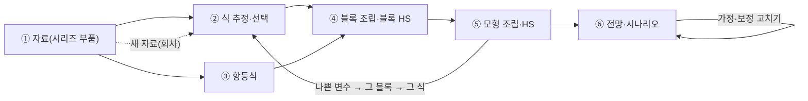

# Equion Desk 기획안 (제안 4판, 2026-11-08)

Windows 데스크톱 앱 **Equion Desk**의 기획안이다. 채택되면 결정은 [`DECISIONS.md`](DECISIONS.md)에 D-번호로, 단계는
[`ROADMAP.md`](ROADMAP.md)에 옮긴다. **먼저 읽을 것**: 요청 전체를 중요도·효율·충돌·확장성으로 정리하고 단계를 다시 짠
[`DESK_REVIEW.md`](DESK_REVIEW.md). 이 자료들을 바탕으로 한 **개발 계획**은 [`DESK_DEVPLAN.md`](DESK_DEVPLAN.md) — 자료와 다르면 개발 계획을 따른다. 작업 시나리오로 이 안을 따져 본 것은 [`DESK_SCENARIO.md`](DESK_SCENARIO.md)에 있다.
회귀·연립 밖의 분석(시계열 기초·단위근·계절조정·VAR …)을 md 결과 문서로 묶는 안(제안)은 [`DESK_ANALYSIS.md`](DESK_ANALYSIS.md)에 있다.
사람과 Claude가 실제로 일하는 모습은 [`DESK_SCENES.md`](DESK_SCENES.md)(작업 장면 10가지)에, Claude 없이 혼자 하는 모습은
[`DESK_SOLO.md`](DESK_SOLO.md)에 있다. 자료 불러오기·이어 하기·가져오기·업데이트는 [`DESK_DATA.md`](DESK_DATA.md)에서 묻고 답한다.
원자료에서 보고서까지 한 번에 재연하는 흐름(재연성·활용성 검토)은 [`DESK_REPRO.md`](DESK_REPRO.md)에, 명령줄에서도 도는
Equion 스크립트(`.eqs`)는 [`DESK_SCRIPT.md`](DESK_SCRIPT.md)에 있다.

> **판마다 바뀐 것**
> - 2판: 보기만 하는 앱(1판) → 방정식으로 하는 계산은 앱 안에서, 사람과 Claude가 같은 작업 기록, 스크립트 없는 작업 명령.
> - 3판: 레고 요구 — 바탕에 **부품과 조립** 층(K0), 조립 작업대(W0), 항등식·블록의 단독 기능, 조립 명세(재현), 자료 부품, 보정항 규칙, 전망 회차.
> - 4판: 사용자 원칙 — **두 길**(손으로도 Claude에게도), **고치기와 제안**, **보이는 계산**(뒤에서 몰래 돌지 않고 앞에서) — 을 §2에 맨 앞으로 세웠다.
>   3판에서 어긋난 곳(채택은 사람만, 조용히 쌓이는 기록, 보이지 않는 거르기, 엔진이 알아서 한 대체·채움, Claude가 고친 파일의 이력)을
>   고치고 대응표(§2.5)·제안(K6)·바뀜 기록(K7)·작업 줄을 더했다. 또 **설치만 하면 작동**(별도 패키지 설치 없이, PC의 Python 판과
>   상관없이 — §10)을 성공 기준(S10)으로 세웠다. **자료 관리**(K8 — 불러오기·자료 회차·값의 종류·출처·산출 관리)와
>   **Lectern 쪽 수정 계획**(§8 — Lectern도 일부 고칠 수 있다)을 더했다.

## 1. 목적과 성공 기준

**목적**: 연립방정식 모형을 만들고(자료 → 개별 식 추정·선택 → 블록·모형 조립) 검증하고(과거 재현) 쓰는(전망·시나리오) 일을,
EViews로 하던 것과 비슷한 흐름으로, 사람과 Claude Code가 함께 빠르게 되풀이하게 한다.

| # | 기준 |
|---|---|
| S1 | 식 하나를 고치고 추정 결과(계수·적합 통계·진단·실측/적합/잔차 차트)를 보기까지 **1초 안**(분기 자료 수백 개 규모) |
| S2 | 한 목표변수의 **후보 식들을 한 화면에서 비교** — 누가(사람·Claude) 추정했든 같은 목록에 |
| S3 | 식 하나를 바꾼 뒤(채택 전에도) **모형 전체의 과거 재현(HS) 전후 비교**가 한 번에 |
| S4 | 외생 가정·보정항을 고치고 다시 풀면 **전망·시나리오 표와 차트**가 바로 |
| S5 | Claude가 **스크립트 없이 명령 한 줄**로 같은 계산을 하고 짧은 글로 결과를 받으며, 그 결과가 Desk에 뜬다 |
| S6 | **레고**: 시리즈·식·항등식·블록·모형·가정·보정항·시나리오·보기가 저마다 혼자서 기능하고, 이름으로 끼워 맞추면 모형이 된다 |
| S7 | **재현**: 어떤 HS·전망이든 그때의 부품 판으로 다시 돌릴 수 있다 |
| S8 | **두 길**: Desk에서 손으로 하는 모든 일을 Claude에게 맡길 수 있고, Claude가 하는 모든 일이 Desk 화면에 있다 |
| S9 | **보이는 계산**: 모든 계산·변경·기록이 생기는 순간 화면에 드러나고, 엔진이 알아서 한 것도 결과에 적혀 있다 |
| S10 | **설치만 하면 작동**: 설치 파일 하나로 끝 — Python·패키지를 따로 깔지 않고, PC에 Python이 없든 어떤 판(3.9·3.15·Anaconda…)이 있든 똑같이 돈다. 인터넷·관리자 권한도 필요 없다 |

## 2. 운영 원칙 — 두 길·제안·보이는 계산

### 2.1 두 길

모든 일은 **사람이 Desk에서 손으로** 할 수도, **Claude Code에게 맡길** 수도 있다. 그래서 Desk의 모든 동작에는 같은 일을 하는 명령이
있고(Claude가 쓴다), 명령이 하는 모든 일에는 Desk 화면이 있다(§2.5 대응표). 한쪽에서 시작한 일을 다른 쪽이 이어받는다.

### 2.2 세 방식 — 직접·맡기기·제안 받기

| 방식 | 누가 바꾸나 | 보이는 곳 | 되돌리기 |
|---|---|---|---|
| **직접** | 사람이 Desk에서 고치고 계산한다 | 그 작업대 | 바뀜 기록(K7)에서 |
| **맡기기** | Claude가 바로 파일을 고치고 명령으로 계산한다 | 바뀐 곳 강조 + 바뀜 기록 + 결과 작업대 | 바뀜 기록에서 |
| **제안 받기** | 아무것도 바뀌지 않는다 — Claude가 제안(K6)만 남긴다 | **제안 카드**: 바뀔 내용(차이)·까닭·미리 계산한 결과 | 적용하기 전이라 필요 없다 |

어느 방식으로 할지는 사람이 정한다. 부품·결과마다 'Claude에게 맡기기'·'Claude에게 제안 받기' 단추가 있어 서로 다른 요청 글
(대상의 이름과 요약 + "바로 고쳐" 또는 "제안만, 파일은 고치지 마")을 터미널에 Enter 없이 붙여 넣는다. 사람이 이어 치고 Enter를 누른다.

### 2.3 고치는 것과 고치지 않는 것

- **정의는 모두 고칠 수 있다** — 시리즈 정의·식·항등식·블록·모형·가정·보정항·시나리오·보기(K0). Desk에서는 폼과 글로, Claude는 글로.
  사람이 만든 것을 Claude가, Claude가 만든 것을 사람이 고친다.
- **결과는 고치지 않는다** — 작업 기록(추정·HS·전망)은 그때의 계산 그대로 둔다. 바꾸고 싶으면 정의를 고쳐 **다시 계산해 새 기록**을 만든다.
  그래야 결과를 믿을 수 있고 다시 돌릴 수 있다(S7). 기록에 메모·고정(pin)·이름은 붙일 수 있다.

### 2.4 보이는 계산 — 뒤에서 몰래 돌지 않는다

1. **계산은 명령이 있을 때만.** 사람의 단추나 Claude의 명령이 있을 때만 추정·풀이한다. 파일이 바뀌면 화면은 다시 그리지만
   **저절로 다시 계산하지 않는다** — 그 파일에 기대는 결과에 '낡음' 표시와 '다시 계산' 단추를 단다. 치는 동안의 문법 검사만 예외다(계산이 아니라 검사).
2. **도는 일은 보인다.** 상태줄 위의 **작업 줄**에 지금 도는 계산(누가·무엇·진행·취소)이 있고, Claude가 친 명령은 터미널에 그대로 보인다.
3. **결과마다 사람의 화면이 있다.** 명령으로 낸 결과도 Desk 작업대에 같은 모양으로 뜨고, `summary.md`로 Lectern에서도 읽힌다. JSON으로만 남는 결과는 없다.
4. **엔진이 알아서 한 것은 결과에 적힌다.** 수렴하지 않은 블록의 실측 대체(`on_fail='actual'`), 결측 입력 식의 제외(`on_missing='exclude'`),
   외생 채우기(`exog_fill`), 보정항 규칙으로 정한 값, 상수항의 도구변수 자동 포함, `@def` 펼침, 실제로 쓴 표본, 결측으로 본 칸,
   대소문자만 다른 이름의 합침. 결과 머리에 **"알아서 한 것"** 목록, 표·차트에는 그 기간·값 표시(대체·채움·제외).
5. **거른 것도 보인다.** Claude가 후보 20개 중 3개를 권하면 17개도 후보 목록에 남는다 — 거른 까닭(부호·진단)과 함께.
6. **바뀜은 남는다.** 정의 파일이 바뀔 때마다 전후 차이를 바뀜 기록(K7)에 남기고 화면의 바뀐 곳을 강조한다. Desk가 꺼져 있는 동안 바뀐 것도 다음에 열 때 보인다.
7. **기록도 앞에서.** 작업 기록은 생기는 순간 작업 기록 띠에 뜬다 — 조용히 쌓이지 않는다.
8. **결론에는 근거가 붙는다.** Claude가 "c5가 가장 낫다"고 할 때는 근거 기록의 이름(`est:cons_c5`·`hs:hs_0009`)을 붙인다(AI용 안내의 규칙) — 사람이 Desk에서 그 기록을 연다.

### 2.5 대응표 — Desk 동작과 명령

| 일 | Desk에서 손으로 | 명령(Claude·사람) | 결과가 보이는 곳 |
|---|---|---|---|
| 원자료 넣기·받아 오기 | W4 '원자료 넣기' | `equion data add` · `equion data fetch`(ECOS·KOSIS) | W4 원자료 목록 |
| 시리즈 정의(불러오기) | W4 미리보기·짝짓기 | `series.toml`·`derived.txt` 고치기 | W4 · 바뀜 기록 |
| 자료 만들기·회차 바꾸기·비교 | W4 '자료 만들기'·'이 회차로 바꾸기' | `equion data build·use·diff` | W4 자료 회차 · 상태줄 |
| 내보내기 | '엑셀로 내보내기' | `equion export … --xlsx` | `exports/` |
| 식 추정·단독 모의 | W1 '추정' | `equion est … [--sim]` | W1 결과·후보 |
| 후보 비교 | W1 후보 목록 | `equion compare` | W1 후보 목록 |
| **후보 채택** | W1 '채택' | `equion adopt est:cons_c5` | 바뀜 기록 · W1 · W0 |
| 항등식 검사 | W1 항등식 보기 | `equion ident … --check` | W1 |
| 블록·모형 조립 고치기 | W0 넣기·빼기·새로 | 블록 파일·`equion.toml` 고치기 · `equion assemble main` | W0 · 바뀜 기록 |
| HS·바꿔 끼우기·다시 돌리기 | W2 '풀기'·'이 후보로 HS'·'다시 돌리기' | `equion hs … [--swap] [--vs] [--replay]` | W2 |
| 가정·보정항 | W3 표 편집 | CSV·TOML 고치기 | W3 · 바뀜 기록 |
| 전망·시나리오·회차 | W3 '풀기'·'회차 비교' | `equion sim … [--vintage] [--vs]` | W3 |
| 보기 저장 | 화면의 '이 보기 저장' | `VIEWS/*.toml` 쓰기 | 보기 탭 |
| **제안** | 제안 카드 '적용'·'고쳐서 적용'·'버림' | `equion propose new·apply·drop` | 제안 카드 · 바뀜 기록 |
| **되돌리기** | 바뀜 기록 '되돌리기' | `equion history list·show·revert` | 바뀜 기록 |
| 작업 기록 | 작업 기록 띠·고정·메모 | `equion work list·show·pin` | 작업 기록 |
| 화면 열기 | — | `equion desk show <이름>` | 그 화면 |

## 3. 작업 흐름



어느 단계든 직접·맡기기·제안 받기(§2.2)로 한다. 단계별로 사람·Claude·Desk가 하는 일은 [`DESK_SCENARIO.md`](DESK_SCENARIO.md)의 S0~S9에 있다.

## 4. 설계의 핵심

### K0. 부품과 조립 — 레고

모든 것을 **이름 붙은 부품**으로 다룬다. 부품은 혼자서 할 일이 있고, 이름으로 다른 부품을 가리켜 조립된다.

| 부품 | 정의하는 곳 | 혼자서 | 조립될 때 |
|---|---|---|---|
| 시리즈 | `DATA/series.toml`(출처·주기 변환·계절조정·단위·설명), `DATA/derived.txt`(파생식) | 보기·차트·변환·통계·단위근, 원자료와 비교, 내력 | 내생(어느 식의 목표)인지 외생(입력)인지는 **조립이 정한다** |
| 식 | 블록 파일의 한 줄(이름 = 목표변수) | 추정·진단·차트·**식 하나의 동태 모의**·표본 밖 평가·후보 | 채택한 식이 들어가고 목표변수가 내생 |
| 항등식 | 블록 파일의 한 줄 | **실측으로 성립 검사·불일치 차트**, 파생 시리즈로 계산 | 목표변수가 내생 |
| 블록 | 방정식 파일 하나(`EQUATIONS/demand.txt`) | 구조 검사, **블록 HS**(나머지 변수는 실측) | 모형의 부품 |
| 모형 | `equion.toml`의 `[model.이름]` — 블록·식·**다른 모형**을 이름으로 | HS·전망·시나리오·안정성 | **더 큰 모형의 부품** |
| 가정 세트 | `ASSUMPTIONS/이름.csv` + 채우기 규칙 | 보기·편집·차트 | 모형의 외생 경로(모형에 없는 변수는 알림) |
| 보정항 세트 | `ADDFACTORS/이름.toml`(+ CSV) | 보기·편집, 초깃값 규칙 | 그 식에 더해진다 |
| 시나리오 | `SCENARIOS/이름.toml` | 정의 보기·검사 | **어느 모형에나** — 모형에 없는 변수를 가리키면 알림 |
| 보기 | `VIEWS/이름.toml`(차트·표 묶음 — 어떤 시리즈·결과를 어떤 변환·구간으로) | 그 보기 그리기 | 어느 결과에나(기준선·시나리오·HS) |

**조립 규칙**

1. 내생·외생은 변수에 적지 않는다 — 목표변수가 되면 내생, 아니면 외생(엔진 `m.endogenous`가 이미 이렇게 한다).
2. 한 모형에 같은 목표변수는 하나. 겹치면 조립 오류(어느 블록의 어느 줄인지).
3. 모르는 변수(자료에도 목표에도 없음)는 조립 오류(목록).
4. 모형은 부품을 **이름으로** 가리킨다. 블록의 식을 고치면 그 블록을 쓰는 모든 모형이 새 식을 쓴다 — 고치기 전에 '쓰는 곳'(W0)으로 영향 범위를 본다.
5. **바꿔 끼우기**: 파일을 바꾸지 않고 조립할 때만 부품을 바꾼다(`--swap demand:CN=est:cons_c5`).
6. **조립 명세(lock)**: 모든 HS·전망·시나리오 기록에 그때 쓴 부품의 판(식 글자·방법·표본·계수, 자료·가정·보정항의 해시, equion 판)을
   통째로 남긴다. 파일이 나중에 바뀌어도 `--replay`로 그때 그대로 다시 돌린다.

**이름 붙이기**: 시리즈 `CN` · 식·항등식 `블록:목표`(`demand:CN`) · 블록 `demand` · 모형 `main` · 가정 `assume:base` · 시나리오 `oil20` ·
보기 `view:core_hs` · 후보 `est:cons_c5` · 기록 `hs:hs_0009` · 제안 `prop:p3`. 명령줄·Desk·Claude가 같은 이름을 쓴다. 이름은 영문·숫자·`_`로
짓는다(TOML 키와 명령줄에서 따옴표 없이 쓰려고) — 한글 이름은 `desc`(설명)로 붙여 화면에 함께 보인다.

```toml
# equion.toml (초안)
[data]
series = "DATA/series.toml"
derived = "DATA/derived.txt"

[block]                                   # 블록 = 방정식 파일 하나
demand   = { file = "EQUATIONS/demand.txt",   desc = "수요" }
external = { file = "EQUATIONS/external.txt", desc = "대외" }
price    = { file = "EQUATIONS/price.txt",    desc = "물가" }
finance  = { file = "EQUATIONS/finance.txt",  desc = "금융" }

[model.core]
blocks = ["demand", "price", "finance"]
[model.main]
include = ["core"]                        # 모형 안에 모형
blocks = ["external"]
[model.main_fixr]                         # 같은 부품의 다른 조립 — 금리 고정 실험
include = ["main"]
exclude = ["finance:R"]

[hs]
range = "2005Q1:2019Q4"
mode = "dynamic"
[forecast]
range = "2025Q1:2027Q4"
assume = "base"
addfactors = "base"
```

```toml
# DATA/series.toml (초안)
[source.na]
file = "DATA/raw/국민계정.xlsx"
sheet = "실질"
[series.CN]
from = "na:민간소비"
seas = "stl"                              # 계절조정(D26)
unit = "십억원(연쇄)"
desc = "민간소비, 실질, 계절조정"
[series.P]
from = "prices:CPI"                       # 월별
convert = "mean"                          # 분기 평균
[series.WY]
from = "world:WY"                         # 연간
convert = "denton"                        # 분기로 나누기(D26)
```

**엔진과의 관계**: 이 층은 워크파일 API(D2) 위의 얇은 층이다. 프로젝트를 읽으면(`eqn.project("equion.toml")` — 초안) 시리즈·식·모형이
워크파일 객체로 풀리고, 모형은 엔진의 `merge`·`append`·`drop`으로 만들어진다. 엔진에 이미 있는 것 — 식 객체의 추정·진단·`forecast(mode="dynamic")`,
`merge`(파일·식·객체·시스템 추정 결과), 모형 일부 풀기(R21), `forecast(exog_fill=…)`, 시나리오의 override·exclude·add_factor·shock·control,
주기 변환·Denton·STL(D26), 풀이의 기간별 상태(정상·일부식 제외·실패대체·실패). 새로 필요한 것 — 블록·모형 계층, 항등식 단독 검사,
조립 명세, 자료 정의 읽기, 보정항 규칙, "알아서 한 것" 목록(§2.4-4)을 모든 결과에 싣기.

### K1. 방정식으로 하는 계산은 앱 안에서 — 명령이 있을 때만

추정·진단·조립·HS·전망·시나리오를 Desk가 equion 엔진으로 계산한다. 입력은 방정식 DSL(허용 목록 파서 — 코드 실행이 아니다),
자료(CSV·XLSX), 선언형 파일(TOML·CSV)뿐이다. **임의의 Python 스크립트**는 앱이 실행하지 않고 터미널에서 `equion run`으로 돌린다.
계산은 사람의 단추나 Claude의 명령이 있을 때만 하고(§2.4-1), 별도 작업 프로세스(같은 런타임)에서 해 창이 멈추지 않으며,
작업 줄에 진행과 취소가 보인다(§2.4-2).

### K2. 작업 기록 — 사람과 Claude가 같은 곳에, 생기는 순간 앞에

계산할 때마다 결과를 프로젝트의 `work/`에 남긴다. Desk에서 사람이 했든 터미널에서 Claude가 했든 같은 형식이고, 생기는 순간 작업 기록 띠에 뜬다.

```text
work/
  log.jsonl              한 줄에 하나: id·시각·누가(desk·terminal·claude)·명령 그대로·종류·대상·핵심 수치·경로
  est/cons_c5/           result.json(식·방법·표본·계수·통계·진단·알아서 한 것) · series.csv(실측·적합·잔차·단독 모의) · summary.md
  hs/hs_0009/            assembly.json(조립 명세) · stats.csv · solved.csv · status.csv · implicit.csv(대체·제외·채움) · summary.md
  sim/2026-11_base/      assembly.json · levels.csv · growth.csv · diff.csv · implicit.csv · summary.md
  data/d2026-11a/        자료 회차(K8) — series.csv · flags.csv(값의 종류) · build.json(입력·정의 해시, 알아서 한 것) · diff.csv · summary.md
  proposals/p3/          제안(K6)
  history/               바뀜 기록(K7)
```

- 숨김 폴더가 아니라 Lectern에서도 보인다. `summary.md`는 표와 `vega-lite` 차트(같은 폴더의 CSV)로 써서 **Lectern이 차트까지 그린다**.
- 결과는 고치지 않는다(§2.3). 메모·고정·이름만 붙인다. 지우는 것은 사용자가 고를 때만, 고정한 기록은 정리 대상에서 빠진다.
- 명령이 Claude Code 안에서 돌았는지는 환경 변수로 알아보고 '누가'에 적는다(D0에서 확인).

### K3. 작업 명령 — Claude가 스크립트 없이

패키지 명령줄에 모형 작업 명령을 더한다. 모두 부품 이름(K0)을 받고, Desk도 같은 함수를 불러 결과가 늘 같다. 전체 목록은 대응표(§2.5).

| 명령 | 하는 일 |
|---|---|
| `equion est demand:CN` · `equion est "<식>" [--method] [--smpl] [--inst] [--as 이름] [--sim]` | 식 하나 추정 → 짧은 요약 + 기록. `--sim`이면 식 하나의 동태 모의도 |
| `equion adopt est:cons_c5` | 후보를 채택 — 블록 파일의 그 줄을 바꾸고 바뀜 기록에 남긴다 |
| `equion ident demand:Y --check` | 항등식을 실측으로 계산해 실제와 비교(불일치 통계·기간) |
| `equion compare <기록…>` · `--target CN` | 후보 비교 표(같은 종속변수·같은 표본이 아니면 AIC·BIC 경고) |
| `equion assemble main` | 조립만 — 내생·외생 수, 겹침·모르는 변수, 블록 분해, 블록 연결, 외생 자료 끝 시점 |
| `equion hs <블록·모형> [--range] [--mode] [--swap 부품=후보] [--vs <기록>] [--replay <기록>]` | 과거 재현, 바꿔 끼우기, 전후 비교, 그때 그대로 다시 |
| `equion sim <시나리오·base> [--model] [--vintage 2026-11] [--vs <기록>]` | 전망·시나리오 → 수준·증가율·차이 표, 회차 비교 |
| `equion data add·fetch·build·use·diff` | 원자료 넣기·받아 오기, 자료 회차 만들기·바꾸기·비교(K8) |
| `equion export <기록·보기> --xlsx` | 값·값의 종류·출처를 함께 내보내기 |
| `equion propose new·apply·drop` · `equion history list·show·revert` · `equion work list·show·pin` | 제안·바뀜 기록·작업 기록 |

출력은 기본이 **짧은 글**(Claude 문맥을 아낀다), `--json`이면 전체. "알아서 한 것"은 짧은 글에도 한 줄로 나온다. 출력 모양(예시):

```text
[cons_c5] OLS CN · 1995Q1~2019Q4 · n=100   R²adj 0.9987 · SE 0.41 · DW 1.93 · AIC 112.4 · BIC 120.2
  계수   c 1.21(t 3.1) · Y 0.42(t 12.0) · RR −0.08(t −2.4) · CN(-1) 0.55(t 9.8)
  진단   LM(2) p=0.41 ✓ · JB p=0.22 ✓ · White p=0.03 ! · RESET p=0.51 ✓
  단독 모의  2005Q1~2019Q4 RMSPE 0.62%
  알아서 한 것  @def RR 펼침 · 표본 앞 1기 시차로 빠짐(1995Q1→1995Q2)
  기록   est:cons_c5 (work/est/cons_c5/)
```

이 명령들은 Desk 없이도(Lectern + 터미널) 바로 쓸모가 있어 **Desk보다 먼저** 만든다(§9 E 단계).

### K4. 가정·보정항·시나리오·보기 파일

```toml
# ADDFACTORS/base.toml (초안) — 식마다 초깃값 규칙, 직접 적은 값은 CSV가 덮는다
default = "zero"
values = "ADDFACTORS/base.csv"
[eq."demand:CN"]
rule = "last"                 # 마지막 잔차 유지
[eq."demand:I"]
rule = "decay"                # 마지막 잔차를 반감기로 줄이기
half_life = 4
[eq."external:X"]
rule = "mean"                 # 마지막 n기 잔차 평균
n = 4
```

```toml
# SCENARIOS/oil20.toml (초안)
base = "base"                 # 가정 세트
model = "main"                # 생략하면 실행할 때 고른 모형(--model)
[[shock]]
var = "POIL"
from = "2025Q1"
pct = 20
[[addfactor]]
eq = "demand:CN"
from = "2025Q1"
value = -0.3
```

```toml
# VIEWS/core_hs.toml (초안) — 어느 HS·전망 결과에나 쓰는 보기
title = "핵심 변수"
series = ["Y", "CN", "I", "P", "R"]
show = ["level", "yoy"]       # 수준·전년동기비
range = "2015Q1:2027Q4"
```

TOML은 Python 표준 라이브러리(`tomllib`)로 읽는다. 외생 가정·보정항 값은 CSV라 Desk의 표 편집·엑셀과 오간다. 가정 세트의 채우기
규칙은 엔진의 `exog_fill`(`last`·`growth`·`trend`)을 쓰고, 채운 값은 표·차트에 '채움'으로 보인다(§2.4-4).

### K5. Desk와 Claude는 양쪽으로 이어진다

- **Desk → Claude**: 짚어 보내기(Shift+→ — Lectern D75)와 'Claude에게 맡기기'·'Claude에게 제안 받기'(§2.2). 줄·후보·변수·기간·블록을 고르면
  터미널에 **이름과 요약**을 Enter 없이 붙인다. 예: `demand:CN 후보 est:cons_c5 — R²adj 0.9987, White p=0.03(이분산) `.
- **Claude → Desk**: ① 작업 기록·바뀜 기록·제안을 감시해 해당 작업대·카드에 바로 띄운다(누가 했는지 표시) ② `equion desk show <이름>`으로
  Desk의 화면을 연다(화면 이동만 — Lectern 단일 인스턴스 파이프와 같은 길).
- **같은 판단 기준**(선택): `equion.toml`의 `[criteria]`에 기대 부호(`"demand:CN" = { Y = "+", RR = "-" }`)·진단 유의수준·HS 목표를 적으면
  Desk의 색 표시와 Claude의 후보 거르기가 같은 기준을 쓴다. 거른 후보도 목록에 남는다(§2.4-5).

### K6. 제안 — 바꾸지 않고 보여 준다

제안은 "이렇게 바꾸면 이렇게 된다"를 **적용하기 전에** 사람이 보게 하는 부품이다.

```text
work/proposals/p3/
  proposal.md            제목·까닭·기대 효과(사람이 읽는 글 — 근거 기록 이름 포함)
  changes/               바뀔 파일의 새 내용(프로젝트 안 같은 상대 경로 — 예: changes/EQUATIONS/finance.txt)
  preview.toml           미리 계산한 기록들(예: hs:hs_0011 — --swap으로 돌린 HS)
```

- Claude가 `equion propose new`로 만든다(사람도 Desk에서 '제안으로 남기기'로 만들 수 있다 — 나중에 보거나 Claude에게 다듬게).
- Desk의 **제안 카드**: 바뀔 내용의 차이(지금 파일 대비), 까닭, 미리 계산한 결과(전후 비교 화면으로 바로), 단추 '적용'·'고쳐서 적용'·'버림'.
- 적용은 사람의 단추나, 사람이 시킨 Claude의 `equion propose apply p3`. 어느 쪽이든 바뀜 기록에 "제안 p3 적용"으로 남는다.
- 제안을 만든 뒤 그 파일이 바뀌었으면 카드에 '낡음' 표시 — 적용 전에 다시 견준다.

### K7. 바뀜 기록 — 누가 무엇을 언제 바꿨나, 되돌리기

- 정의 파일(블록·`equion.toml`·자료 정의·가정·보정항·시나리오·보기)이 바뀔 때마다 `work/history/`에 전후 내용과 차이를 남긴다.
  누가: Desk에서 저장(사람) · 명령(`adopt`·`propose apply`·`history revert` — 명령 그대로) · 바깥(터미널·Claude의 직접 편집, 다른 편집기).
- Desk는 마지막으로 본 내용을 기억해 두었다가, **꺼져 있는 동안 바뀐 것도** 다음에 열 때 "Desk가 꺼져 있는 동안 바뀐 파일 3개"로 보인다.
- **되돌리기**는 이전 내용으로 다시 저장하는 것이다 — 그것도 바뀜 기록에 남는다(지우지 않는다). 프로젝트가 git이면 git 이력도 함께 보인다.
- 정의가 바뀌면 그것에 기대는 결과에 '낡음'이 붙는다(§2.4-1).

### K8. 자료 관리 — 불러오기·회차·값의 종류·출처

자료는 세 층으로 나누고, 층 사이를 오가는 일은 모두 이름 있는 동작(단추·명령)이며 기록에 남는다.

| 층 | 무엇 | 어디 | 누가 바꾸나 |
|---|---|---|---|
| 원자료 | 받은 파일 그대로(엑셀·CSV, 받아 온 자료) | `DATA/raw/` | **아무도 고치지 않는다** — 넣기만(사람이 파일을 고르거나 `equion data fetch`) |
| 정의 | 시리즈를 만드는 법(출처·변환·계절조정·파생·단위·설명) | `DATA/series.toml` · `DATA/derived.txt` | 사람·Claude(§2.2의 세 방식), 바뀜 기록에 |
| 자료 회차 | 정의대로 만든 시리즈 묶음 | `work/data/<회차>/` | **만들기**(`equion data build`)로만 새로 생긴다 — 고치지 않는다 |

**불러오기 — 단계마다 보인다**

1. **원자료 넣기**: Desk '원자료 넣기'(사람이 파일을 고르면 `DATA/raw/`에 복사) 또는 명령. 받아 온 자료(ECOS·KOSIS — ROADMAP 0.8)는
   터미널의 `equion data fetch`로 — 사람이나 시킨 Claude가 친 명령이고, 앱 자신은 인터넷에 닿지 않는다(§6-3). 파일마다 옆에
   `<파일>.source.toml`(받은 곳·질의·받은 시각·해시)을 남긴다. Desk의 **원자료 목록**: 파일·크기·해시·받은 날·어느 시리즈가 쓰는지.
2. **미리보기와 짝짓기**: 시트·열을 고르면 Desk가 읽은 그대로 보인다 — 시점 열과 추론한 주기, 숫자가 아니라 결측으로 볼 칸(원자료의 칸 위치),
   대소문자만 다른 이름, 단위. 사람이 열 ↔ 시리즈 이름을 짝지어 저장하면 `series.toml`에 그 항목이 생긴다. Claude에게 맡기거나 제안 받을 수도 있다
   (제안 카드에는 만들어질 시리즈의 미리보기 차트).
3. **변환 정의**: 주기 변환(평균·합·끝값·Denton·Chow-Lin)·계절조정(STL·고전 분해)·기준년 바꾸기·파생식(`derived.txt`) — 모두 정의 파일에 글로.
4. **만들기**: '자료 만들기'·`equion data build` → 새 회차 `d2026-11a`. 결과 화면: 만든 시리즈 수, **알아서 한 것**(결측으로 본 칸·합친 이름·추론한 주기·
   Denton의 합 맞추기 오차), **앞 회차와 다른 값**(새 기간·개정된 기간과 크기). 시리즈마다 **내력**(원자료 → 변환 → 계절조정 → 파생) 차트.
5. **회차 바꾸기**: 새 회차를 만들어도 지금 쓰는 회차는 저절로 바뀌지 않는다. '이 회차로 바꾸기'·`equion data use d2026-11a`를 해야 하고,
   그때 다른 회차로 계산한 결과에는 '자료 회차 다름' 표시가 붙는다(다시 계산은 사람·Claude가 시킬 때만 — §2.4-1). 지금 회차는 상태줄에 늘 보인다.

**작업 중 생기는 데이터**

| 생기는 것 | 어디 | 이름 |
|---|---|---|
| 자료 회차(만든 시리즈·파생) | `work/data/<회차>/` | `data:d2026-11a` |
| 추정 결과(계수·적합값·잔차·단독 모의) | `work/est/<id>/` | `est:cons_c5` |
| HS 결과(해·상태) | `work/hs/<id>/` | `hs:hs_0009` |
| 전망·시나리오 결과(해·채운 외생·보정항 값) | `work/sim/<id>/` | `sim:2026-11_base` |
| 내보내기(공유용 엑셀 등) | `exports/` — 사람이 고를 때만 | — |

1. **계산 결과는 실측 자리에 쓰지 않는다.** `CN`은 늘 지금 자료 회차의 실측이다. 푼 값은 기록 이름을 붙여 `hs:hs_0009:CN`·`sim:oil20:CN`으로 가리키고,
   표·차트의 열 이름에도 그렇게 나온다. 엔진이 워크파일에 쓰는 별칭 시리즈(`CN_0`·`CN_1` — D4)는 그 기록 안에서만 쓰인다.
   풀린 값을 다음 계산의 실측 자리에 이어 쓰는 일(예: 실측이 끝나기 전부터 전망)은 '이어 쓰기'라는 이름 있는 동작으로만 하고 기록에 남는다.
2. **값마다 종류가 붙는다**(`flags.csv` — 표의 칸 색·차트의 선 모양·범례로 보인다):

   | 종류 | 뜻 |
   |---|---|
   | 실측 | 원자료 그대로 |
   | 변환 · 파생 | 주기 변환·계절조정 / 파생식으로 계산 |
   | 결측 | 숫자가 아닌 칸·빈 칸(원자료의 칸 위치와 함께) |
   | 가정 · 채움 | 사람이 적은 외생 경로 / 채우기 규칙(`last`·`growth`·`trend`)이 채운 값 |
   | 해 | 모형이 푼 값 |
   | 대체 · 제외 | 수렴 실패로 실측을 씀(`on_fail='actual'`) / 결측 입력으로 그 식을 뺌(`on_missing='exclude'`) |
   | 보정 | 보정항이 더해진 값(규칙 값·판단 값을 나눠) |

3. **어디서 왔나**: 표·차트의 값 하나를 누르면 그 값의 종류, 만든 기록, 쓰인 입력(자료 회차·식·가정 세트·보정항)이 보이고, 자료 값이면
   원자료 파일의 칸(`국민계정_2026-11.xlsx` 실질!C42)까지 거슬러 간다. 거꾸로 시리즈·회차를 고르면 **그것을 쓴 결과** 목록.
4. **내보내기는 출처와 함께**: '엑셀로 내보내기'·`equion export <기록·보기> --xlsx`는 값 시트와 함께 **값의 종류** 시트와 **출처** 시트(기록·조립 명세·자료 회차·가정)를 넣는다.
5. **보이는 관리**: Desk의 '작업 자료' 화면에 종류별 기록 수와 용량, 고정 여부. 정리는 '정리할 것 보기'(고정하지 않은·오래된 기록과 크기 목록 →
   사람이 확인)·`equion work clean --dry-run`으로만 — 지우기 전에 늘 목록을 보인다. 원자료와 정의는 정리 대상이 아니다.
6. **Python과도 같은 자료**: 스크립트는 `eqn.project()`로 지금 자료 회차와 기록을 읽는다(`equion run`의 결과도 기록으로). 공유·보관용으로 회차를 워크파일(`.eqw`)로 내보낼 수 있다.

## 5. 화면 — 작업대

Lectern의 뼈대(툴바·프로젝트 탭·사이드바·가운데 탭·오른쪽 터미널·상태줄)를 쓴다. 사이드바의 기본 탭은 **부품**(모형·블록·식·
항등식·시리즈·가정·보정항·시나리오·보기)이고 **파일** 탭이 따로 있다. 화면은 Lectern을 따르고 EViews의 화면·아이콘·문장을 쓰지 않는다(D13).

**늘 보이는 것**(§2.4)

- **작업 줄**(상태줄 위): 지금 도는 계산 — 누가·무엇·진행·취소. 끝나면 결과 링크.
- **작업 기록 띠**: 새 기록이 생기는 순간 한 줄(누가·무엇·핵심 수치) — 누르면 그 결과 화면.
- **바뀜 알림**: 정의 파일이 바뀌면 "Claude가 `EQUATIONS/finance.txt`를 고쳤습니다 — 2줄" → 누르면 차이·되돌리기. 결과의 '낡음' 표시.
- **제안 카드**: 새 제안이 오면 오른쪽 위에 카드 — 차이·까닭·미리 계산한 결과·적용·버림.
- 모든 부품·결과 화면의 머리에 '이름 복사'·'Claude로 보내기'·'Claude에게 맡기기'·'Claude에게 제안 받기'.

### W0. 조립 작업대

```text
 모형 main ▾   [조립 검사] [HS] [전망]          내생 10 · 외생 5 · 동시 블록 1 · 문제 0
 조립   main = core(demand · price · finance) + external
        demand 수요    CN ✓  I ✓  Y(항등)      price 물가     P ✓  PY ✓
        finance 금융   R ✓                     external 대외  X ✓  M ✓
 연결   demand →Y→ external · price →P→ finance · finance →R→ demand · external →M→ demand
 외생   G · WY · E · POIL · SD   (자료 끝 2024Q4 — 전망 구간은 가정 base가 채움)
 쓰는 곳  demand:I ← core · main · main_fixr
```

- **조립 보기**: 모형 → 포함한 모형 → 블록 → 식·항등식의 나무와, 블록 사이를 잇는 변수 그림(Viz). 내생·외생 수, 동시 블록, 문제(겹친 목표·모르는 변수·외생 자료 빔).
- **고치기**: 블록에 식을 넣고 빼기(블록 파일), 모형에 블록·모형을 넣고 빼기·`exclude`(`equion.toml`), 새 블록·새 모형 — 저장하면 바뀜 기록에.
- **바꿔 끼우기**: 후보를 모형 위에 끌어 놓으면 '이 후보로 HS'(파일은 그대로 — K0 규칙 5).
- **쓰는 곳**: 부품 하나를 고르면 그것을 쓰는 블록·모형·시나리오·보기 목록 — 고치기 전에 영향 범위를 본다.

### W1. 식 작업대 — 가장 많이 쓰는 화면

```text
 식 demand:CN   [ CN c Y RR CN(-1)                ]  방법 LS ▾  표본 1995Q1~2019Q4  [추정 Ctrl+Enter]
 결과  계수표(값·SE·t·p·기대 부호) · 적합(R²adj .9987 · SE .41 · DW 1.93 · AIC 112.4 · BIC 120.2 · n 100)
       진단  LM ✓ · JB ✓ · White ! · RESET ✓      강건 SE로 다시 보기(HC·HAC)
       알아서 한 것  @def RR 펼침 · 표본 앞 1기 시차로 빠짐
 차트  [실측·적합 | 잔차 ±2SE | 단독 모의 | 재귀 계수 | CUSUM | 표본 밖 예측]
 후보 (CN)  누가    R²adj   SE   DW   AIC   BIC  LM p  White p  단독모의 RMSPE  표본 밖 RMSE  부호
 ★ c5      Claude  .9987  .41 1.93 112.4 120.2  .41    .03      0.62%          0.52         ✓
   c2      나      .9985  .44 1.71 118.9 124.0  .08    .21      0.80%          0.61         ✓
   c1      Claude  .9990  .38 1.20 101.3 111.7  .00    .44      1.40%          0.95         ✗ RR  (걸러짐: 부호)
                                                       [겹쳐 보기] [이 후보로 HS] [채택]
```

- **결과**: 계수표, 적합 통계(R²·조정 R²·SE·SSR·로그우도·F·DW·AIC·BIC·HQ·n·표본), 진단(LM·Ljung-Box·JB·White·BP·ARCH·RESET — 통과·주의 색), 알아서 한 것.
- **차트**(Plotly, 확대·값 보기): 실측·적합, 잔차(±2SE 띠), **단독 모의**, 재귀 계수·CUSUM, Chow 시점, 표본 밖 예측.
- **후보**: 사람·Claude 구분 없이 쌓이고, 걸러진 후보도 까닭과 함께 남는다. 정렬·거르기, 2~4개 겹쳐 보기, 같은 표본·같은 종속변수가 아니면 AIC·BIC 칸에 경고.
  **이 후보로 HS**(W2로, 파일은 그대로). **채택**은 사람의 단추나 Claude의 `equion adopt` — 블록 파일의 그 줄이 바뀌고 바뀜 기록에 남는다.
- **항등식 보기**: 항등식을 고르면 실측으로 계산한 값과 실제 값, 불일치(수준·%) 차트와 통계.

### W2. 모형 작업대 — 과거 재현

- **HS**: 블록이나 모형을 골라 범위·방식(dynamic·static·fit)으로 푼다. 블록이면 나머지 변수는 실측이다.
  **변수별 적합도 표**(RMSPE·MAE·평균오차 — 정렬, 0 근처 계열은 MAE도 보라는 표시), **실측 대 해 차트**(작은 그림 격자 → 누르면 크게),
  **기간별 풀이 상태 띠**(정상·일부식 제외·실패대체·실패 — 차트에도 그 기간 표시), 수렴 정보, 알아서 한 것.
- **전후 비교**: HS 두 개를 골라 변수별 적합도 차이(좋아짐·나빠짐 색)와 겹친 차트, 두 HS의 **조립 명세 차이**(어느 부품이 달랐는지).
- **원인 따라가기**: 나쁜 변수 → 그 식(W1) → 그 식의 입력 변수들의 HS 오차 → 그 블록만 HS → 거슬러 올라가기.
- **다시 돌리기**: 고정한 HS를 그때의 조립 명세로 다시(`--replay`).

### W3. 전망·시나리오 작업대

- **가정**: 외생 경로 표(CSV — 칸 편집, 수준·증가율로 보기·입력, 채우기 규칙 — 채운 칸은 따로 표시), 전망 구간을 덮지 못하는 외생 변수 경고.
- **보정항**: 식마다 마지막 몇 기의 잔차와 초깃값 규칙(0·마지막 잔차·평균·감쇠), 규칙이 정한 값과 판단 조정 값을 나눠 보인다.
- **기준선**: 풀기 → 결과 표(수준·전기비·전년동기비·연간 집계)·차트(과거 실측에 이어서).
- **시나리오**: 목록(파일마다 하나)·충격 보기, 어느 모형에 끼울지 고르기, 기준선 대비 차이(수준·%·%p) 표·차트, 승수, 기여도 분해(D24), 동태 안정성. 여러 시나리오를 한 차트·한 표로.
- **회차 비교**: 이번 전망과 지난 회차(`--vintage`) — 바뀐 값과, 가정 변화·자료 갱신·식 변경의 몫(하나씩 바꿔 다시 풀어 나눈다 — 그 풀이들도 기록으로 보인다).

### W4. 자료 작업대(K8)

- **원자료 목록**: 파일·크기·해시·받은 곳·받은 날, 그 파일을 쓰는 시리즈. '원자료 넣기'.
- **불러오기**: 시트·열 미리보기(읽은 그대로·결측으로 볼 칸 표시), 열 ↔ 시리즈 짝짓기, 변환·계절조정 고르기 → 저장하면 `series.toml`.
- **시리즈**: 목록(주기·구간·결측·끝 시점·단위·설명·값의 종류), 시리즈 하나의 내력(원자료 → 변환 → 계절조정 → 파생 — 단계마다 차트), 단위근 검정, 그것을 쓴 결과.
- **자료 회차**: 회차 목록(지금 회차 표시), '자료 만들기'·'이 회차로 바꾸기', 두 회차 비교(새 기간·개정 크기 — 시리즈별 표와 차트).
- **작업 자료**: 기록 종류별 수·용량·고정, '정리할 것 보기'.

### 그 밖의 화면

보기(K4 — 저장한 차트·표 묶음), 방정식 파일(줄마다 분류·검사 오류), 실행 보고서(`out/<id>/` — 스크립트를 `equion run`으로 돌린 것),
작업 기록(시간순·누가·명령 그대로·핵심 수치, 고정·메모), 바뀜 기록(차이·되돌리기), 제안 목록, 문서(md 기본 보기 — 풍부한 문서 작업은 Lectern).

## 6. 안전 원칙

1. **앱 안의 계산은 방정식 DSL·자료·선언형 파일로만.** 임의의 Python 코드는 앱이 실행하지 않는다 — 터미널에서 사람·Claude가.
   'Run'(스크립트)·'새 프로젝트' 버튼은 명령을 터미널에 Enter 없이 붙여 넣는다(Lectern D51).
2. **사용자 파일은 사용자가 시킬 때만.** 정의 파일은 사람이 Desk에서 저장·채택·적용·되돌리기를 하거나, 사람이 시킨 Claude가 고칠 때만 바뀌고,
   어느 쪽이든 바뀜 기록에 남는다. 작업 기록 `work/`는 앱과 명령이 덧붙여 쓰기만 한다. 앱 설정은 `%APPDATA%\EquionDesk\config.json`.
3. **로컬 전용.** 앱 자신은 외부에 요청하지 않는다. Claude Code의 통신은 사용자가 띄운 프로그램의 일이다.
4. **연 폴더와 그 아래만.** 경로 검사는 Lectern의 `resolve_inside()`.
5. **열어도 코드가 돌지 않는 형식만.** 워크파일 `.npz`·JSON·CSV·XLSX·TOML. 레거시 pickle은 열지 않는다(D18).
6. **단순함.** pywebview(WebView2) + 로컬 서버 + 빌드 단계 없는 순수 JS(D7).

## 7. Claude Code와 함께

단계별 흐름은 [`DESK_SCENARIO.md`](DESK_SCENARIO.md)에 있다. 고리는 하나다 — **사람이 짚어 보내며 방식(직접·맡기기·제안)을 정한다 →
Claude가 명령으로 후보·HS·전망을 돌리거나 파일을 고치거나 제안을 남긴다 → Desk 작업대·바뀜 알림·제안 카드에 앞으로 뜬다 → 사람이 보고 받아들이거나 되돌린다.**

**Claude에게 주는 것**(설치본에 넣는다): ① AI용 모형 작업 안내(`help/claude.md` — 부품·조립 규칙, 명령, 판단 기준, 기록 읽기, 보고 형식.
규칙: 결론에는 근거 기록의 이름을 붙인다, "제안만"이라면 파일을 고치지 않고 `equion propose`로 남긴다, 정의를 고칠 때는 명령(`adopt`·`propose apply`)을
먼저 쓴다, 거른 후보도 기록에 남긴다. 'Claude Code에 Equion 알려 주기'가 경로를 붙여 넣으면 Claude가 그 프로젝트의 `CLAUDE.md`에 정리 — Lectern D57)
② Claude Code 스킬 `equion`(방정식 문법·명령·오류 해결 — 설치는 사용자가 시킬 때 Claude가 묻고 — Lectern D98).

## 8. Lectern과의 연계 — 선택, 파일로만

연동은 필수가 아니다. 두 앱은 서로를 부르지 않고 **같은 프로젝트 폴더를 저마다 본다** — Desk는 모형 작업(계산·작업대), Lectern은
문서 작업(읽기·고치기·슬라이드·pptx). Lectern은 고치지 않고 그대로 쓴다.

| # | 이어지는 곳 | 어떻게 |
|---|---|---|
| L1 | 같은 폴더를 두 앱에서 | 탐색기 우클릭 'Lectern으로 열기'(Lectern 설치본)·'Equion Desk로 열기'(Desk 설치본). Desk의 'Lectern에서 열기'는 Lectern 설치 위치를 레지스트리(Lectern의 고정 AppId)에서 찾아 그 폴더를 Lectern에 넘긴다 — 떠 있는 Lectern이면 탭으로. Lectern이 없으면 단추를 감춘다 |
| L2 | 결과가 문서로 | 모든 작업 기록의 `summary.md`(표 + `vega-lite` 차트, 같은 폴더의 CSV를 상대 경로로)와 `work/README.md`(고정한 기록·최근 기록 목차) — Lectern 사이드바에 보이고 차트까지 그려진다. 새 기록이 생기면 Lectern의 감시가 바로 보이고 바뀐 곳을 강조한다 |
| L3 | Claude가 쓰는 보고서 | "이번 전망 메모를 써 줘" → Claude가 `reports/…md`에 `work/`의 CSV를 가리키는 차트로 쓴다 → Lectern에서 읽고 고치고, Lectern 슬라이드로 바꿔 pptx로 낸다(Lectern D102 — 차트가 pptx로 어떻게 옮겨지는지는 D0에서 확인) |
| L4 | 같은 이름으로 짚기 | `summary.md` 맨 위에 기록 이름(`est:cons_c5`)을 적는다 → Lectern에서 그 줄을 Shift+→로 Claude에 보내면 Claude가 그 기록을 알아보고, `equion desk show est:cons_c5`로 Desk의 그 화면을 연다 |
| L5 | Lectern 터미널의 `equion` | Lectern 터미널은 PC의 PATH를 쓰므로, Desk 설정 '터미널 밖에서도 equion 쓰기'를 켜면(§10 — 사용자 PATH에 실행기 하나) Lectern 터미널의 Claude도 `equion est`·`hs`·`desk show`를 쓴다. 지금 Lectern은 시작할 때의 환경을 쓰므로 켠 뒤 Lectern을 다시 연다(LC4가 이것을 없앤다) |
| L6 | 같은 손버릇·모양 | `@경로 a~b행`·Shift+→·터미널 모음·테마(Lectern의 스타일을 복사 — D10)를 같게 |

- **Claude 세션은 한 프로젝트에 하나**를 권한다 — 어느 앱의 터미널이든. 두 앱에서 따로 띄우면 두 세션이 같은 파일을 고친다(바뀜 기록에는 둘 다 남는다).
- **차트용 CSV에는 날짜 열을 함께** — `vega-lite`는 `2005Q1` 같은 기간 표기를 날짜로 읽지 못하므로 기간 첫날(`2005-01-01`) 열을 둔다. Desk의 md 보기도 같은 차트 문법을 그린다(Lectern의 차트 코드를 복사 — D10).

**연동이 없을 때**

- **Desk만**: md 기본 보기(차트 포함)로 `summary.md`·보고서를 읽는다. 모든 기능이 그대로다.
- **Lectern만**(Desk가 나오기 전 — E 단계의 작업 환경): Lectern 터미널 + `equion` 명령 + `summary.md`로 같은 고리를 돈다. 다만 이때는 equion을 패키지로
  설치해야 한다(uv·pip) — "설치만 하면 작동"(S10)은 Desk 설치본의 약속이다.

**Lectern에 더할 것**(Lectern 저장소에서, Lectern의 원칙과 결정 기록대로). equion 전용 기능이 아니라 **다른 프로젝트에도 쓰이는 일반 기능**으로 만든다 —
Lectern은 범용 문서 앱으로 남는다.

| # | 더할 것 | 쓰임 | 맞춰 볼 Lectern 원칙 |
|---|---|---|---|
| LC1 | 문서를 지정해 열기 — `Lectern.exe <폴더> --doc <문서>`(떠 있는 창이면 단일 인스턴스 파이프로) | Desk의 'Lectern에서 이 문서 열기'(`summary.md`·보고서) | 원칙 3(폴더 안만 — 문서도 `resolve_inside`) |
| LC2 | '다른 앱으로 보기' — 사용자가 설정에 등록한 프로그램(전체 경로)과 인자 틀(`{project}`·`{path}`·`{line}`)로 문서·파일·줄 메뉴에 항목 | Lectern에서 'Equion Desk에서 보기' → Desk가 그 기록·부품 화면을 연다(`summary.md` 맨 위의 이름으로) | 원칙 5(이름만으로 띄우지 않음 — 전체 경로만, 코드 파일을 실행하지 않음), 새 결정 항목 |
| LC3 | 사이드바에서 접어 둘 폴더 설정(예: `work/`는 접힌 채, `work/README.md`만 위에) | 기록이 많아도 문서 목록이 깨끗하다 | 원칙 4(숨김·제외 규칙과 같은 자리) |
| LC4 | 터미널을 새로 열 때 사용자 PATH를 다시 읽기 | Desk에서 'equion 쓰기'를 켠 뒤 Lectern을 다시 켜지 않아도 된다 | 원칙 5(셸은 전체 경로로 — 그대로) |
| LC5 | 차트의 기간 표기 읽기 — `2005Q1`·`2005M01` 같은 열을 날짜로 바꿔 `vega-lite`에 넘기는 선택 | 차트용 CSV에 날짜 열을 따로 두지 않아도 된다 | 원칙 2(로컬 전용 — 그대로) |

LC1·LC2가 연계의 중심이고(Desk의 D5와 같은 때), LC3~LC5는 쓰면서 필요해지면 한다. Lectern을 고치지 않아도 L1~L6은 된다.

## 9. 단계

**E. 패키지 — 부품·조립 층, 작업 명령, 작업 기록**(Desk보다 먼저 — Lectern·터미널에서 바로 쓴다)

- E0 **부품·조립 층**: `equion.toml`(블록·모형·포함·제외), 이름 붙이기, 조립 규칙과 오류, 블록 HS, 바꿔 끼우기, 항등식 단독 검사, 공개 API(`eqn.project`)
- E1 작업 기록 `work/`·**조립 명세**·`--replay`·`summary.md`, 모든 결과에 **"알아서 한 것"** 목록
- E2 작업 명령 `est`(`--sim`)·`adopt`·`ident`·`compare`·`assemble`·`hs`·`sim`·`work` — 짧은 글·`--json`
- E3 **제안**(`propose`)·**바뀜 기록**(`history`) — 명령으로 바꾼 것은 명령이 기록, 직접 편집은 다음 명령·Desk가 알아챈다
- E4 **자료 관리(K8)**: 원자료 목록·`source.toml`, `series.toml`·`derived.txt`, `data add·build·use·diff`, 자료 회차, 값의 종류(`flags.csv`)·출처, `export`;
  가정·보정항(초깃값 규칙)·시나리오·보기 파일. `data fetch`(ECOS·KOSIS)는 ROADMAP 0.8의 외부 자료와 함께
- E5 표본 밖 평가, HS 전후·조립 명세 비교, 전망 회차 비교와 요인 나누기
- E6 AI용 모형 작업 안내·`equion` 스킬 초안 — Lectern + 터미널에서 먼저 써 보며 다듬는다

**D. Equion Desk**

- D0 시험판: 런타임을 넣은 창 — Lectern 테마, 터미널의 `claude`·`equion`·`python`, 작업 프로세스로 추정 1초 안(S1), 설치본 크기, Claude Code 안에서 돈 명령 알아보기,
  **설치만 하면 작동**(S10 — §10의 PC 여덟 가지)
- D1 뼈대(Lectern에서 복사): 창·서버·단일 인스턴스·프로젝트 탭·사이드바(부품·파일)·터미널·설정·감시, **작업 줄·작업 기록 띠·바뀜 알림**
- D2 식 작업대(W1)·자료(W4)
- D3 조립 작업대(W0)·모형 작업대(W2)
- D4 전망·시나리오 작업대(W3)·보기
- D5 Claude 연동 마감: 맡기기·제안 받기 단추, **제안 카드**, 바뀜 기록 화면·되돌리기, `equion desk show`, 판단 기준, 안내·스킬
- D6 설치본(런타임·Inno Setup·Windows CI·예제 프로젝트·설명서 F1·한국어/English)
- D7 (배포를 시작할 때) 코드 서명

1차판 = D0~D6. 4판에서 D5(제안·바뀜 기록·맡기기)를 1차판에 넣었다 — 두 길·보이는 계산이 운영 원칙이라 빼면 원칙이 깨진다.

**L. Lectern**(Lectern 저장소, 선택): LC1·LC2는 D5와 함께, LC3~LC5는 필요할 때(§8).

## 10. 설치본과 런타임 — 설치만 하면 작동

**요구(S10)**: 설치 파일 하나로 끝난다. Python·pip 패키지를 따로 깔지 않고, PC에 Python이 없든 어떤 판이 있든(3.9·3.15·Anaconda·
깨진 바로 가기가 남은 PC든) 똑같이 돈다. 첫 실행 때 내려받는 것이 없고, 인터넷·관리자 권한이 필요 없다.

**런타임 하나를 설치 폴더 안에**

- 설치본에 python-build-standalone CPython 3.13(옮겨도 도는 배포본, VC++ 런타임 DLL 포함)과 `uv.lock`에 잠긴 판 그대로(해시 검사)
  equion·numpy·pandas·scipy·openpyxl·equion-desk를 **미리 설치한 채로** 넣는다. 첫 실행에 pip·인터넷이 없다.
- 앱은 그 런타임으로 돌고(작은 실행기가 아이콘·단일 인스턴스를 맡는다), Desk 터미널의 PATH 맨 앞에도 같은 런타임을 둔다 — 터미널의
  `python`·`equion`이 늘 설치본의 것이고, 터미널이 만든 결과를 앱이 같은 판으로 읽는다.
- 사용자별 설치(`%LOCALAPPDATA%\Programs\EquionDesk`, Lectern과 같은 Inno Setup) — 관리자 권한이 없다. 새 판은 런타임째 바꾼다(제자리 pip 갱신 없음).

**PC의 Python과 떨어뜨리기(격리)**

- 앱과 앱이 띄우는 계산 프로세스는 격리 모드로 돈다 — 사용자 PC의 `PYTHONPATH`·`PYTHONHOME`·사용자 site-packages·`.pth`를 읽지 않는다.
- Desk 터미널에서는 그 변수들을 지우고(`PYTHONNOUSERSITE=1`) 런타임을 PATH 맨 앞에 둔다. 사용자의 시스템 PATH·레지스트리·파일 연결(`.py`)은 건드리지 않는다.
- PC에 설치된 다른 Python은 Desk가 찾지도 쓰지도 않는다. 그래서 그 판이 바뀌거나 지워지거나 깨져 있어도 Desk는 그대로다.
- Desk 밖(다른 터미널)에서 `equion`을 쓰고 싶으면 설정의 '터미널 밖에서도 equion 쓰기'로 사용자 PATH에 실행기 하나만 더한다 — 사람이 고를 때만, 끌 수 있게(§2.4).

**설치본에 들지 않는 것 — 따로이지만 Desk는 그것 없이도 돈다**

- **Claude Code**: Python 패키지가 아니라 사용자가 따로 설치하고 로그인하는 프로그램이다(인터넷 필요). Desk는 설치·로그인하지 않고,
  터미널에 `claude`가 있는지 보고 없으면 설치 안내를 보인다. **Claude Code 없이도 Desk의 모든 기능은 손으로 된다**(두 길 — §2.1).
- **WebView2 런타임**: Windows 11에는 기본으로 있고 Windows 10도 대부분 있다. 없는 PC를 위해 설치본에 Microsoft 설치 도우미를 넣는다(D29).
  인터넷이 없는 PC가 많으면 WebView2 오프라인 설치 프로그램을 품은 큰 설치본을 따로 만든다(§11 Q7).
- 추가 Python 패키지(사용자 스크립트가 statsmodels 같은 것을 쓰고 싶을 때): Desk 기능에는 필요 없다. 쓰려면 프로젝트 자체 환경(`.venv`)을
  만들어 터미널에서 `uv run …` — 고급 사용자의 선택이다. 기록·보고서는 형식 판으로 읽고, 자기보다 새 형식이면 "Desk를 새 판으로" 안내.

**D0에서 확인하는 PC**: ① Python이 없는 PC ② Python 3.9·3.15가 있는 PC ③ Anaconda가 있는 PC ④ `PYTHONPATH`·`PYTHONHOME`이 설정된 PC
⑤ 깨진 바로 가기가 남은 PC(예: 지워진 Python을 가리키는 chocolatey 바로 가기 — 이 저장소 주인의 PC가 그렇다) ⑥ 인터넷이 없는 PC
⑦ 관리자 권한이 없는 계정 ⑧ 보안 프로그램(DRM)이 있는 PC. 모두 설치 → 예제 프로젝트 열기 → 추정·HS·전망 → 터미널의 `equion`·`python`이 같아야 한다.

- 크기는 D0에서 잰다(설치 후 수백 MB로 추정 — Lectern은 57MB). 선택 기능 패키지·tcl/tk·시험 파일을 뺀다.
- 구성은 D28 그대로 — `desk/`(패키지 `equion-desk`, 의존 방향 `equion-desk → equion`), Lectern 0.69.1(`cd7fb26`)에서 복사한 코드와 고지는 `desk/`(CPython·numpy 등의 라이선스 포함).
- 바뀌는 결정: **D9**(명령 창은 앱 안의 Python 해석기 → 터미널의 Claude Code·`python`·`equion` + 앱 안의 작업대), **D29**(PyInstaller onedir → 런타임 하나).

## 11. 정할 것

| # | 질문 | 추천 | 다른 길 |
|---|---|---|---|
| Q0 | 부품을 어디에 적나(K0) | **블록 = 방정식 파일 하나, 조립은 `equion.toml`** — 지금 방정식 파일 형식을 그대로 쓰고, 텍스트라 비교·버전 관리·Claude 편집이 쉽다 | 부품마다 파일 하나 / 워크파일(`.eqw`) 안 객체로만 |
| Q1 | 방정식 계산을 앱 안에서(K1) | **예**, 명령이 있을 때만 — 작업 속도(S1)가 이것으로 정해진다 | 모두 터미널에서 |
| Q2 | 작업 기록(K2) | **계산할 때마다 남기고 생기는 순간 띠에 보인다**, 위치 `work/` | 사람이 '남기기'를 누를 때만 |
| Q3 | 맡긴 변경의 기록(K7) | **바뀜 기록을 `work/history/`에 늘** — git이 아니어도 되돌린다 | git에만 맡긴다(git을 쓰지 않는 프로젝트는 되돌릴 길이 없다) |
| Q4 | 자료·가정·보정항·시나리오·보기 파일 | **TOML + CSV** | 스크립트만 |
| Q5 | 순서 | **E(패키지) 먼저 → D** — ROADMAP 0.8의 외부 자료(ECOS·KOSIS)는 그다음 | Desk와 함께 / 0.8 그대로 먼저 |
| Q6 | 런타임 | **런타임 하나를 설치 폴더 안에, 격리해서**(§10) | PyInstaller 앱 + 런타임(크기가 두 벌) — "사용자 Python"은 S10과 어긋나 빠진다 |
| Q7 | 인터넷이 없는 PC | **기본 설치본 하나**(WebView2는 Windows에 있거나 설치 도우미로) | WebView2 오프라인 설치 프로그램을 품은 큰 설치본도 함께 낸다 |
| Q8 | 자료 회차(K8) | **만들기와 바꾸기를 나눈다** — 새 회차를 만들어도 '이 회차로 바꾸기'를 해야 쓴다 | 만들면 바로 지금 회차가 된다(빠르지만 모르는 사이 결과의 바탕이 바뀐다) |
| Q9 | git에 넣을 것(프로젝트) | **정의는 넣고, `work/`·`exports/`·`DATA/raw/`는 기본 제외** — `equion new`의 `.gitignore`, 바꾸는 것은 사람 | 원자료도 넣는다(작으면 재현에 좋지만 크거나 공개하면 안 되는 자료가 섞인다) |
| Q10 | Lectern 수정(§8) | **LC1·LC2를 Lectern 일반 기능으로**, LC3~LC5는 필요할 때 | Lectern은 고치지 않는다(L1~L6만) |

## 12. 위험

| 위험 | 대응 |
|---|---|
| 맡긴 Claude가 여러 파일을 한꺼번에 바꿔 사람이 따라가지 못한다 | 바뀜 알림·차이·되돌리기(K7), 큰 변경은 "제안 받기"로 시키라고 AI용 안내에 — 사람이 방식을 고른다 |
| 화면에 띠·알림·카드가 많아 시끄럽다 | 띠는 한 줄씩 쌓이고 접힌다, 알림은 묶어서("Claude가 파일 3개를 고쳤습니다"), 설정으로 알림 정도를 고른다 — 기록 자체는 늘 남는다 |
| 부품·조립 층이 워크파일 API와 겹쳐 두 갈래가 된다 | 조립 층은 워크파일 객체로 풀리는 얇은 층(K0) — 계산은 늘 엔진 한 곳에서 |
| 같은 부품을 여러 모형이 써서, 하나를 고치면 뜻하지 않게 다른 모형이 바뀐다 | 쓰는 곳 보기(W0), 바뀐 정의에 기대는 결과의 '낡음', 조립 명세와 `--replay` |
| 앱 안 계산이 큰 모형에서 느리거나 멈춘다 | 별도 작업 프로세스·작업 줄의 진행·취소, D0에서 큰 모형(식 수백 개)으로 잰다, 희소 자코비안(D25) |
| 작업 기록·바뀜 기록이 커진다 | 시계열은 CSV 하나씩, 고정하지 않은 오래된 기록은 사용자가 고를 때 정리(K8-5) |
| 자료 회차가 여럿이라 어느 자료로 계산했는지 헷갈린다 | 상태줄에 지금 회차, 결과마다 회차 배지와 '자료 회차 다름' 표시, 조립 명세에 회차 |
| Lectern을 equion에 맞춰 고치다 Lectern이 범용성을 잃는다 | LC는 일반 기능으로만(§8), Lectern의 결정 기록에 남긴다 |
| 선언형 파일로 못 하는 작업이 생긴다 | Python 스크립트(`equion run`)는 그대로 — 그 결과도 기록·보고서로 Desk에 뜬다 |
| 설치본이 커진다(수백 MB) | 런타임 한 벌, 선택 기능 패키지·tcl/tk 빼기 |
| PC의 Python 설정이 런타임에 섞인다(`PYTHONPATH` 등) | 격리 모드·터미널 환경 정리(§10), D0의 PC 여덟 가지 시험 |
| 보안 프로그램이 사용자 폴더의 `python.exe`를 막거나 격리한다 | D0에서 DRM PC 시험, 코드 서명(D7) — 실행기·런타임 모두 |
| 보안 프로그램(DRM)이 터미널 프로그램을 막는다 | Lectern D58의 멈춤 감지·다시 시작(`claude --continue`) |
| Lectern 코드를 복사해 두 갈래가 된다 | 복사한 커밋 기록, 고침은 필요한 것만 옮긴다(D10) |
| 화면이 EViews를 닮는다 | D13 — Lectern 화면을 따르고 우리 말·우리 배치로 |
