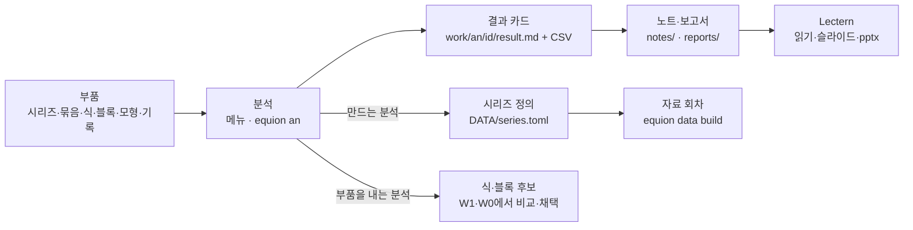

# Equion Desk — 분석 도구와 md 결과 문서 (제안, 2026-11-09)

[`DESK.md`](DESK.md) 4판에 더할 안이다. 채택되면 4판의 K0·K2·K3·W4·§8·§9·§11에 옮긴다.

**답**: 회귀·연립 밖의 분석도 식 추정과 같은 길로 들인다. 시계열 기초, 단위근·공적분, 계절조정·주기 변환, VAR·VECM, 시스템 추정,
예측 평가가 모두 그렇다. **분석 하나 = 명령 하나 = 기록 하나 = md 결과 카드 하나**다. 결과 창은 따로 두지 않는다. 카드가 곧 결과 창이고,
머리에는 그 결과를 낸 명령이 그대로 적히며, 닫아도 사라지지 않는다. 결과를 모으고 설명을 붙이는 곳은 **노트**(md)다. 노트 안의
```` ```equion ```` 블록이 명령이고, 그 바로 아래가 그 명령의 결과 구역이다. 노트는 Desk·Lectern·편집기·GitHub 어디서나 표와 차트째 읽힌다.

## 1. 한눈에



모든 분석은 결과 카드를 남긴다. 계절조정처럼 시리즈를 만드는 분석은 정의를 거쳐서만 자료에 들어가고, ECM·VAR처럼 식을 내는
분석은 후보를 거쳐서만 모형에 들어간다.

## 2. 분석 목록 — 지금 equion에 있는 것

| 갈래 | 분석(명령 이름) | 엔진에 있는 것 | 대상 | 결과 | 만드는 것 |
|---|---|---|---|---|---|
| 자료 살펴보기 | `summary` · `graph` | 시리즈 목록·메타데이터·그래프 객체 | 시리즈·묶음 | 구간·결측·끝 시점·단위 표, 수준·증가율·로그 차트 | — |
| 기초 통계 **(새로)** | `stats` · `hist` · `corr` · `acf` | 없음(정규성 JB·Ljung-Box만 있다) | 시리즈·식·묶음 | 기술 통계·히스토그램·상관표·ACF·PACF·Q | — |
| 주기 변환 | `convert` | `wf.convert`(평균·합·첫값·끝값·Denton·Chow-Lin) | 시리즈 | 변환 전후 차트, 합 맞추기 오차 | 시리즈 정의 |
| 계절조정 | `seas` | `wf.seas`(STL·고전 분해, 가법·승법) | 시리즈 | 실측·계절·추세·불규칙·조정 표와 차트 | 시리즈 정의 |
| 파생 | `genr` | `wf.genr`(방정식 문법) | 식 | 결과 차트 | `derived.txt` 한 줄 |
| 단위근 | `unitroot` | `wf.adf` · `wf.kpss` | 시리즈·식·묶음 | 검정 표(묶음이면 시리즈 × 검정) | — |
| 공적분 | `coint` | `wf.coint`(Engle-Granger) · `wf.johansen` | 묶음 | 순위 검정 표, 공적분 벡터 | — |
| 식 진단 | `diag` | LM·Ljung-Box·White·BP·ARCH·JB·RESET·누락·불필요·Wald·Chow·CUSUM·재귀·시차 분포 | 식·후보 | 검정 표, CUSUM·재귀 계수 차트 | — (W1에 이미 있다) |
| 오차수정 | `ecm` | `wf.ecm`(장기식·조정 속도·반감기) | 목표와 설명 변수 | 장기식·조정 속도·반감기 | 식 후보 |
| 시스템 추정 | `system` | OLS·SUR·2SLS·3SLS·FIML, 식 사이 Wald | 블록·식 묶음 | 계수·적합 통계·잔차 공분산 | 블록 후보 |
| VAR | `var` | 시차 고르기·정보기준·Granger·충격반응·분산분해·전망·안정성 | 묶음 | 표, 충격반응 차트 | 블록 후보 |
| VECM | `vecm` | α·β·Γ·전망 | 묶음 | 표·차트 | 블록 후보 |
| 예측 평가 | `fcsteval` | `wf.forecast_eval` · `wf.dm_test`(Diebold-Mariano) | 기록 둘 이상(식·HS·전망) | 평가 통계·검정 표 | — |
| 모형 분석 | `stability` · `multipliers` · `decompose` · `stochastic` | 동반행렬 고윳값·승수·기여도 분해(Shapley)·확률적 모의 | 모형·시나리오 | 표·차트 | — (W2·W3에 이미 있다) |

- 엔진의 결과 객체는 이미 같은 모양을 돌려준다 — `.output()`(표·글), `.graph()`(그래프), 검정은 `TestResult`. 그래서 md 렌더러
  하나(§4)만 더하면 모든 분석이 카드가 된다.
- **(새로)**: 기술 통계·히스토그램·상관표·자기상관은 지금 equion에 없다. 계산이 작아 E7에서 더한다(§9, Q14). HP 필터·X-13 같은 것은
  쓰임이 생길 때 더한다.

## 3. 세 갈래 — 결과가 어디로 가나

| 갈래 | 예 | 결과가 가는 곳 | 규칙 |
|---|---|---|---|
| **보는 분석** | 단위근·공적분·기초 통계·진단·예측 평가·모형 분석 | 분석 기록 `work/an/<id>/` 하나 | 아무 파일도 바꾸지 않는다 |
| **만드는 분석** | 계절조정·주기 변환·파생 | 기록(미리보기) → '정의로 남기기' → `DATA/series.toml`·`derived.txt` → '자료 만들기' → 새 자료 회차 | 실측 자리에 바로 쓰지 않는다(K8-1). 시리즈는 정의가 있어야만 자료에 들어간다 |
| **부품을 내는 분석** | ECM·VAR·VECM·시스템 추정 | 기록 → '후보로 남기기' → 식 후보(`est:`)·블록 후보 → W1·W0에서 비교·채택 | 채택은 사람의 단추나, 사람이 시킨 Claude의 `equion adopt`(K3) |

워크파일 API는 `wf.seas(…, write=True)`처럼 결과를 바로 시리즈로 쓴다. Desk와 작업 명령은 이 길을 쓰지 않는다. 그렇게 쓰면 그 값이
어느 정의에서 나왔는지가 사라지기 때문이다. '정의로 남기기'는 정의 파일에 이런 항목을 남긴다(바뀜 기록 K7에도 남는다).

```toml
# DATA/series.toml에 더해지는 항목(초안) — seas = "stl"처럼 글자만 쓰면 기본 옵션
[series.CN]
from = "na:민간소비_원계열"
seas = { method = "stl", model = "multiplicative", robust = true }
unit = "십억원(연쇄)"
desc = "민간소비, 실질, 계절조정(STL 승법)"
made_by = "an:seas_0004"          # 이 정의를 만든 분석 기록 — 시리즈 내력(K8)에서 거슬러 간다
```

## 4. 결과 카드 — 분석 하나 = md 하나

```text
work/an/unitroot_0003/
  result.md       카드 — Desk 분석 탭·Lectern·편집기에서 같은 모양
  result.json     전체 값(명령의 --json과 같다)
  table_1.csv …   카드의 표마다 하나(엑셀로 열린다)
  chart_1.csv …   차트 자료(기간 열 + 날짜 열)
```

카드의 모양(예시 수치):

````markdown
# 단위근 — 묶음 core

| 기록 | 명령 | 자료 회차 | 표본 | 누가 · 언제 |
|---|---|---|---|---|
| `an:unitroot_0003` | `equion an unitroot core --trend ct` | d2026-11b | 1995Q1~2024Q4 | claude · 2026-11-09 10:12 |

| 시리즈 | ADF t | p | 시차(BIC) | KPSS | KPSS 5% 임계 | 판단 |
|---|---|---|---|---|---|---|
| log(Y) | −2.41 | .37 | 2 | .21 | .146 | 단위근 |
| log(CN) | −2.05 | .57 | 1 | .24 | .146 | 단위근 |
| log(I) | −3.62 | .03 | 3 | .19 | .146 | 엇갈림 — 두 검정이 다르다 |

```vega-lite
{"data": {"url": "chart_1.csv"}, "mark": "line",
 "encoding": {"x": {"field": "date", "type": "temporal"},
              "y": {"field": "value", "type": "quantitative"},
              "color": {"field": "series"}}}
```

**알아서 한 것** — 시차 수를 BIC로 골랐다(최대 8) · 표본 앞 4기가 시차로 빠졌다
````

- **머리에 명령 그대로**: 기록 이름·명령·자료 회차·표본·누가·언제. 명령을 복사해 터미널에 치면 같은 결과가 새 기록으로 나온다(같은 자료 회차일 때).
- **표는 md 표, 차트는 `vega-lite` + 같은 폴더의 CSV**: Desk가 없어도 Lectern이 차트까지 그린다(§8 L2). CSV에는 기간 열과 날짜 열을
  함께 둔다(`vega-lite`가 `2005Q1`을 날짜로 읽지 못한다 — LC5).
- **알아서 한 것**은 카드 맨 아래에 늘 있는 줄이다(§2.4-4). 없으면 "없음".
- **결과는 고치지 않는다**(§2.3): 옵션을 바꿔 다시 실행하면 새 기록이 생기고 옛 카드는 그대로 남는다. 입력(자료 회차·식·정의)이 바뀌면 카드 머리에 '낡음'.
- **카드 모양은 하나**: K2의 `est`·`hs`·`sim` 기록의 `summary.md`도 같은 렌더러로 만든다 — 추정 결과든 단위근이든 같은 모양으로 읽는다.

## 5. 노트 — 실행 블록과 결과 구역

노트(`notes/*.md`)는 사람과 Claude가 함께 쓰는 작업 문서다. 글 사이에 ```` ```equion ```` 블록을 두면 그 줄들이 명령이 되고, 실행하면
블록 바로 아래에 결과 구역이 생긴다.

````markdown
# core 묶음 — 적분 차수와 공적분 (2026-11)

소비함수를 오차수정 꼴로 쓸 수 있는지 본다.

```equion
equion an unitroot core --trend ct
```

<!-- equion:out an:unitroot_0003 · 2026-11-09 10:12 · d2026-11b -->
(카드의 표와 차트가 여기에 펼쳐진다)
<!-- /equion:out -->

Y·CN은 단위근, I는 두 검정이 엇갈린다. 공적분을 본다.

```equion
equion an coint core --method johansen --lags 2
```

<!-- equion:out an:coint_0005 · 2026-11-09 10:15 · d2026-11b -->
…
<!-- /equion:out -->
````

| 규칙 | 내용 |
|---|---|
| 블록 줄 = 명령줄 그대로 | 터미널과 노트 사이에 복사해 오갈 수 있다. 블록이 부를 수 있는 것은 등록부(§7)에 있는 명령뿐이다 — 노트는 프로그램이 아니다(K1) |
| 실행은 명령이 있을 때만 | 블록의 ▶ · '노트 전체 실행' · `equion note run notes/core.md`. 노트를 열거나 고쳐도 저절로 돌지 않는다(§2.4-1) |
| 결과 구역은 펼친 md | 카드의 표·차트가 그대로 들어간다(차트는 기록 폴더의 CSV를 노트에서 본 상대 경로로). Lectern·GitHub·편집기에서 Desk 없이 읽힌다. 구역 머리 줄에 기록 이름·시각·자료 회차 |
| 다시 실행 = 새 기록 | 구역이 새 기록으로 바뀌고 옛 기록은 `work/an/`에 남는다. 구역 안을 손으로 고쳤으면 바꾸기 전에 차이를 보이고 묻는다 |
| 낡음 | 구역이 가리키는 기록의 입력이 바뀌면 구역 머리에 '낡음'. `equion note check`가 낡은 구역 목록을 낸다 |
| Python 블록 | 앱이 실행하지 않는다(§6-1). ▶는 `equion note run notes/core.md --block 3`을 터미널에 Enter 없이 붙여 넣고, 사람이 Enter를 누른다 |
| 노트도 사용자 파일 | 바뀜 기록(K7) 대상 — Claude가 노트를 고치면 바뀜 알림이 뜬다. 노트가 가리키는 기록은 정리(K8-5) 목록에 '노트가 씀'으로 보이고 기본으로 빠진다 |
| 노트와 보고서 | `notes/`는 작업 중 기록(명령 블록 + 결과 구역), `reports/`는 남에게 보일 글(§8 L3) — 보고서는 명령 블록 없이 결과만 받는다(아래 '보고서로 보내기') |

이 방식은 이 저장소의 문서 도구가 이미 쓰고 있다. `docs/build_docs.py`는 md의 ```` ```python ```` 블록을 실행해 `<!-- out -->` 아래에 출력을
채우고, `--check`로 그 출력이 지금 코드와 맞는지 본다(D27). 노트는 같은 생각을 모형 작업에 옮긴 것이다.

### 보고서로 보내기

노트가 작업 기록이라면 보고서는 남이 읽는 글이다. 그래서 보고서에는 명령 블록을 넣지 않고 **결과만** 보낸다. 어느 카드에서나(분석·추정·HS·전망·시나리오·보기,
노트의 결과 구역) '보고서로 보내기'를 누르면 고르는 것은 넷이다.

| 고르는 것 | 내용 |
|---|---|
| 보낼 것 | 카드 전체 · 표 하나 · 차트 하나 |
| 모양 | 행·열·시리즈, 기간(분기·연간 집계), 보이기(수준·전기비·전년동기비·차이), 소수점·단위, 차트 종류·전망 구간 음영 |
| 제목·출처 | 표·차트 제목(번호는 보고서 안에서 저절로), 출처 줄 "자료: Equion sim:2026-12_base(자료 회차 d2026-12a)" |
| 보낼 곳 | 고른 보고서의 커서 자리 · 고른 제목 아래 · 끝. 보고서가 없으면 '새 보고서'(틀: 제목·날짜·자료 회차·모형) |

보고서에 들어가는 모양(예시 수치):

````markdown
<!-- equion:report sim:2026-12_base #표1 · 2026-12-12 · d2026-12a · rows=Y,CN,P · show=yoy · annual · digits=1 -->
**표 1. 주요 지표 전망** (전년동기비, %)

| | 2025 | 2026 | 2027 |
|---|---|---|---|
| 실질 GDP | 2.0 | 1.8 | 2.1 |
| 민간소비 | 1.7 | 1.6 | 1.9 |
| 소비자물가 | 2.2 | 2.0 | 1.9 |

자료: Equion sim:2026-12_base(자료 회차 d2026-12a)
<!-- /equion:report -->
````

| 규칙 | 내용 |
|---|---|
| 보고서는 혼자 선다 | 차트 자료는 `reports/<보고서>_data/`로 복사한다 — `work/`를 정리해도, 다른 PC로 옮기거나 메일로 보내도 깨지지 않는다(Q16) |
| 보이지 않는 표시 | 구역마다 주석 한 줄에 기록 이름·보낸 날·자료 회차·**보낸 모양**. Lectern·GitHub에서는 보이지 않고, Desk에서는 구역 머리 띠로 보인다 |
| 손으로 고쳐도 된다 | 보고서는 사람의 글이라 행 이름·소수점을 고쳐도 된다. '새 기록으로 바꾸기' 때 고친 곳을 차이로 보이고 남길지 묻는다 |
| 새 기록으로 바꾸기 | 저절로 바뀌지 않는다(Q17). '보고서 검사'가 더 새 기록·낡음·없는 기록을 알리고, 사람이 '새 기록으로 바꾸기'(구역 하나·모두)를 누르면 같은 모양으로 다시 만들어 전후 차이(바뀐 숫자 강조)를 보인 뒤 적용한다 |
| 다음 달 보고서 | '새 보고서 — 지난달에서'는 지난 보고서를 복사하고 구역마다 바꿔 낄 기록(같은 종류의 최신)을 제안한다. 사람이 확인하면 숫자는 끝나고 글만 고친다 |
| 정리에서 빠진다 | 보고서가 쓴 기록은 정리(K8-5) 목록에 '보고서가 씀' |
| 다른 형식은 Lectern | pptx는 Lectern의 슬라이드·내보내기로(§8 L3) |

## 6. Desk 화면

```text
 분석 단위근 ▾   대상 [ core (Y·CN·I) ▾ ]   결정항 ( )없음 ( )상수 (•)상수+추세   시차 [BIC ▾] 최대 [8]
 명령  equion an unitroot core --trend ct                                   [복사] [실행 Ctrl+Enter]
 ──────────────────────────────────────────────────────────────────────────────────
 an:unitroot_0003 · claude · 10:12 · d2026-11b      [노트에 담기 ▾] [엑셀로] [Claude로 보내기] [제안 받기]
 | 시리즈 | ADF t | p | 시차 | KPSS | 판단 |  …
 (차트)
 알아서 한 것  시차 수를 BIC로 골랐다 · 표본 앞 4기가 시차로 빠졌다
```

- **분석 메뉴**: 부품(시리즈·묶음·식·후보·블록·모형·기록)을 우클릭하면 **그 부품에 맞는 분석만** 나온다. 시리즈면 요약·기초 통계·단위근·
  계절조정·주기 변환, 묶음이면 상관·단위근·공적분·VAR·VECM, 기록 둘을 고르면 예측 평가. 명령 찾기(Ctrl+K)에서 '분석: 단위근'처럼 이름으로도 연다.
- **분석 탭**: 위에 옵션 폼이 있고, 그 아래에 **지금 옵션의 명령 글**이 바뀌는 대로 보인다(복사하면 터미널에서 같은 일). 실행하면 아래에 카드가 뜬다.
  옵션을 바꿔 다시 실행하면 탭 안에 기록이 쌓이고(이전·다음), 둘을 골라 나란히 본다.
- **카드의 단추**: '노트에 담기'(고른 노트의 커서 자리나 끝에 명령 블록 + 결과 구역 — 목록에 최근 노트), 만드는 분석은 '정의로 남기기',
  부품을 내는 분석은 '후보로 남기기', '보고서로 보내기'(§5), '엑셀로'(값·값의 종류·출처 함께 — K8-4), 'Claude로 보내기'·'제안 받기'(§2.2).
- **W1·W2·W3도 같다**: 식 진단·HS·전망의 결과 화면도 같은 카드 렌더러를 쓰고 '노트에 담기'가 붙는다.
- **노트 보기**: md 보기에 더해 ```` ```equion ```` 블록마다 ▶와 마지막 실행 시각, 결과 구역마다 머리 띠(기록 이름·낡음·다시 실행·기록 열기). 쓰기는 md 편집 그대로다.
- **묶음 — 새 부품**: 여러 시리즈를 이름 하나로 부른다(`equion.toml`의 `[group]`). 단위근·상관·공적분·VAR·차트·내보내기가 묶음을 받는다(레고 — K0).

```toml
# equion.toml에 더하는 것(초안)
[group]
core  = { series = ["Y", "CN", "I"], transform = "log", desc = "핵심 수요" }
price = { series = ["P", "PY", "POIL"], desc = "물가" }
```

## 7. 명령과 등록부

| 명령 | 하는 일 |
|---|---|
| `equion an list [--for 시리즈·묶음·식·모형·기록]` | 분석 목록 — 이름·대상·옵션·만드는 것 |
| `equion an <분석> <대상> [옵션] [--as 이름] [--note 노트]` | 분석 하나 → 짧은 글 + 기록. `--note`면 그 노트 끝에 블록과 결과 구역을 더한다 |
| `equion an <분석> --help` | 옵션과 기본값, 예 |
| `equion an keep <기록>` | 만드는 분석은 정의로, 부품을 내는 분석은 후보로 남긴다(Desk의 '정의로 남기기'·'후보로 남기기'와 같다) |
| `equion note run <노트> [--block n] [--stale]` | 노트의 블록을 실행해 결과 구역을 채운다. `--stale`이면 낡은 구역만 |
| `equion note check <노트…>` | 실행하지 않고 낡은 구역·없는 기록·손으로 고친 구역 목록 |
| `equion report new <이름> [--from <보고서>]` | 새 보고서(틀). `--from`이면 지난 보고서를 복사하고 구역마다 바꿔 낄 기록을 제안한다 |
| `equion report add <보고서> <기록>[#표1] [--rows …] [--show yoy] [--annual] [--digits 1] [--under "## 전망"]` | 보고서로 보내기 |
| `equion report check <보고서>` | 낡음·더 새 기록·없는 기록·손으로 고친 구역 |
| `equion report update <보고서> [--region n] [--to <기록>]` | 새 기록으로 바꾸기 — 차이를 보이고 적용 |

출력은 K3처럼 기본이 짧은 글이고 `--json`이면 전체다(예시 수치).

```text
[an:unitroot_0003] 단위근 · 묶음 core(log Y·CN·I) · 1995Q1~2024Q4 · 자료 d2026-11b
  log(Y)   ADF −2.41 p=.37 · KPSS .21 !  → 단위근
  log(CN)  ADF −2.05 p=.57 · KPSS .24 !  → 단위근
  log(I)   ADF −3.62 p=.03 · KPSS .19 !  → 엇갈림
  알아서 한 것  시차 수를 BIC로(최대 8) · 표본 앞 4기가 시차로 빠짐
  기록   an:unitroot_0003 (work/an/unitroot_0003/result.md)
```

**등록부**: 분석마다 이름·대상 종류·옵션(종류·기본값·설명)·부르는 엔진 함수·결과(표·차트)·만드는 것을 등록부 한 곳에 적는다.

- 명령줄 옵션, Desk의 옵션 폼, `--help`·F1 도움말, Claude용 안내(`help/claude.md`의 분석 표)가 **모두 등록부에서 나온다** — 분석 하나를
  더하면 네 곳에 함께 생긴다(두 길 — §2.1).
- 등록부는 노트의 ```` ```equion ```` 블록이 부를 수 있는 것의 **허용 목록**이기도 하다 — 방정식 파서의 허용 목록(보안)과 같은 생각이다.
- 엔진의 결과 객체는 이미 같은 모양이라, 새로 쓸 것은 등록 항목과 md 렌더러 하나다.

## 8. 시나리오로 따져 보기

소비함수를 오차수정 꼴로 바꿔 볼지 정하는 일이다(가상 분기 모형 — [`DESK_SCENARIO.md`](DESK_SCENARIO.md)의 모형).

| 단계 | 사람·Claude | 남는 것 | 보이는 곳 |
|---|---|---|---|
| A1 계절조정 | 사람: W4에서 원계열 우클릭 → 계절조정 → 승법 STL → 성분 차트 확인 → '정의로 남기기' → '자료 만들기' → '이 회차로 바꾸기' | `an:seas_0004` · `series.toml`의 `CN` 항목 · 회차 `d2026-11b` | 분석 탭 · 바뀜 알림 · 상태줄의 회차 |
| A2 단위근·공적분 노트 | 사람이 터미널에 "core 묶음 단위근·공적분 보고 노트로 정리해 줘" → Claude가 `notes/core.md`(블록 둘과 글)를 쓰고 `equion note run notes/core.md` | `an:unitroot_0003` · `an:coint_0005` · `notes/core.md` | 터미널(명령 그대로) · 작업 기록 띠 · 바뀜 알림 → 노트 보기 |
| A3 옵션 바꿔 다시 | 사람: 노트에서 Johansen 블록의 `--lags 2`를 `4`로 고쳐 ▶ | `an:coint_0006`(옛 `_0005`도 남는다) | 노트의 결과 구역 · 분석 탭에서 둘을 나란히 |
| A4 ECM 후보 | 사람: "ECM으로 소비함수 후보를 만들어 c5와 비교해, 채택은 하지 마" → Claude: `equion an ecm CN Y RR` → `equion an keep an:ecm_0007 --as cons_ecm1` → `equion compare --target CN` | `est:cons_ecm1`(후보) | W1 후보 목록(c5와 나란히) — 채택은 사람 |
| A5 보고서 | 사람: Lectern에서 `notes/core.md`를 열어 읽고 고쳐 `reports/2026-11_소비.md`로 → 슬라이드 → pptx | 보고서 md | Lectern(차트까지) |

| 원칙 | 판정 | 근거 |
|---|---|---|
| 두 길(§2.1) | ○ | A1은 손으로, A2·A4는 Claude가 — 같은 명령, 같은 카드. 등록부가 폼과 명령줄을 함께 만든다 |
| 보이는 계산(§2.4) | ○ | 실행은 ▶·명령으로만, 카드 머리의 명령·회차, 알아서 한 것, 노트 바뀜 알림, 낡음 |
| 고치기와 결과(§2.3) | ○ | 노트의 글·블록은 고치고, 결과는 다시 실행해 새 기록으로 |
| 레고(S6) | ○ | 묶음 부품, 만드는 분석 → 정의, 부품을 내는 분석 → 후보 |
| 재현(S7) | ○ | 카드 머리의 명령 + 자료 회차, 노트 다시 실행 |
| 자료 관리(K8) | ○ | 계산 결과를 실측 자리에 쓰지 않는다 — 정의 → 회차로만 |
| 남는 일 | △ | 결과 구역을 손으로 고쳤을 때의 처리(차이·묻기), Lectern에서 고치다 구역 표시 주석이 깨질 때 — D0에서 확인 |

## 9. 더할 것과 단계

| 단계 | 더할 것 |
|---|---|
| E1 보강 | **md 렌더러 하나** — 출력 객체(`TableOutput`·`GraphOutput`·`TextOutput`·`TestResult`)마다 `md()`(표 → md 표 + CSV, 그래프 → `vega-lite` + CSV). K2의 모든 `summary.md`를 이것으로 만든다 |
| E2 보강 | `equion an`(등록부·`list`·`--help`·`keep`), `equion note run·check`, `equion report new·add·check·update` |
| E4 보강 | 만드는 분석의 '정의로 남기기'(`series.toml`·`derived.txt`의 항목과 `made_by`), 묶음(`[group]`) |
| E7 (새) | 기초 분석 — 기술 통계·히스토그램·상관표·자기상관(ACF·PACF·Q). 자체 구현(D17), 시험·docstring·튜토리얼 절(D27) |
| D2 보강 | 분석 메뉴·분석 탭·노트 보기(블록 ▶·결과 구역 머리·낡음). W1·W2·W3 결과에도 '노트에 담기'·'보고서로 보내기'(대화상자·보고서 검사·새 기록으로 바꾸기) |
| LC6 (Lectern, 선택) | 설정에 등록한 언어의 코드 블록(예: `equion`)에 '터미널로 보내기' 단추 — Enter 없이 붙여 넣는다(Lectern D51). Lectern에서도 노트의 블록을 돌린다. 일반 기능 |

## 10. 정할 것

| # | 질문 | 추천 | 다른 길 |
|---|---|---|---|
| Q11 | 분석 결과의 단위 | **분석마다 기록**(`work/an/<id>/`) — 노트 없이도 남고 띠에 뜬다 | 노트 안에만(노트를 지우면 결과도 사라진다) |
| Q12 | 노트의 결과 구역 | **펼친 md**(표·차트가 그대로) — Lectern·GitHub에서 Desk 없이 읽힌다 | 기록을 가리키는 표시만(짧지만 Desk에서만 보인다) |
| Q13 | 노트의 Python 블록 | **터미널에서만**(`equion note run --block`, 사람이 Enter) — §6-1 그대로 | 앱 안에서도 실행(빠르지만 안전 원칙이 깨진다) |
| Q14 | 없는 기초 분석 | **기술 통계·히스토그램·상관표·자기상관을 E7에서 먼저** | 모두 한꺼번에(HP 필터·X-13 포함) / Desk 뒤로 |
| Q15 | 분석 명령 이름 | **`equion an <분석>` 하나 아래** — 목록·도움말이 한 곳, 기록 이름 `an:` | 분석마다 최상위 명령(`equion unitroot` — 짧지만 명령이 많아진다) |
| Q16 | 보고서의 차트 자료 | **보고서 옆 폴더로 복사**(`reports/<보고서>_data/`) — 보고서가 혼자 선다 | `work/`의 CSV를 가리킨다(가볍지만 정리·옮기기에 깨진다) |
| Q17 | 보고서 구역의 갱신 | **사람이 '새 기록으로 바꾸기'를 누를 때만, 차이를 보이고** | 노트처럼 명령 블록을 두고 다시 실행(보고서에 명령이 섞인다) |
