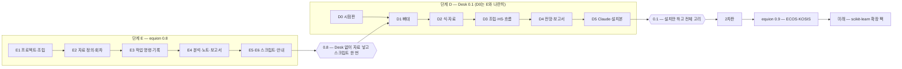

# Equion Desk 개발 계획 (2026-11-09)

Equion Desk를 두 단계로 만든다. 먼저 **패키지 equion 0.8(단계 E)**에 프로젝트·자료 회차·작업 명령·기록·스크립트를 넣어, Desk 없이도
Lectern 터미널과 Claude로 "자료를 넣고 `equion run monthly.eqs`"가 되게 한다. 그 위에 **Desk 1차판 equion-desk 0.1(단계 D)**을 얹어,
설치만 하면 손으로도 Claude로도 같은 일을 화면에서 하게 한다.

노트 실행 화면·후보 묶음과 시나리오 폼·Lectern 수정·기초 분석 추가는 **2차판**, ECOS·KOSIS 받기는 **equion 0.9**, scikit-learn 확장은 그 뒤다.
Desk 시험판(D0)은 위험이 커서 E와 나란히 일찍 시작한다.

사용자가 고를 것은 여덟 가지이고(§고를 것) 모두 추천안이 있다. "추천대로"라고 답하면 결정 기록을 옮기고 바로 E1을 시작한다.

## 기준

근거는 기획 자료 아홉 개다 — [`DESK.md`](DESK.md)(기획안 4판), [`DESK_REVIEW.md`](DESK_REVIEW.md)(종합 정리), [`DESK_SCENARIO.md`](DESK_SCENARIO.md),
[`DESK_ANALYSIS.md`](DESK_ANALYSIS.md), [`DESK_SCENES.md`](DESK_SCENES.md), [`DESK_SOLO.md`](DESK_SOLO.md), [`DESK_DATA.md`](DESK_DATA.md),
[`DESK_REPRO.md`](DESK_REPRO.md), [`DESK_SCRIPT.md`](DESK_SCRIPT.md). 이 계획은 그 운영 원칙 — 두 길(손으로도 Claude로도), 보이는 계산,
결과는 고치지 않음, 레고, 설치만 하면 작동 — 을 그대로 따르고, 정할 것 Q0~Q28은 추천안을 넣었다(바꿀 것은 §고를 것).
기획 자료끼리 엇갈리던 곳은 아래처럼 정했다 — 자료와 이 계획이 다르면 이 계획을 따른다.

| 엇갈리던 것 | 이 계획의 결정 |
|---|---|
| Lectern 수정(LC1~LC6) 시기 | 2차판. 1차판은 파일로만 잇는다(L1~L6) |
| 기초 분석(기술 통계·히스토그램·상관·ACF) 추가 | 2차판 |
| 노트의 ▶ 실행 화면 | 2차판. 1차판은 `equion note run` 명령과 md 보기 |
| 묶어 보내기·이정표 | 2차판. 그 전에는 폴더 복사 |
| 흐름의 형식 | Equion 스크립트 `.eqs` + `equion run`. TOML 흐름과 `equion flow` 명령 안은 버린다 |
| 결과 카드 파일 이름 | `summary.md` 하나(분석 문서의 `result.md`는 버린다) |
| 실행 기록 | 프로젝트 안에서는 `work/run/<id>/`·이름 `run:`. 프로젝트 밖에서는 지금처럼 `out/<id>/` |
| "스크립트 없이"(기획안 S5·K3) | "Python 스크립트 없이" |
| 기록을 남기지 않는 계산 | 미리보기(불러오기·보고서 보내기·`--dry-run`)는 기록을 남기지 않고 화면에 '미리보기'로 표시한다 |
| '회차 바꾼 뒤 할 일' 화면과 스크립트 | 둘 다 둔다 — 화면은 손으로 하나씩, 스크립트는 한 번에 |
| 기록 이름 앞글자 | `data:`·`est:`·`hs:`·`sim:`·`an:`·`run:`·`prop:` |

결정은 [`DECISIONS.md`](DECISIONS.md)에 D31부터, 단계는 [`ROADMAP.md`](ROADMAP.md)에 옮긴다. Lectern은 같은 저자의 MIT 라이선스라
Desk로 코드를 복사해도 되고, 복사한 커밋(0.69.1 `cd7fb26`)과 고지를 남긴다.

## 한눈에

## 단계 E — 패키지 equion 0.8

계산과 파일 형식은 모두 패키지에 둔다. Desk는 이 단계의 함수를 부르는 화면일 뿐이다. 수치 코어(파서·IR·풀이·통계)는 이 단계에서 고치지 않는다 —
워크파일 API 위의 새 층이다. 규모는 서로 견준 크기(소·중·대)다.

| 묶음 | 만드는 것 | 명령 | 완료 기준 | 규모 |
|---|---|---|---|---|
| **E1 프로젝트·조립** | `equion.toml`(블록·모형·포함·제외·묶음·판단 기준·지금 회차), 블록 = 방정식 파일, 채택표 `adopted.toml`, 이름 규칙(`demand:CN`), 조립 검사, 블록 HS, 바꿔 끼우기, 항등식 단독 검사, `eqn.project()`, 예제 프로젝트(`equion new --template desk` — 가상 분기 모형) | `assemble` · `ident --check` | 예제 프로젝트가 조립되고, 블록·모형 HS가 워크파일 API로 푼 것과 허용오차 안에서 같다 | 대 |
| **E2 자료 정의·회차** | `DATA/raw/`와 출처 해시, `series.toml`(불러오기 틀 — 시트·열 이름 줄·단위 줄·시점 꼴·숫자 꼴·결측 표시, 시점이 행인 표부터), 변환(주기 변환·계절조정·`derived.txt`), 자료 회차·값의 종류(`flags.csv`), 틀 검사, 상대 기간(`last`·`next:n`) | `data add·build·use·diff·impact` | 같은 원자료·정의면 같은 회차 해시, 원자료를 바꾼 뒤 `diff`가 새 기간·개정을 정확히 | 대 |
| **E3 작업 명령·기록** | `work/` 기록 저장소(id·`log.jsonl`·형식 판·조립 명세·알아서 한 것), md 렌더러(출력 객체의 `md()` → `summary.md`), 바뀜 기록·제안, 짧은 글 출력 + `--json` | `est`(`--adopted`·`--adopt`) · `adopt` · `compare` · `hs`(`--swap`·`--vs`·`--replay`) · `sim`(`--vintage`·`--vs`) · `export --xlsx` · `work` · `propose` · `history` | 기획 자료의 장면 2·4·5가 명령만으로 되고(시험), 기록 하나를 `--replay`하면 같은 결과 | 대 |
| **E4 분석·노트·보고서** | 분석 등록부(이름·대상·옵션·엔진 함수·결과·만드는 것) — 엔진에 있는 분석(단위근·공적분·계절조정·주기 변환·ECM·VAR·VECM·시스템·진단·예측 평가·안정성…), '정의로 남기기'·'후보로 남기기', 노트의 결과 구역, 보고서로 보내기(옆 폴더로 복사) | `an`(`list`·`--help`·`keep`) · `note run·check` · `report new·add·check·update` | 분석 문서의 예가 명령으로 되고, 보고서 구역을 새 기록으로 바꿀 때 손으로 고친 곳을 차이로 알린다 | 중 |
| **E5 스크립트·재연** | `.eqs` 해석기(줄 = 명령, `param`·`{…}`·`expect`·`run`·`py`), 실행 기록 `work/run/<id>/`(풀린 스크립트·단계 기록·정의 사본·판), `DATA/raw/inbox/` | `run x.eqs`(`--set`·`--from`·`--dry-run`) · `run --replay` · `check x.eqs` · `script new·export --py` | 예제 프로젝트에서 "원자료 교체 → `equion run monthly.eqs`"가 보고서까지 만들고, 실행 기록 replay가 같은 결과 | 중 |
| **E6 안내·문서** | AI용 모형 작업 안내(`help/claude.md`)·`equion` 스킬 초안, 튜토리얼 "프로젝트와 스크립트", 명령·파일 형식 레퍼런스, CHANGELOG | — | 문서 검사 통과, Claude가 안내만 읽고 예제의 월간 스크립트를 돌린다 | 소 |

**0.8 출시 관문**: Desk 없이 Lectern 터미널과 Claude로 핵심 고리(자료 → 식 → 조립 → HS → 전망 → 보고서)와 재연(스크립트 한 번)이 된다.
기존 시험·문서 검사·CI가 모두 통과하고, 새 명령은 종료 코드 약속(0·1·2·3)을 따른다. 비공개 `macro_model`은 0.8을 판 번호로 가져다 쓸 수 있다.

## 단계 D — Desk 1차판 equion-desk 0.1

Desk는 같은 저장소의 `desk/`(패키지 `equion-desk`, 의존은 `equion-desk → equion` 한쪽 — D28)에 둔다. 살은 Lectern 0.69.1에서 복사하고
(창·로컬 서버·터미널·사이드바·설정·감시·md 보기), 화면은 E의 명령과 같은 함수를 부른다.

| 묶음 | 만드는 것 | 완료 기준 | 규모 |
|---|---|---|---|
| **D0 시험판**(E와 나란히) | 설치 폴더 안 런타임(python-build-standalone + 잠긴 패키지), 격리 실행, Lectern 테마 창, 터미널의 `claude`·`equion`·`python`, 작업 프로세스로 추정, 설치본 크기 | 추정 1초 안(S1), PC 여덟 가지에서 설치 → 추정·HS·전망(S10). 못 넘으면 런타임 방식을 다시 고른다 | 중 |
| **D1 뼈대** | Lectern에서 복사한 창·서버·단일 인스턴스·프로젝트 탭·사이드바(부품·파일)·터미널·설정·감시, 작업 줄·작업 기록 띠·바뀜 알림, md 보기(차트)·결과 카드 보기, 초안·화면 상태 | 터미널에서 친 명령의 기록이 띠에 뜨고 카드로 열린다, 닫았다 열면 이어진다 | 중 |
| **D2 식·자료** | W1 식 작업대(계수표·진단·차트·후보 목록·겹쳐 보기·채택), W4 자료 작업대(원자료 목록·불러오기 화면·회차·시리즈 내력), 분석 메뉴·분석 탭(등록부가 만드는 폼) | 혼자 장면 1·2, 장면 2(식 고르기)가 화면으로 된다 | 대 |
| **D3 조립·HS·흐름** | W0 조립 작업대(조립 보기·쓰는 곳·바꿔 끼우기), W2 모형 작업대(HS·전후 비교·원인 따라가기), 흐름 화면(스크립트 단계 보기·고치기·실행·이 단계부터), 회차 바꾼 뒤 할 일 | 혼자 장면 5, 장면 4·10이 화면으로 되고, 스크립트를 화면에서 실행한다 | 대 |
| **D4 전망·보고서** | W3(가정 표·보정항·기준선·시나리오·회차 비교), 보기, 보고서로 보내기(대화상자·보고서 검사·새 기록으로 바꾸기), 엑셀로 | 혼자 장면 6·8, 장면 5·6이 화면으로 된다 | 중 |
| **D5 Claude·마감·설치본** | 맡기기·제안 받기 단추, 제안 카드, 바뀜 기록 화면·되돌리기, `equion desk show`, 'Claude Code에 Equion 알려 주기', 설치본(사용자별 설치·WebView2 도우미), Windows CI, 예제 프로젝트, 도움말 | 장면 8(맡기고 되돌리기), PC 여덟 가지 설치 시험 | 중 |

**1차판 출시 관문**: 설치 파일 하나로 설치하고, 손으로도 Claude로도 핵심 고리와 스크립트 재연이 화면에서 된다. Claude Code가 없는 PC에서도 모든 화면 기능이 돈다.

## 2차판과 그 뒤

| 때 | 담는 것 | 왜 미루나 |
|---|---|---|
| **2차판**(equion-desk 0.2~) | 노트 ▶ 실행 화면, 후보 묶음 폼, 시나리오 폼, 기초 분석(기술 통계·히스토그램·상관표·ACF·PACF), 같은 분석의 두 기록 비교, 회차 비교 요인 나누기 화면, 시점이 열인 표·여러 머리줄 불러오기, 묶어 보내기·묶음 열기·이정표, Lectern 수정(LC1~LC6), 영문 화면 | 1차판에도 같은 일을 하는 길이 있다(명령·스크립트·파일 복사). 폼은 Claude 없이 혼자 할 때를 위한 것이라 2차판 처음에 |
| **equion 0.9** | ECOS·KOSIS 받기(`data fetch` — 받은 파일을 원자료로, 출처 정의 파일), 비선형 시스템 추정 | 0.8 후보였으나 프로젝트·회차 구조가 먼저 있어야 받은 자료를 넣을 자리가 생긴다 |
| **배포를 넓힐 때** | 코드 서명(D7), 인터넷 없는 PC용 큰 설치본(Q7) | 가까운 사용자에게는 서명 없이도 된다 |
| **미래** | scikit-learn 선택 확장 팩(Keras 제외) | 지금은 요청하지 않았다. 등록부·블록·런타임을 막지 않게만 만든다 |

## 개발 방식

| 항목 | 방식 |
|---|---|
| 저장소 | `samiblog/equion` 하나 — 패키지 `equion/`(E), 앱 `desk/`(D, uv workspace). 작업은 `main`에 바로 커밋, 묶음마다 하나 이상의 커밋 |
| 새 모듈(E) | `equion/projects/`(설정·부품·조립·채택표 — `eqn.project`와 이름이 겹치지 않게 복수형) · `equion/data/source.py`·`vintage.py`(불러오기 틀·회차) · `equion/work/`(기록·바뀜 기록·제안) · `equion/registry.py`(명령·분석 등록부) · `equion/reporting/markdown.py`(md 렌더러) · `equion/script/`(`.eqs`) · `equion/cli/`의 새 하위 명령. 상대 기간은 `data/periods.py`에 |
| 시험 | E: 새 시험 파일(프로젝트·회차·기록·스크립트·등록부), 기획 자료의 장면을 명령 시험으로, 예제 자료만(D30). 엔진 104·통계 166 시험은 그대로 통과해야 한다. D: 로컬 서버 API 시험 + 화면 점검표 + PC 여덟 가지 설치 시험 |
| CI | 지금의 locked(3 OS × py3.12~3.14)·minimal·lowest·latest·audit에 예제 프로젝트 스크립트 실행을 더하고, D부터 Windows 설치본 빌드·기동 시험 |
| 문서(D27) | 새 공개 함수·명령·파일 형식마다 docstring·레퍼런스·튜토리얼 절, `build_docs --check` 통과가 완료 조건 |
| 형식의 판 | 기록·스크립트·`equion.toml`에 형식 이름과 판(지금 `manifest.json`처럼). 바꾸면 판을 올리고 옛 것을 계속 읽는다 |
| 약속 | 종료 코드 0·1·2·3을 바꾸지 않는다(D15). 공개 API·문법·형식을 바꾸면 CHANGELOG(하위 사용자 `macro_model`). 실제 자료는 저장소에 넣지 않는다(D30). EViews 이름·화면·문장을 쓰지 않는다(D13) |
| 판 | E → equion 0.8.0 · D → equion-desk 0.1.0(설치 파일 `EquionDesk-0.1.0-setup.exe`) · ECOS·KOSIS → equion 0.9 |

## 위험과 대응

| 위험 | 대응 |
|---|---|
| 식 작업대가 1초 안에 못 돌아온다(큰 모형·차트) | D0에서 먼저 잰다. 작업 프로세스를 띄워 두고, 차트는 보이는 탭만 그린다 |
| 설치본(런타임 격리)이 일부 PC에서 막힌다(보안 프로그램·DRM) | D0의 PC 여덟 가지 시험, 막히면 코드 서명을 앞당기거나 런타임 방식을 바꾼다(고를 것 6) |
| 범위가 커서 1차판이 늦어진다 | 0.8만으로도 쓸모가 있다(Lectern + 터미널). 2차판으로 미룰 목록이 정해져 있다 |
| 불러오기 표 모양이 끝없이 다양하다 | 흔한 모양(시점이 행)부터, 틀 검사로 실패를 보이게, Claude가 틀을 제안 |
| 파일 형식이 많아 서로 어긋난다 | 형식마다 판, `equion check`가 프로젝트 전체를 검사, 파일 지도를 레퍼런스에 |
| 엔진 수치가 바뀐다 | 수치 코어는 이 계획에서 고치지 않는다. 엔진·통계 시험과 문서 출력 비교가 지킨다 |
| Lectern에서 복사한 코드가 갈라진다 | 복사한 커밋을 적고, 고침은 필요한 것만 양쪽으로(D10) |
| 오래 걸리는 개발에서 맥락을 잃는다 | 기획 자료·이 계획·결정 기록을 저장소에 두고, 묶음마다 완료 기준으로 끝을 확인한다 |

## 사용자가 고를 것

> **결정 (2026-11-09)**: 여덟 가지 모두 추천대로 — `DECISIONS.md` D31~D39.

계획의 모양을 바꾸는 선택만 추렸다. 굵은 글씨가 추천이고, 이 계획은 추천을 고른 것으로 쓰여 있다. 기획 자료의 나머지 정할 것(Q0~Q28)은
추천안대로 넣었으니 바꿀 것만 번호로 알려 주면 된다.

| # | 고를 것 | 선택지 | 추천과 까닭 |
|---|---|---|---|
| 1 | 개발 순서 | **(가) E 먼저, D0 시험판만 나란히** · (나) E를 다 끝낸 뒤 D0부터 · (다) E와 D를 처음부터 함께 | (가) — 런타임·설치 위험을 일찍 알고, 화면은 명령이 굳은 뒤에 만든다. (나)는 위험을 늦게 알고, (다)는 명령이 바뀔 때 화면을 다시 만든다 |
| 2 | 0.8에 담을 것 | **(가) E1~E6 전부, ECOS·KOSIS는 0.9로** · (나) 두 번에: E1~E3 → 0.8, E4~E6 → 0.9 · (다) ROADMAP대로 ECOS·KOSIS를 0.8에 먼저 | (가) — "자료 넣고 스크립트 한 번"이 한 판에서 완성된다. (나)는 일찍 쓰지만 재연이 늦다. (다)는 받은 자료를 넣을 회차 구조가 없다 |
| 3 | Desk 1차판 범위 | **(가) D0~D5** · (나) 더 작게: D0~D2와 흐름 화면만 0.1, 나머지 0.2 · (다) 더 크게: 노트 화면·폼까지 | (가) — 핵심 고리 전체가 화면에 있어야 "두 길"이 선다. (나)는 일찍 설치본을 쓰되 조립·전망은 명령으로 |
| 4 | 모형의 계수(Q18·Q23) | **(가) 평소엔 채택 계수 고정, 스크립트는 기준을 통과한 식만 새 계수(`if_pass`)** · (나) 스크립트도 고정(연 1회 손으로) · (다) 풀 때마다 다시 추정 | (가) — 몰래 바뀌지 않으면서 "자료만 넣으면"이 된다. (다)는 보이는 계산 원칙과 부딪힌다 |
| 5 | 정의 파일을 고치는 방법 | **(가) `tomlkit` 의존성 추가** — 주석·순서를 지키며 고친다(순수 Python·MIT) · (나) 자체 최소 편집기 · (다) 명령은 정의를 고치지 않고 사람·Claude만 | (가) — '채택'·'정의로 남기기'가 사람이 쓴 주석을 지우면 안 된다. 새 필수 의존성이라 결정 기록이 필요하다(D17). (나)는 품과 버그 위험, (다)는 두 길이 깨진다 |
| 6 | 런타임(Q6) | **(가) 설치 폴더 안 런타임 하나(python-build-standalone)** · (나) PyInstaller 앱 + 터미널용 런타임 | (가) — 앱과 터미널의 `python`·`equion`이 같고 크기가 한 벌. D0에서 안 되면 (나)로 |
| 7 | 1차판의 사용자 | **(가) 본인과 가까운 동료 — 서명 없는 설치본, 한국어 화면** · (나) 조직 배포 — 코드 서명·오프라인 설치본·영문 화면을 1차판부터 | (가) — 써 보며 다듬는 것이 먼저다. (나)는 D가 길어지고 서명 비용이 든다 |
| 8 | 기획 자료의 처리 | **(가) 기획 자료 9개와 이 계획을 저장소에 커밋 — 자료는 그대로 두고 이 계획이 기준** · (나) 기획안 본문을 5판으로 고쳐 상충을 없앤 뒤 커밋 · (다) 저장소에는 이 계획만 | (가) — 상충은 이 계획의 '기준' 절이 정리했다. (나)는 품이 들고, (다)는 근거가 저장소에 없다 |

## 첫 걸음

"추천대로"(또는 바꿀 번호)라는 답을 받으면 바로 이렇게 한다.

1. ✓ **결정 옮기기**(2026-11-09): `DECISIONS.md` D31~D39, `ROADMAP.md`에 0.8(E1~E6)·Desk 0.1(D0~D5)·2차판·0.9. 기획 자료 9개와 이 계획을 `docs/`에 두고 커밋·push.
2. ✓ **예제 프로젝트부터**(2026-11-09 — `equion new 폴더 --template desk`): 가상 분기 모형(예제 자료 `toy_q` 기반 — 블록 넷·모형 main·시나리오 oil20·스크립트 monthly.eqs)을 먼저 만들어, 모든 E 단계 시험과 문서의 기준으로 쓴다.
3. ✓ **E1**(2026-11-09 — `equion/projects/`·`assemble`·`ident`, 시험 82개; 채택표는 기록과 함께 E3로): `equion/projects/`(설정·부품·조립·채택표)와 `equion assemble`, 블록 HS. 묶음이 끝날 때마다 완료 기준을 확인하고, 시험·문서·CI가 통과하면 진행을 이 문서에 표시한다.
   ✓ **E2**(2026-11-09 — `equion/data/source.py`(불러오기 틀)·`equion/projects/vintage.py`(정의·회차)·`equion data list·add·build·use·diff·impact`, 상대 기간 `last-N`·`next:N`, 프로젝트 시험 150개): 같은 원자료·정의면 같은 회차, 원자료를 바꾼 뒤 `diff`가 새 기간·개정(기간·크기)을 정확히 — 예제 프로젝트는 자료 정의·회차를 쓰고 `[hs] range = "2005Q1:last"`. 시점이 열로 가는 표는 다음 판.
   ✓ **E3**(2026-11-09 — `equion/work/`(기록·바뀜 기록)·`equion/projects/records.py`·`sim.py`·`proposals.py`·`export.py`·`equion/reporting/markdown.py`, 명령 `est`(`--adopted --adopt`)·`adopt`·`compare`·`hs`(`--swap`·`--vs`·`--replay`)·`sim`(`--vintage`·`--vs`)·`propose`·`export --xlsx`·`work`·`history`, 시험 175개): 장면 2·4·5가 명령만으로 되고(시험 I·N·O), HS 기록을 `--replay`하면 같은 결과(파일·회차를 바꾼 뒤에도). 회차 비교의 요인 나누기(자료·가정·식)는 2차판 — 지금은 `--vintage`로 나눠 푼다.
   ✓ **E4**(2026-11-09 — `equion/registry.py`(등록부)·`equion/projects/analyses.py`·`notes.py`·`reports.py`, 명령 `an`(`list`·`--help`·`keep`)·`note run·check`·`report new·add·check·update`, 분석 13개, 시험 97개): 분석 기획 자료의 예(A1~A5)가 명령만으로 되고, 보고서 구역을 새 기록으로 바꿀 때 손으로 고친 곳을 차이로 알린다(시험 G·I). VAR·VECM·시스템을 블록 후보로 남기기와 기초 통계(기술 통계·히스토그램·상관·ACF)는 2차판 — 지금은 식마다 식 후보로 남긴다.
   ✓ **E5**(2026-11-09 — `equion/script/`(문법·실행·실행 기록·재연·내보내기)·`equion/projects/inbox.py`, 명령 `run x.eqs`(`--set`·`--from`·`--dry-run`)·`run --replay`·`check x.eqs`·`script new·export --py`·`data inbox`·`data build --inbox`, 예제 프로젝트의 `FLOWS/monthly.eqs`, 시험 72개): 예제 프로젝트에서 원자료를 받은 상자에 넣고 `equion run FLOWS/monthly.eqs` 한 번이 새 회차·다시 추정·HS·전망·노트·보고서·엑셀까지 만들고, 실행 기록의 `--replay`가 단계마다 같은 결과(시험 L). `expect --stop`은 종료 코드 2(결과 확인 실패 — `--fail-on`과 같은 갈래). 같은 회차로 다시 돌려도 보고서의 글은 남는다(`report new --exist-ok`·`report add --key`). 재연은 프로젝트 사본에서 하고 견준 결과만 새 실행 기록으로 남긴다.
4. **D0 준비(나란히)**: 런타임 묶기·격리 실행 시험과 PC 여덟 가지 목록. 여러 PC가 필요한 시험은 사용자의 도움을 받는다.
