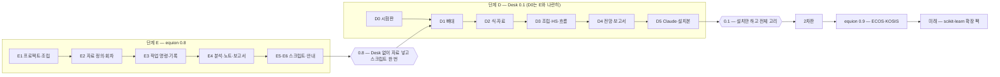

# Equion Desk 개발 계획 (2026-11-09)

Equion Desk를 두 단계로 만든다. 먼저 **패키지 equion 0.8(단계 E)**에 프로젝트·자료 회차·작업 명령·기록·스크립트를 넣어, Desk 없이도
Lectern 터미널과 Claude로 "자료를 넣고 `equion run monthly.eqs`"가 되게 한다. 그 위에 **Desk 1차판 equion-desk 0.1(단계 D)**을 얹어,
설치만 하면 손으로도 Claude로도 같은 일을 화면에서 하게 한다.

노트 실행 화면·후보 묶음과 시나리오 폼·Lectern 수정·기초 분석 추가는 **2차판**, ECOS·KOSIS 받기는 **equion 0.9**, scikit-learn 확장은 그 뒤다.
Desk 시험판(D0)은 위험이 커서 E와 나란히 일찍 시작한다.

사용자가 고를 것은 여덟 가지이고(§고를 것) 모두 추천안이 있다. "추천대로"라고 답하면 결정 기록을 옮기고 바로 E1을 시작한다.

## 기준

근거는 기획 자료 아홉 개다 — [`DESK.md`](DESK.md)(기획안 4판), [`DESK_REVIEW.md`](DESK_REVIEW.md)(종합 정리), [`DESK_SCENARIO.md`](DESK_SCENARIO.md),
[`DESK_ANALYSIS.md`](DESK_ANALYSIS.md), [`DESK_SCENES.md`](DESK_SCENES.md), [`DESK_SOLO.md`](DESK_SOLO.md), [`DESK_DATA.md`](DESK_DATA.md),
[`DESK_REPRO.md`](DESK_REPRO.md), [`DESK_SCRIPT.md`](DESK_SCRIPT.md). 이 계획은 그 운영 원칙 — 두 길(손으로도 Claude로도), 보이는 계산,
결과는 고치지 않음, 레고, 설치만 하면 작동 — 을 그대로 따르고, 정할 것 Q0~Q28은 추천안을 넣었다(바꿀 것은 §고를 것).
기획 자료끼리 엇갈리던 곳은 아래처럼 정했다 — 자료와 이 계획이 다르면 이 계획을 따른다.

| 엇갈리던 것 | 이 계획의 결정 |
|---|---|
| Lectern 수정(LC1~LC6) 시기 | 2차판. 1차판은 파일로만 잇는다(L1~L6) |
| 기초 분석(기술 통계·히스토그램·상관·ACF) 추가 | 2차판 |
| 노트의 ▶ 실행 화면 | 2차판. 1차판은 `equion note run` 명령과 md 보기 |
| 묶어 보내기·이정표 | 2차판. 그 전에는 폴더 복사 |
| 흐름의 형식 | Equion 스크립트 `.eqs` + `equion run`. TOML 흐름과 `equion flow` 명령 안은 버린다 |
| 결과 카드 파일 이름 | `summary.md` 하나(분석 문서의 `result.md`는 버린다) |
| 실행 기록 | 프로젝트 안에서는 `work/run/<id>/`·이름 `run:`. 프로젝트 밖에서는 지금처럼 `out/<id>/` |
| "스크립트 없이"(기획안 S5·K3) | "Python 스크립트 없이" |
| 기록을 남기지 않는 계산 | 미리보기(불러오기·보고서 보내기·`--dry-run`)는 기록을 남기지 않고 화면에 '미리보기'로 표시한다 |
| '회차 바꾼 뒤 할 일' 화면과 스크립트 | 둘 다 둔다 — 화면은 손으로 하나씩, 스크립트는 한 번에 |
| 기록 이름 앞글자 | `data:`·`est:`·`hs:`·`sim:`·`an:`·`run:`·`prop:` |

결정은 [`DECISIONS.md`](DECISIONS.md)에 D31부터, 단계는 [`ROADMAP.md`](ROADMAP.md)에 옮긴다. Lectern은 같은 저자의 MIT 라이선스라
Desk로 코드를 복사해도 되고, 복사한 커밋(0.69.1 `cd7fb26`)과 고지를 남긴다.

## 한눈에

## 단계 E — 패키지 equion 0.8

계산과 파일 형식은 모두 패키지에 둔다. Desk는 이 단계의 함수를 부르는 화면일 뿐이다. 수치 코어(파서·IR·풀이·통계)는 이 단계에서 고치지 않는다 —
워크파일 API 위의 새 층이다. 규모는 서로 견준 크기(소·중·대)다.

| 묶음 | 만드는 것 | 명령 | 완료 기준 | 규모 |
|---|---|---|---|---|
| **E1 프로젝트·조립** | `equion.toml`(블록·모형·포함·제외·묶음·판단 기준·지금 회차), 블록 = 방정식 파일, 채택표 `adopted.toml`, 이름 규칙(`demand:CN`), 조립 검사, 블록 HS, 바꿔 끼우기, 항등식 단독 검사, `eqn.project()`, 예제 프로젝트(`equion new --template desk` — 가상 분기 모형) | `assemble` · `ident --check` | 예제 프로젝트가 조립되고, 블록·모형 HS가 워크파일 API로 푼 것과 허용오차 안에서 같다 | 대 |
| **E2 자료 정의·회차** | `DATA/raw/`와 출처 해시, `series.toml`(불러오기 틀 — 시트·열 이름 줄·단위 줄·시점 꼴·숫자 꼴·결측 표시, 시점이 행인 표부터), 변환(주기 변환·계절조정·`derived.txt`), 자료 회차·값의 종류(`flags.csv`), 틀 검사, 상대 기간(`last`·`next:n`) | `data add·build·use·diff·impact` | 같은 원자료·정의면 같은 회차 해시, 원자료를 바꾼 뒤 `diff`가 새 기간·개정을 정확히 | 대 |
| **E3 작업 명령·기록** | `work/` 기록 저장소(id·`log.jsonl`·형식 판·조립 명세·알아서 한 것), md 렌더러(출력 객체의 `md()` → `summary.md`), 바뀜 기록·제안, 짧은 글 출력 + `--json` | `est`(`--adopted`·`--adopt`) · `adopt` · `compare` · `hs`(`--swap`·`--vs`·`--replay`) · `sim`(`--vintage`·`--vs`) · `export --xlsx` · `work` · `propose` · `history` | 기획 자료의 장면 2·4·5가 명령만으로 되고(시험), 기록 하나를 `--replay`하면 같은 결과 | 대 |
| **E4 분석·노트·보고서** | 분석 등록부(이름·대상·옵션·엔진 함수·결과·만드는 것) — 엔진에 있는 분석(단위근·공적분·계절조정·주기 변환·ECM·VAR·VECM·시스템·진단·예측 평가·안정성…), '정의로 남기기'·'후보로 남기기', 노트의 결과 구역, 보고서로 보내기(옆 폴더로 복사) | `an`(`list`·`--help`·`keep`) · `note run·check` · `report new·add·check·update` | 분석 문서의 예가 명령으로 되고, 보고서 구역을 새 기록으로 바꿀 때 손으로 고친 곳을 차이로 알린다 | 중 |
| **E5 스크립트·재연** | `.eqs` 해석기(줄 = 명령, `param`·`{…}`·`expect`·`run`·`py`), 실행 기록 `work/run/<id>/`(풀린 스크립트·단계 기록·정의 사본·판), `DATA/raw/inbox/` | `run x.eqs`(`--set`·`--from`·`--dry-run`) · `run --replay` · `check x.eqs` · `script new·export --py` | 예제 프로젝트에서 "원자료 교체 → `equion run monthly.eqs`"가 보고서까지 만들고, 실행 기록 replay가 같은 결과 | 중 |
| **E6 안내·문서** | AI용 모형 작업 안내(`help/claude.md`)·`equion` 스킬 초안, 튜토리얼 "프로젝트와 스크립트", 명령·파일 형식 레퍼런스, CHANGELOG | — | 문서 검사 통과, Claude가 안내만 읽고 예제의 월간 스크립트를 돌린다 | 소 |

**0.8 출시 관문**: Desk 없이 Lectern 터미널과 Claude로 핵심 고리(자료 → 식 → 조립 → HS → 전망 → 보고서)와 재연(스크립트 한 번)이 된다.
기존 시험·문서 검사·CI가 모두 통과하고, 새 명령은 종료 코드 약속(0·1·2·3)을 따른다. 비공개 `macro_model`은 0.8을 판 번호로 가져다 쓸 수 있다.

## 단계 D — Desk 1차판 equion-desk 0.1

Desk는 같은 저장소의 `desk/`(패키지 `equion-desk`, 의존은 `equion-desk → equion` 한쪽 — D28)에 둔다. 살은 Lectern 0.69.1에서 복사하고
(창·로컬 서버·터미널·사이드바·설정·감시·md 보기), 화면은 E의 명령과 같은 함수를 부른다.

| 묶음 | 만드는 것 | 완료 기준 | 규모 |
|---|---|---|---|
| **D0 시험판**(E와 나란히) | 설치 폴더 안 런타임(python-build-standalone + 잠긴 패키지), 격리 실행, Lectern 테마 창, 터미널의 `claude`·`equion`·`python`, 작업 프로세스로 추정, 설치본 크기 | 추정 1초 안(S1), PC 여덟 가지에서 설치 → 추정·HS·전망(S10). 못 넘으면 런타임 방식을 다시 고른다 | 중 |
| **D1 뼈대** | Lectern에서 복사한 창·서버·단일 인스턴스·프로젝트 탭·사이드바(부품·파일)·터미널·설정·감시, 작업 줄·작업 기록 띠·바뀜 알림, md 보기(차트)·결과 카드 보기, 초안·화면 상태 | 터미널에서 친 명령의 기록이 띠에 뜨고 카드로 열린다, 닫았다 열면 이어진다 | 중 |
| **D2 식·자료**(✓ D2a · D2b-1 · D2b-2) | W1 식 작업대(계수표·진단·차트·후보 목록·겹쳐 보기·채택), W4 자료 작업대(원자료 목록·불러오기 화면·회차·시리즈 내력), 분석 메뉴·분석 탭(등록부가 만드는 폼) | 혼자 장면 1·2, 장면 2(식 고르기)가 화면으로 된다 | 대 |
| **D3 조립·HS·흐름**(✓) | W0 조립 작업대(조립 보기·쓰는 곳·바꿔 끼우기), W2 모형 작업대(HS·전후 비교·원인 따라가기), 흐름 화면(스크립트 단계 보기·고치기·실행·이 단계부터), 회차 바꾼 뒤 할 일 | 혼자 장면 5, 장면 4·10이 화면으로 되고, 스크립트를 화면에서 실행한다 | 대 |
| **D4 전망·보고서**(✓) | W3(가정 표·보정항·기준선·시나리오·회차 비교), 보기, 보고서로 보내기(대화상자·보고서 검사·새 기록으로 바꾸기), 엑셀로 | 혼자 장면 6·8, 장면 5·6이 화면으로 된다 | 중 |
| **D5 Claude·마감·설치본**(✓ — 다른 PC 점검이 남음) | 맡기기·제안 받기 단추, 제안 카드, 바뀜 기록 화면·되돌리기, `equion desk show`, 'Claude Code에 Equion 알려 주기', 설치본(사용자별 설치·WebView2 도우미), Windows CI, 예제 프로젝트, 도움말 | 장면 8(맡기고 되돌리기), PC 여덟 가지 설치 시험 | 중 |

**1차판 출시 관문**: 설치 파일 하나로 설치하고, 손으로도 Claude로도 핵심 고리와 스크립트 재연이 화면에서 된다. Claude Code가 없는 PC에서도 모든 화면 기능이 돈다.

## 2차판과 그 뒤

2차판의 화면(대상에서 출발 — 변수 탭·변수 창, 분석 탭과 개별 식, 명령 창, 터미널 여러 개)은 [`DESK_V2.md`](DESK_V2.md)에서 기획한다(초안, 2026-11-12).

| 때 | 담는 것 | 왜 미루나 |
|---|---|---|
| **2차판**(equion-desk 0.2~) | 노트 ▶ 실행 화면, 후보 묶음 폼, 시나리오 폼, 기초 분석(기술 통계·히스토그램·상관표·ACF·PACF), 같은 분석의 두 기록 비교, 회차 비교 요인 나누기 화면, 시점이 열인 표·여러 머리줄 불러오기, 묶어 보내기·묶음 열기·이정표, Lectern 수정(LC1~LC6), 영문 화면 | 1차판에도 같은 일을 하는 길이 있다(명령·스크립트·파일 복사). 폼은 Claude 없이 혼자 할 때를 위한 것이라 2차판 처음에 |
| **equion 0.9** | ECOS·KOSIS 받기(`data fetch` — 받은 파일을 원자료로, 출처 정의 파일), 비선형 시스템 추정 | 0.8 후보였으나 프로젝트·회차 구조가 먼저 있어야 받은 자료를 넣을 자리가 생긴다 |
| **배포를 넓힐 때** | 코드 서명(D7), 인터넷 없는 PC용 큰 설치본(Q7) | 가까운 사용자에게는 서명 없이도 된다 |
| **미래** | scikit-learn 선택 확장 팩(Keras 제외) | 지금은 요청하지 않았다. 등록부·블록·런타임을 막지 않게만 만든다 |

## 개발 방식

| 항목 | 방식 |
|---|---|
| 저장소 | `samiblog/equion` 하나 — 패키지 `equion/`(E), 앱 `desk/`(D, uv workspace). 작업은 `main`에 바로 커밋, 묶음마다 하나 이상의 커밋 |
| 새 모듈(E) | `equion/projects/`(설정·부품·조립·채택표 — `eqn.project`와 이름이 겹치지 않게 복수형) · `equion/data/source.py`·`vintage.py`(불러오기 틀·회차) · `equion/work/`(기록·바뀜 기록·제안) · `equion/registry.py`(명령·분석 등록부) · `equion/reporting/markdown.py`(md 렌더러) · `equion/script/`(`.eqs`) · `equion/cli/`의 새 하위 명령. 상대 기간은 `data/periods.py`에 |
| 시험 | E: 새 시험 파일(프로젝트·회차·기록·스크립트·등록부), 기획 자료의 장면을 명령 시험으로, 예제 자료만(D30). 엔진 104·통계 166 시험은 그대로 통과해야 한다. D: 로컬 서버 API 시험 + 화면 점검표 + PC 여덟 가지 설치 시험 |
| CI | 지금의 locked(3 OS × py3.12~3.14)·minimal·lowest·latest·audit에 예제 프로젝트 스크립트 실행을 더하고, D부터 Windows 설치본 빌드·기동 시험 |
| 문서(D27) | 새 공개 함수·명령·파일 형식마다 docstring·레퍼런스·튜토리얼 절, `build_docs --check` 통과가 완료 조건 |
| 형식의 판 | 기록·스크립트·`equion.toml`에 형식 이름과 판(지금 `manifest.json`처럼). 바꾸면 판을 올리고 옛 것을 계속 읽는다 |
| 약속 | 종료 코드 0·1·2·3을 바꾸지 않는다(D15). 공개 API·문법·형식을 바꾸면 CHANGELOG(하위 사용자 `macro_model`). 실제 자료는 저장소에 넣지 않는다(D30). EViews 이름·화면·문장을 쓰지 않는다(D13) |
| 판 | E → equion 0.8.0 · D → equion-desk 0.1.0(설치 파일 `EquionDesk-0.1.0-setup.exe`) · ECOS·KOSIS → equion 0.9 |

## 위험과 대응

| 위험 | 대응 |
|---|---|
| 식 작업대가 1초 안에 못 돌아온다(큰 모형·차트) | D0에서 먼저 잰다. 작업 프로세스를 띄워 두고, 차트는 보이는 탭만 그린다 |
| 설치본(런타임 격리)이 일부 PC에서 막힌다(보안 프로그램·DRM) | D0의 PC 여덟 가지 시험, 막히면 코드 서명을 앞당기거나 런타임 방식을 바꾼다(고를 것 6) |
| 범위가 커서 1차판이 늦어진다 | 0.8만으로도 쓸모가 있다(Lectern + 터미널). 2차판으로 미룰 목록이 정해져 있다 |
| 불러오기 표 모양이 끝없이 다양하다 | 흔한 모양(시점이 행)부터, 틀 검사로 실패를 보이게, Claude가 틀을 제안 |
| 파일 형식이 많아 서로 어긋난다 | 형식마다 판, `equion check`가 프로젝트 전체를 검사, 파일 지도를 레퍼런스에 |
| 엔진 수치가 바뀐다 | 수치 코어는 이 계획에서 고치지 않는다. 엔진·통계 시험과 문서 출력 비교가 지킨다 |
| Lectern에서 복사한 코드가 갈라진다 | 복사한 커밋을 적고, 고침은 필요한 것만 양쪽으로(D10) |
| 오래 걸리는 개발에서 맥락을 잃는다 | 기획 자료·이 계획·결정 기록을 저장소에 두고, 묶음마다 완료 기준으로 끝을 확인한다 |

## 사용자가 고를 것

> **결정 (2026-11-09)**: 여덟 가지 모두 추천대로 — `DECISIONS.md` D31~D39.

계획의 모양을 바꾸는 선택만 추렸다. 굵은 글씨가 추천이고, 이 계획은 추천을 고른 것으로 쓰여 있다. 기획 자료의 나머지 정할 것(Q0~Q28)은
추천안대로 넣었으니 바꿀 것만 번호로 알려 주면 된다.

| # | 고를 것 | 선택지 | 추천과 까닭 |
|---|---|---|---|
| 1 | 개발 순서 | **(가) E 먼저, D0 시험판만 나란히** · (나) E를 다 끝낸 뒤 D0부터 · (다) E와 D를 처음부터 함께 | (가) — 런타임·설치 위험을 일찍 알고, 화면은 명령이 굳은 뒤에 만든다. (나)는 위험을 늦게 알고, (다)는 명령이 바뀔 때 화면을 다시 만든다 |
| 2 | 0.8에 담을 것 | **(가) E1~E6 전부, ECOS·KOSIS는 0.9로** · (나) 두 번에: E1~E3 → 0.8, E4~E6 → 0.9 · (다) ROADMAP대로 ECOS·KOSIS를 0.8에 먼저 | (가) — "자료 넣고 스크립트 한 번"이 한 판에서 완성된다. (나)는 일찍 쓰지만 재연이 늦다. (다)는 받은 자료를 넣을 회차 구조가 없다 |
| 3 | Desk 1차판 범위 | **(가) D0~D5** · (나) 더 작게: D0~D2와 흐름 화면만 0.1, 나머지 0.2 · (다) 더 크게: 노트 화면·폼까지 | (가) — 핵심 고리 전체가 화면에 있어야 "두 길"이 선다. (나)는 일찍 설치본을 쓰되 조립·전망은 명령으로 |
| 4 | 모형의 계수(Q18·Q23) | **(가) 평소엔 채택 계수 고정, 스크립트는 기준을 통과한 식만 새 계수(`if_pass`)** · (나) 스크립트도 고정(연 1회 손으로) · (다) 풀 때마다 다시 추정 | (가) — 몰래 바뀌지 않으면서 "자료만 넣으면"이 된다. (다)는 보이는 계산 원칙과 부딪힌다 |
| 5 | 정의 파일을 고치는 방법 | **(가) `tomlkit` 의존성 추가** — 주석·순서를 지키며 고친다(순수 Python·MIT) · (나) 자체 최소 편집기 · (다) 명령은 정의를 고치지 않고 사람·Claude만 | (가) — '채택'·'정의로 남기기'가 사람이 쓴 주석을 지우면 안 된다. 새 필수 의존성이라 결정 기록이 필요하다(D17). (나)는 품과 버그 위험, (다)는 두 길이 깨진다 |
| 6 | 런타임(Q6) | **(가) 설치 폴더 안 런타임 하나(python-build-standalone)** · (나) PyInstaller 앱 + 터미널용 런타임 | (가) — 앱과 터미널의 `python`·`equion`이 같고 크기가 한 벌. D0에서 안 되면 (나)로 |
| 7 | 1차판의 사용자 | **(가) 본인과 가까운 동료 — 서명 없는 설치본, 한국어 화면** · (나) 조직 배포 — 코드 서명·오프라인 설치본·영문 화면을 1차판부터 | (가) — 써 보며 다듬는 것이 먼저다. (나)는 D가 길어지고 서명 비용이 든다 |
| 8 | 기획 자료의 처리 | **(가) 기획 자료 9개와 이 계획을 저장소에 커밋 — 자료는 그대로 두고 이 계획이 기준** · (나) 기획안 본문을 5판으로 고쳐 상충을 없앤 뒤 커밋 · (다) 저장소에는 이 계획만 | (가) — 상충은 이 계획의 '기준' 절이 정리했다. (나)는 품이 들고, (다)는 근거가 저장소에 없다 |

## 첫 걸음

"추천대로"(또는 바꿀 번호)라는 답을 받으면 바로 이렇게 한다.

1. ✓ **결정 옮기기**(2026-11-09): `DECISIONS.md` D31~D39, `ROADMAP.md`에 0.8(E1~E6)·Desk 0.1(D0~D5)·2차판·0.9. 기획 자료 9개와 이 계획을 `docs/`에 두고 커밋·push.
2. ✓ **예제 프로젝트부터**(2026-11-09 — `equion new 폴더 --template desk`): 가상 분기 모형(예제 자료 `toy_q` 기반 — 블록 넷·모형 main·시나리오 oil20·스크립트 monthly.eqs)을 먼저 만들어, 모든 E 단계 시험과 문서의 기준으로 쓴다.
3. ✓ **E1**(2026-11-09 — `equion/projects/`·`assemble`·`ident`, 시험 82개; 채택표는 기록과 함께 E3로): `equion/projects/`(설정·부품·조립·채택표)와 `equion assemble`, 블록 HS. 묶음이 끝날 때마다 완료 기준을 확인하고, 시험·문서·CI가 통과하면 진행을 이 문서에 표시한다.
   ✓ **E2**(2026-11-09 — `equion/data/source.py`(불러오기 틀)·`equion/projects/vintage.py`(정의·회차)·`equion data list·add·build·use·diff·impact`, 상대 기간 `last-N`·`next:N`, 프로젝트 시험 150개): 같은 원자료·정의면 같은 회차, 원자료를 바꾼 뒤 `diff`가 새 기간·개정(기간·크기)을 정확히 — 예제 프로젝트는 자료 정의·회차를 쓰고 `[hs] range = "2005Q1:last"`. 시점이 열로 가는 표는 다음 판.
   ✓ **E3**(2026-11-09 — `equion/work/`(기록·바뀜 기록)·`equion/projects/records.py`·`sim.py`·`proposals.py`·`export.py`·`equion/reporting/markdown.py`, 명령 `est`(`--adopted --adopt`)·`adopt`·`compare`·`hs`(`--swap`·`--vs`·`--replay`)·`sim`(`--vintage`·`--vs`)·`propose`·`export --xlsx`·`work`·`history`, 시험 175개): 장면 2·4·5가 명령만으로 되고(시험 I·N·O), HS 기록을 `--replay`하면 같은 결과(파일·회차를 바꾼 뒤에도). 회차 비교의 요인 나누기(자료·가정·식)는 2차판 — 지금은 `--vintage`로 나눠 푼다.
   ✓ **E4**(2026-11-09 — `equion/registry.py`(등록부)·`equion/projects/analyses.py`·`notes.py`·`reports.py`, 명령 `an`(`list`·`--help`·`keep`)·`note run·check`·`report new·add·check·update`, 분석 13개, 시험 97개): 분석 기획 자료의 예(A1~A5)가 명령만으로 되고, 보고서 구역을 새 기록으로 바꿀 때 손으로 고친 곳을 차이로 알린다(시험 G·I). VAR·VECM·시스템을 블록 후보로 남기기와 기초 통계(기술 통계·히스토그램·상관·ACF)는 2차판 — 지금은 식마다 식 후보로 남긴다.
   ✓ **E5**(2026-11-09 — `equion/script/`(문법·실행·실행 기록·재연·내보내기)·`equion/projects/inbox.py`, 명령 `run x.eqs`(`--set`·`--from`·`--dry-run`)·`run --replay`·`check x.eqs`·`script new·export --py`·`data inbox`·`data build --inbox`, 예제 프로젝트의 `FLOWS/monthly.eqs`, 시험 72개): 예제 프로젝트에서 원자료를 받은 상자에 넣고 `equion run FLOWS/monthly.eqs` 한 번이 새 회차·다시 추정·HS·전망·노트·보고서·엑셀까지 만들고, 실행 기록의 `--replay`가 단계마다 같은 결과(시험 L). `expect --stop`은 종료 코드 2(결과 확인 실패 — `--fail-on`과 같은 갈래). 같은 회차로 다시 돌려도 보고서의 글은 남는다(`report new --exist-ok`·`report add --key`). 재연은 프로젝트 사본에서 하고 견준 결과만 새 실행 기록으로 남긴다.
   ✓ **E6**(2026-11-09 — `equion/help/`(모형 작업 안내 `guide.md` — 명령·분석·허용 목록 표는 코드에서, 스킬 초안 `skill/SKILL.md`)·명령 `guide`(`--path`·`skill --install user|project`)·예제 프로젝트의 `CLAUDE.md`, 튜토리얼 9편 "프로젝트와 스크립트", 파일 형식의 파일 지도, 시험 21개): 문서 검사 통과. 저장소를 보지 않고 안내·`--help`만 읽은 새 Claude 에이전트가 예제 프로젝트에서 받은 원자료로 월간 스크립트를 돌리고 근거 기록과 함께 보고했다 — 그 의견(옛 계수가 없을 때·'회차 다름'·자료 점검·지난달 비교·보고서의 글·단위·문서 위치)을 안내와 출력에 반영. 안내 파일은 `claude.md`라 하지 않는다(대소문자를 가리지 않는 OS에서 CLAUDE.md 지시 파일로 읽힌다). **단계 E 끝 — 0.8 출시 관문 확인만 남음.**
4. **단계 D 시작**(2026-11-11 — 점검과 결정 D40): D0를 여섯 걸음으로 나눈다. 묶음이 끝날 때마다 설치 파일로 확인한다(설치본 빌드를 D5에서 D1로),
   D2는 D2a 식 작업대 · D2b 자료 작업대·분석 탭으로 나눈다. 보기 파일(`VIEWS/`)은 D4에서 패키지에 함께. 0.8.0 태그는 가이드 시험 뒤, 늦어도 D1 전에 — **0.8.0(2026-11-11)**: D1을 시작하며 판을 매겼다.

   | 걸음 | 만드는 것 | 확인 |
   |---|---|---|
   | ✓ D0-1 | `desk/` 패키지 뼈대(`equion-desk`)·uv workspace·경계 시험 | 최상위 `uv sync`는 `equion`만 설치, 잠금 파일의 Python 범위 그대로, 패키지 CI 통과 |
   | ✓ D0-2 | 창(pywebview)·로컬 서버·터미널(Lectern `cd7fb26`의 ConPTY·터미널·서버 보호 장치를 복사, xterm.js) | 창이 뜨고, 터미널의 `python`·`equion`이 앱의 런타임이며 PC의 `PYTHONPATH`가 넘어가지 않는다(시험 E) |
   | ✓ D0-3 | 작업 프로세스(`equion_desk/worker.py` — 격리 모드, JSON 줄) + 식 작업대 한 화면(계수·적합·진단·판단 기준·알아서 한 것·차트) | 누른 뒤 화면까지 0.06초(예제), 합성 큰 모형(추정식 300 + 항등식 60)에서도 추정 0.04~0.05초 — S1 통과 |
   | ✓ D0-4 | 런타임 묶기(`desk/build/runtime.py` — python-build-standalone 3.13.18 + 잠긴 패키지(해시 검사) + 이 저장소의 휠, 시험 폴더·tcl/tk·pip 빼기) | 222MB(뺀 것 98MB). 다른 폴더로 옮겨도, `PYTHONPATH`·`PYTHONHOME`이 어지러워도 돈다 |
   | ✓ D0-5 | 설치본(`desk/build/make.py`·`equiondesk.iss` — 사용자별, 바로 가기 실행기, 탐색기 우클릭 'Equion Desk로 열기') · 폴더 없이 띄우면 '폴더 열기'·'예제 프로젝트 만들기' | 설치 파일 47MB, 설치 16초·설치 뒤 242MB. 개발 PC의 임시 폴더에 설치 → 추정 0.03~0.06초·과거 재현·전망·터미널의 `python`·`equion`이 설치본의 것 → 제거 |
   | D0-6 | PC 여덟 가지 점검 — [`DESK_D0_CHECK.md`](DESK_D0_CHECK.md) | 개발 PC로 ②④⑤ 통과. ①③⑥⑦⑧은 다른 PC에서 사용자가 — 못 한 항목은 '확인 못 함'으로 적는다 |

   재 본 것(예제 프로젝트): 띄워 둔 프로세스 안에서 추정 0.02~0.04초·과거 재현 0.04~0.06초·전망 0.15초, 새 프로세스로는 1.7초 — 작업 프로세스를 띄워 둔다.

   D0-4·D0-5에서 알게 된 것: ① 설치 도구가 만드는 `Scripts/*.exe`는 만든 곳의 `python.exe` 절대 경로를 품어 옮기면 돌지 않는다 —
   자기 위치 기준의 `equion.cmd`로 바꿨다(터미널에서 Ctrl+C를 누르면 cmd의 '일괄 작업을 끝내시겠습니까?'가 뜰 수 있다 — 전용 실행기를 만들 때 함께 푼다).
   ② WebView2 설치 도우미는 아직 넣지 않았다 — Lectern처럼 없으면 설치할 때 알린다(도우미를 품는 것은 D5에서, Microsoft 파일을 받아 넣어야 한다).
   ③ 앱 아이콘이 아직 없어 바로 가기·작업 표시줄에 Python 아이콘이 보인다(D1에서 아이콘과 함께).

   D0-3에서 재 본 것(`desk/tests/bench_s1.py` — 서버 → 작업 프로세스 → `eqn.project`): 작업 프로세스가 뜨는 데 1.4~1.5초(앱을 열 때 한 번),
   추정은 모형 크기와 무관하게 0.04~0.05초. **합성 큰 모형(식 360개)의 과거 재현은 3.7~5.6초** — 채택 계수 없이 식 300개를 매번 다시 추정하는
   시간이 크다. D1의 작업 줄에 진행·취소를 넣고, D3에서 어디에 시간이 드는지 재서 줄인다. 앱을 강제로 끝내면 작업 프로세스는 입력이 닫혀
   스스로 끝난다(계산 중이면 그 계산이 끝난 뒤) — D1에서 작업 개체에 넣어 바로 끝나게 한다.

5. **D1 뼈대**(2026-11-11 — 결정 D41): 프로젝트를 여러 개 탭으로 열고, 터미널에서 친 명령의 결과가 화면에 놓이는 틀.

   | 걸음 | 만든 것 | 확인 |
   |---|---|---|
   | ✓ D1-1 | 화면의 색과 틀(`web/css/tokens.css` — 종이·잉크·청록, 밝은·어두운 바탕) · 제목줄의 프로젝트 탭 · 사이드바(부품·파일) · 가운데 탭 · 오른쪽 터미널 · 상태줄 · 개요 화면 | 화면 점검 U·V, 화면 그림(밝은·어두운 바탕) |
   | ✓ D1-2 | 창은 하나(`instance.py`) · 프로젝트 탭(탭마다 작업 프로세스·터미널) · 설정과 지난 화면(`config.py` — 사용자 폴더의 `config.json`) | 시험 F·I — 닫았다 열면 탭·고른 탭·쓰던 식이 그대로, 또 실행하면 폴더가 떠 있는 창의 탭으로 |
   | ✓ D1-3 | 알림 줄과 감시(`watch.py`) · 작업 기록 띠 · 바뀜 알림과 바뀜 기록 화면(차이) · 꺼져 있는 동안 바뀐 것 | 시험 H·E5 — 터미널에 친 명령의 기록이 1초 안팎에 띠에(누가: 터미널·Claude), 밖에서 고친 정의 파일은 '바깥' 바뀜으로 |
   | ✓ D1-4 | 문서(md) 보기와 결과 카드(`md.js` — 표·vega-lite 차트·그림·링크) · 파일 보기(md·csv·글, 읽기 전용) · 작업 기록 목록 | 시험 G — 프로젝트 폴더 밖은 읽지 않는다, 화면 점검 W2·X4 |
   | ✓ D1-5 | 작업 줄(도는 일·지난 시간·취소·끝난 기록) · 작업 개체(`jobs.py`) · 정의가 바뀌면 작업 프로세스가 프로젝트를 다시 연다 · 식 작업대(초안·보던 기록·차트에 값 보기) | 시험 D15~D17, 화면 점검 V·X1 — 누른 뒤 화면까지 0.05~0.06초 |
   | ✓ D1-6 | 아이콘(`build/icon.py`) · 설치본의 아이콘 · 화면 점검(`tests/ui_check.py`) · 설치본 기동 시험(`build/smoke.py`) · CI `desk-ui`·`desk-installer` | 개발 PC에서 설치 파일 → 조용히 설치 → 기동 시험 → 제거 |

   완료 기준 — **터미널에서 친 명령의 기록이 띠에 뜨고 카드로 열린다**(시험 E5, 화면 점검 W1·W2: 화면의 터미널에 `equion hs main`을 치면
   띠에 `hs_0001 · 터미널 · 방금`이 뜨고 누르면 표와 차트의 카드), **닫았다 열면 이어진다**(시험 F7, 화면 점검 Y1~Y3).

   만들며 알게 된 것: ① 앱 프로세스는 `equion`을 불러오지 않게 했다 — 기록·카드·파일은 그대로 읽고 계산만 작업 프로세스로(D41). ② 감시는 알림을
   그대로 믿지 않고 상태를 견준다 — 알림이 빠져도 2초 안에 따라온다. ③ 바깥 고침을 적는 일이 드물게 실패했다(방금 쓴 폴더를 옮길 때 Windows가
   거절) — 패키지의 기록 쓰기에 다시 시도를 넣고(CHANGELOG), Desk도 몇 번 다시 한다. ④ `equion.toml`이 없는 폴더는 탭으로 열지 않는다.
   ⑤ 터미널 여러 개·터미널 모음과 Lectern의 편집 기능은 옮기지 않았다 — 지금 쓰임(Claude Code 하나)에는 하나로 충분하고, 고치는 화면은 D2부터다.

   D2a(식 작업대)로 넘어가기 전에 볼 것: 설치 파일로 하는 손 점검([`DESK_D0_CHECK.md`](DESK_D0_CHECK.md) — 새 화면 기준으로 고쳤다),
   다른 PC(①③⑥⑦⑧)는 아직 '확인 못 함'이다.

6. **D2a 식 작업대**(2026-11-11 — 결정 D42): 식 하나를 다듬고, 후보를 견주고, 채택한다. 혼자 장면 2와 장면 2(소비함수 고르기)가 화면으로 된다.

   | 걸음 | 만든 것 | 확인 |
   |---|---|---|
   | ✓ D2a-1 | 식 칸 — 치는 동안의 문법 검사(종류·목표·자료에 없는 변수·목표가 다른 식), 표본·표준오차(보통·White·HAC)·단독 모의, 기록 이름·추정법 | 시험 J2~J8, 화면 점검 B1~B3 — 검사 1~2ms, 추정은 누른 뒤 화면까지 0.05~0.1초 |
   | ✓ D2a-2 | 후보 목록 — 부품의 추정 기록 모두(사람·터미널·Claude), 같은 계산은 한 줄(×n), 걸러진 것은 까닭과 함께, 정렬·'통과만', 견줄 수 없는 칸 표시, 가장 좋은 값 | 시험 J9·J10, 화면 점검 B4~B6 |
   | ✓ D2a-3 | 겹쳐 보기(둘에서 넷) — 적합·잔차·단독 모의를 한 축에, 계수(t)와 적합 통계를 나란히 | 화면 점검 B7·B8 |
   | ✓ D2a-4 | 채택 — 바뀔 줄을 보이는 확인 상자 → `equion adopt`와 같은 일 → 바뀜 기록, ★ | 시험 J16~J18, 화면 점검 B10·B11 |
   | ✓ D2a-5 | 이 후보로 과거 재현 — 기준(지금 파일)과 함께 풀어 변수마다 전후 RMSPE, 결과 카드의 전후 비교 띠와 명령 줄 | 시험 J13~J15·J17, 화면 점검 B12·B13 |
   | ✓ D2a-6 | 기간 짚기와 더미 · 진단 더 보기(`an diag`) · 'Claude로'(이름과 요약을 터미널에) · 항등식을 실측으로 검사 | 시험 J11·J12·J19, 화면 점검 B9·B14 |

   완료 기준(D2의 식 작업대 몫) — 장면 2의 걸음이 화면으로 된다: ① 식을 치고 Ctrl+Enter → 1초 안에 계수표·진단·차트와 후보 한 줄 ② 고칠 때마다 후보가 쌓이고
   기대 부호·진단으로 걸러진 것이 까닭과 함께 남는다 ③ 짚어 보내기('Claude로') ④ Claude가 터미널에서 낸 후보가 같은 목록에 뜬다 ⑤ 걸러진 것도 남는다
   ⑥ 겹쳐 보기 ⑦ 이 후보로 과거 재현(전후 비교) ⑧ 채택(블록 파일의 줄·바뀜 기록·★). 화면 점검 B1~B14와 시험 J1~J19가 본다.

   만들며 알게 된 것: ① 후보 목록을 결과 아래가 아니라 **식 칸 바로 아래**에 두어야 고칠 때마다 앞의 시도와 견준다 — 대신 계수표가 한 화면에 들어오게
   머리와 통계를 줄였다. ② Ctrl+Enter를 되풀이하면 같은 줄이 목록을 메운다 — 같은 계산은 한 줄로 모았다. ③ 추정 기록에 표준오차의 종류가 없었다 —
   패키지에 넣었다(CHANGELOG). ④ 목록이 스스로 스크롤할 때 화면 전체가 끌려오면 아래 차트를 보던 사람이 길을 잃는다 — 목록만 민다.
   ⑤ 요소에 `null`을 붙이면 'null'이라는 글이 찍힌다 — 화면 점검이 새는 글자를 본다.

   D2b는 두 걸음으로 나눈다 — D2b-1(있는 정의로 자료를 돌리는 일과 분석 탭) · D2b-2(정의를 새로 짝짓는 불러오기 화면).

7. **D2b-1 자료 작업대·분석 탭**(2026-11-11 — 결정 D43): 받은 파일을 넣어 새 회차를 만들고 견주어 바꾼다, 등록부의 분석을 화면에서 돌리고 남긴다.
   혼자 장면 4(새 분기 자료가 왔다)의 자료 쪽 걸음과 장면 5(계절조정 시리즈를 하나 더)가 화면으로 된다.

   | 걸음 | 만든 것 | 확인 |
   |---|---|---|
   | ✓ D2b-1 | 자료의 세 층(① 원자료 → ② 시리즈 → ③ 회차)과 지금 할 일 한 줄 — 정의·원자료가 바뀌면 무엇이 바뀌었는지와 함께 '자료 만들기'를, 새 회차가 준비돼 있으면 '바꾸기'를 권한다 | 시험 K1·K10·K11·K13, 화면 점검 A1·A5·A6 |
   | ✓ D2b-2 | 시리즈 목록 — 만드는 법·구간·결측·쓰는 식, 찾기와 거르기. 누르면 내력(원자료 → 열 → 변환 → 시리즈)·차트(원자료 값과 겹쳐)·쓰는 식·분석으로 | 시험 K3~K5, 화면 점검 A2·A3 |
   | ✓ D2b-3 | 원자료 — 정의가 읽는 파일마다 틀(주기·구간·줄·열)과 읽는 시리즈, 받은 상자(짝지은 원자료·틀 검사)와 넣기, 창 모드의 '원자료 넣기…'(파일 고르기) | 시험 K2·K6~K9, 화면 점검 A4·A5 |
   | ✓ D2b-4 | 회차 — 자료 만들기(지금 회차는 그대로)·견주기(늘어난 값·개정·쓰는 식과 모형)·이 회차로 바꾸기(바뀔 줄을 보이고 나서)·옛 회차로 되돌아가기 | 시험 K11~K14, 화면 점검 A6~A8 |
   | ✓ D2b-5 | 분석 탭 — 등록부가 그리는 목록과 폼(대상으로 고를 이름·옵션·표본), 실행 전의 명령 줄, 결과 카드를 같은 화면에, 지난 분석 | 시험 K15~K17, 화면 점검 A9·A10 |
   | ✓ D2b-6 | 남기기 — 만드는 분석은 미리보기, '정의로 남기기'(series.toml·derived.txt)·'식 후보로 남기기'(est:)는 무엇이 어디에 적히는지 보이고 나서. 자료 작업대가 '회차에 없음'·'자료 만들기'로 이어 받는다 | 시험 K18~K23, 화면 점검 A11~A13 |

   완료 기준(D2의 자료·분석 몫 가운데 이 걸음) — ① 받은 상자에 놓인 새 분기 파일을 넣는다(틀이 맞지 않으면 까닭과 함께 막는다) ② '자료 만들기'로 새 회차가
   생기고 지금 회차는 그대로다 ③ 무엇이 늘고 고쳐졌는지와 그것을 쓰는 식·모형을 본다 ④ 확인 상자를 거쳐 회차를 바꾸고, 같은 길로 되돌아간다
   ⑤ 시리즈에서 '계절조정'을 눌러 미리 보고 정의로 남긴다 → 다시 만들면 새 시리즈가 회차에 들어간다 ⑥ 분석을 고르고 옵션을 바꿔 돌린 기록의 명령이
   화면에 보이던 명령과 같다. 화면 점검 A1~A13·Y6과 시험 K1~K25가 본다.

   만들며 알게 된 것: ① '자료를 다시 만드세요'는 지금 회차만 보고 말하면 틀린다 — 새 회차를 만들고도 같은 말이 남았다. 가장 새 회차가 이미 지금의
   파일로 만든 것인지도 견주어 '만들기'와 '바꾸기'를 가른다. ② 받은 파일을 넣은 뒤 받은 상자에 그대로 두면 같은 파일을 또 넣으라고 권한다 — 명령
   (`data build --inbox`)이 하듯 넣은 것을 확인하고 뺀다. ③ 좁은 폭(터미널을 연 기본 창)에서는 표의 단추 열이 잘린다 — 회차는 표가 아니라 줄로(단추가
   아래 줄로 내려간다), 분석 목록은 카드가 아니라 한 줄씩. ④ 분석의 결과 카드 머리에 있는 표(기록·명령·자료…)가 결과를 화면 아래로 민다 — 같은 화면에
   그릴 때는 감춘다. ⑤ 화면 상태를 기억하므로 점검 스크립트는 설정을 비우고 돌려야 한다.

   다음은 D2b-2(불러오기 화면 — 원자료 미리보기, 열 ↔ 시리즈 짝짓기, 틀(시트·열 이름 줄·시점 열·결측 표시) 고치기. 정의를 쓰는 함수를 패키지에 먼저).

8. **D2b-2 불러오기 화면**(2026-11-11 — 결정 D44): 받은 통계표의 열을 시리즈로. 혼자 장면 1이 화면으로 된다 — D2(식·자료)가 끝났다.
   이 걸음부터는 사용자가 "남은 단계를 끝까지, 갈리는 곳은 판단해서"라고 해 묶음마다 묻지 않고 이어 간다(고른 것은 결정 기록에).

   | 걸음 | 만든 것 | 확인 |
   |---|---|---|
   | ✓ D2b-7 | 패키지: `Project.data_preview`(읽은 그대로의 줄·그 틀로 읽은 결과·열 하나 만들어 보기)·`data_define`(출처의 틀과 시리즈 쓰기 — 검사 뒤, 주석 그대로, 바뀜 기록), 명령줄 `equion data preview·define`, 줄마다 칸 수가 다른 CSV 읽기 | 프로젝트 시험 I(25개 — 모두 175), 레시피 R59 |
   | ✓ D2b-8 | 화면: ① 파일(이미 읽는 출처면 그 틀로) ② 틀 — 읽은 그대로의 표에 열 이름 줄·단위 줄·시점 열·결측 칸을 표시, 틀을 권하는 단추 ③ 열마다 한 줄 — 고른 열만 이름·단위·설명·변환·채움·계절조정, 미리보기 차트 ④ 차이와 명령을 보이고 저장 | 시험 L1~L12, 화면 점검 M1~M6 |
   | ✓ D2b-9 | 자료 작업대에서 들어오는 길 — 출처의 '틀·시리즈 고치기', 읽지 않는 파일의 '불러오기', 받은 상자의 '새 원자료로 불러오기', '원자료 넣기… → 새 원자료' | 화면 점검 M1·M5·M6 |

   완료 기준 — 혼자 장면 1: ① 파일을 고르면 읽은 그대로의 표와 읽은 것(또는 읽지 못한 까닭과 해 볼 것) ② 열을 짝지어 이름·단위·설명, 계절조정을 고르면
   원자료와 조정한 값이 겹쳐 보인다(아무것도 남지 않는다) ③ 주기가 다른 파일은 변환을 고른다 ④ 저장 — 정의 파일이 바뀌고 바뀜 기록에 남는다 → 자료 만들기
   → 이 회차로 바꾸기. (파생식은 분석 탭의 '파생'으로, 결측 칸에서 원자료의 칸으로 가기는 미룸.)

   만들며 알게 된 것: ① 표 위에 제목 줄이 있는 CSV를 패키지가 읽지 못했다 — 화면보다 먼저 시험이 잡았다. ② 좁은 폭에서 열마다의 입력 칸을 표로 두면
   잘린다 — 열마다 한 줄, 고른 열만 펼친다. ③ 안쪽 결측이 있는 열은 계절조정을 못 하는데 '결측 채움'을 고를 칸이 없었다 — 화면 점검이 그 길을 따라가다
   잡았다. ④ 만들어 보다 안 된 것을 HTTP 오류로 돌려주면 브라우저 콘솔에 오류가 찍힌다 — 미리보기의 실패는 자료(까닭)로 돌려준다.

   다음은 D3(조립 작업대 W0 · 모형 작업대 W2 — 과거 재현·전후 비교·원인 따라가기 · 흐름 화면 — 스크립트 · 회차 바꾼 뒤 할 일).

9. **D3 조립·과거 재현·흐름**(2026-11-11 — 결정 D45): 모형을 조립해 풀고, 오차가 어디서 오는지 따라가고, 스크립트를 화면에서 돌린다.

   | 걸음 | 만든 것 | 확인 |
   |---|---|---|
   | ✓ D3-1 | 패키지: `Project.model_define`·`block_define`(명령줄 `equion model define`·`equion block define`), `load_config(text=…)` | 프로젝트 시험 J(12개 — 모두 187) |
   | ✓ D3-2 | 모형 작업대 ① 조립 — 구성·연결·풀이 순서·외생·문제·함께 쓰는 모형, 모형 고치기·새 모형·새 블록(차이와 명령을 보이고 저장) | 시험 N1~N5, 화면 점검 S3·S4 |
   | ✓ D3-3 | 정의 파일을 화면에서 글로 고치기 — 치는 동안의 검사(블록 파일·TOML), 저장하면 바뀜 기록, 쓰던 글 기억 | 시험 N6~N8, 화면 점검 S9 |
   | ✓ D3-4 | 모형 작업대 ② 과거 재현 — 모형·블록·범위·방식, 푼 기록 목록과 견주기, 풀이 상태(수와 띠), 변수마다의 적합도, 그때 그대로 다시 | 시험 N9~N11·N14, 화면 점검 S5·S8 |
   | ✓ D3-5 | 원인 따라가기 — 실측과 해, 식의 입력마다 오차(내생)·실측(외생), 거슬러 올라가기, 식만 따로 모의, 이 블록만·식마다 풀어 견주기 | 시험 N12·N13, 화면 점검 S6~S8 |
   | ✓ D3-6 | 흐름 화면 — 스크립트의 단계 줄(미리보기)·매개변수·실행(단계마다의 진행과 기록)·여기부터·지난 실행, 작업 기록에서 스크립트로 | 시험 N15~N18, 화면 점검 S10·S11 |
   | ✓ D3-7 | 회차 바꾼 뒤 할 일 — 옛 자료의 채택 계수·과거 재현·전망을 알리고, 다시 추정해 견주기 → 고른 식만 채택 | 시험 N19~N21, 화면 점검 S1·S2 |

   완료 기준 — ① 혼자 장면 5: 새 모형을 만들어 조립을 검사하고(문제를 고치고) 풀어, 풀이 상태와 알아서 한 것을 보고, 나쁜 변수에서 입력으로 거슬러 올라간다
   ② 장면 4의 1~3걸음: 적합도 표 → 실측과 해 → 원인 따라가기 → 블록만 풀기 → 식 작업대(4~6걸음의 제안 받기·제안 카드는 D5) ③ 장면 10: 새 블록에 식을 적고
   새 모형에 끼워 조립 검사, 블록만 풀기·모형 풀기(바꿔 끼워 풀기는 식 작업대의 '이 후보로 과거 재현') ④ 스크립트를 화면에서 실행하고 '여기부터' 다시.
   화면 점검 S1~S11과 시험 N1~N21이 본다.

   만들며 알게 된 것: ① 화면에서 시킨 스크립트의 바뀜마다 알림 카드가 떠 화면을 덮었다 — 이 화면이 시킨 것은 띄우지 않는다. ② 변수를 펼쳐 둔 채 다시 풀면
   기록 목록이 낡았다 — 목록만 따로 다시 그린다. ③ 탭 한도(14)에 걸려 쓰던 식 작업대가 닫혔다 — 24로. ④ 바쁠 때의 검사를 HTTP 오류로 돌려주면 콘솔 오류가
   된다 — 바쁨은 자료로(`busy`). ⑤ CI의 실행기에서 '취소' 시험이 뒤에서 도는 scan과 겹쳤다 — 조용해진 뒤에 본다.

10. **D4 전망·보고서**(2026-11-12 — 결정 D46): 가정을 적어 기준선과 시나리오를 풀고, 결과를 보고서와 엑셀로 낸다.

   | 걸음 | 만든 것 | 확인 |
   |---|---|---|
   | ✓ D4-1 | 패키지: 보기 `Project.views`·`view_define`(명령줄 `equion view list·define`, `VIEWS/*.toml`) | 프로젝트 시험 K(11개 — 모두 198) |
   | ✓ D4-2 | 전망 작업대 ① 가정 표 — 외생 × 전망 구간, 붙여 넣기, 값 사이의 빈칸 알림, 저장(바뀜 기록), 풀기 전 저장, 접기 | 시험 O1~O4·O7b, 화면 점검 T1·T2 |
   | ✓ D4-3 | ② 풀기 — 기준선과 시나리오를 한 번에(작업 하나·진행 알림), 구간·견줄 지난 전망·자료 회차, 명령 줄 | 시험 O5·O7, 화면 점검 T3·X1 |
   | ✓ D4-4 | ③ 결과 — 수준·전기비·전년동기비·연간·기준선 대비, 값의 종류, 시리즈 칩, 연간 나란히, 차트, 보기 고르기·저장 | 시험 O6·O8·O9, 화면 점검 T4·T5 |
   | ✓ D4-5 | 보고서로 보내기(전망 작업대·결과 카드) — 새 보고서·행·모양·보낼 곳·차트 | 시험 O10·O14, 화면 점검 T6·T9 |
   | ✓ D4-6 | 보고서 탭 — 목록·구역 검사·새 기록으로 바꾸기(먼저 차이)·손으로 고친 구역·글 고치기 | 시험 O11·O12, 화면 점검 T6·T7 |
   | ✓ D4-7 | 엑셀로 — 보는 전망과 견주는 전망을 `exports/` 에 | 시험 O13, 화면 점검 T8 |
   | ✓ D4-8 | 패키지 고침 — 시나리오 기록의 외생 수준, 보기와 가정이 '낡음'에 미치는 범위 | 작업 기록 시험(179) |

   완료 기준 — ① 혼자 장면 6: 가정 표에 값을 적고(붙여 넣고) 풀어, 값의 종류와 연간 증가율을 본다 ② 장면 5: 기준선과 시나리오를 함께 풀어 기준선 대비와
   연간을 나란히 본다 ③ 혼자 장면 8·장면 6: 결과를 보고서의 구역으로 보내고, 다시 푼 뒤 '새 기록으로 바꾸기'로 그 구역만 바꾼다(글은 그대로) ④ 엑셀로 낸다.
   화면 점검 T1~T9·X1과 시험 O1~O14가 본다.

   만들며 알게 된 것: ① 연달아 시킨 일(새 보고서 → 보내기, 기준선 → 시나리오)이 '바쁨'에 걸려 조용히 버려졌다 — 응답에 일의 이름을 돌려주고, 여러 전망은
   작업 하나로. ② 채우기 규칙은 마지막 값 뒤만 채운다 — 값 사이의 빈칸을 화면이 먼저 알린다. ③ 보기를 저장하자 모든 기록이 '낡음'이 되었다 — 계산의 입력이
   아닌 정의는 낡음에서 뺀다(가정·시나리오는 전망 기록만). ④ 시나리오 기록에 충격을 준 외생의 경로가 기준선 그대로 적혀 있었다 — 화면의 표가 틀린 값을 보일
   뻔했다. ⑤ 가정 표가 길어 결과가 화면 밖으로 밀렸다 — 푼 전망이 있으면 접는다. ⑥ 패키지의 '보낼 곳'은 제목 줄 전체(`## 본문`)를 받는다 — 화면은 제목에서 고르게.

11. **D5 Claude·마감·설치본**(2026-11-12 — 결정 D47): 맡기고, 제안을 받아 적용하거나 버리고, 마음에 들지 않으면 되돌린다. 설치본 `0.1.0rc1`.

   | 걸음 | 만든 것 | 확인 |
   |---|---|---|
   | ✓ D5-1 | 패키지: `history revert --file`(파일 하나만), `equion desk show`(`work/desk/requests.jsonl`), 제안·회차 폴더 옮기기 재시도 | 작업 기록 시험 182, 프로젝트 시험 L(4개 — 모두 202) |
   | ✓ D5-2 | 제안 탭과 알림 — 새 제안의 알림 카드·사이드바 점, 차이·까닭·식·미리 계산한 결과, 적용·적용하고 고치기·버림, 낡음 | 시험 P1~P4·P6·P9, 화면 점검 R1·R2 |
   | ✓ D5-3 | 바뀜 기록의 되돌리기 — 바뀜 전체·파일 하나만(무엇이 돌아가는지와 명령을 먼저) | 시험 P5, 화면 점검 R3 |
   | ✓ D5-4 | 고정과 메모 — 결과 카드에서, 작업 기록 목록에 보이고 가려 본다 | 시험 P7, 화면 점검 R4 |
   | ✓ D5-5 | Claude ▾ — 맡기기·제안 받기·이름만 보내기·Claude Code에 Equion 알려 주기(없으면 설치 안내) | 화면 점검 R5 |
   | ✓ D5-6 | `equion desk show` → 그 화면이 앞으로 | 시험 P8·P9, 화면 점검 R6 |
   | ✓ D5-7 | 도움말(F1·제목줄·첫 화면), 좁은 폭에서 목록·내용 화면을 위아래로 | 화면 점검 R7, 기동 시험 9-3 |
   | ✓ D5-8 | 설치본 `EquionDesk-0.1.0rc1-setup.exe` — 만들기·설치·기동 시험(9-2·9-3 포함)·지우기 | 만든 PC에서(다른 PC는 점검표) |

   완료 기준 — ① 장면 8: Claude가 터미널에서 고친 것이 바뀜 알림으로 뜨고, 차이를 보고, 파일 하나만 되돌린다(되돌린 것도 기록에) ② 장면 4의 4~6걸음:
   '제안 받기' → 터미널의 Claude가 `propose new` → 알림 카드 → 제안 카드(차이·까닭·전후) → 적용 또는 버림 ③ Claude Code가 없는 PC에서도 모든 화면 기능이 돈다.
   화면 점검 R1~R7과 시험 P1~P9가 본다. **남은 것**: 출시 관문의 다른 PC 설치 점검(점검표 ①③⑥⑦⑧) — 지나면 `0.1.0`.

   만들며 알게 된 것: ① Desk를 띄운 채 명령이 폴더를 옮기면 가끔 거절됐다(감시가 파일을 잠깐 쥔다) — 패키지의 남은 두 곳도 기다렸다 옮기게.
   ② 목록 옆의 내용 칸이 터미널을 연 폭에서 300px밖에 안 됐다 — 좁으면 위아래로. ③ 결과 카드의 머리에 단추가 일곱 개가 됐다 — '터미널로'를 Claude ▾에 넣고
   고정은 한 단추로. ④ CI의 느린 실행기에서 화면 점검이 '풀이가 끝남'과 '견줄 기록을 읽음' 사이를 읽었다 — 끝난 모양을 기다린 뒤 읽는다.

   **출시 후보를 본 뒤 고친 것(2026-11-12, 결정 D48)**: 터미널이 밝은 바탕에서도 검었다 — 창의 바탕을 따르게 했다(Lectern과 같은 방식: 색 이름에서 읽은 바탕·글자,
   밝기에 맞는 ANSI 색표, 낮은 대비 보정). 설정에서 '늘 어둡게'도 고른다. 시험 F6-1, 화면 점검 W0·Y4-1·Y5-1(모두 88), 설치본을 다시 만들어 실제 창에서 확인.
   이때부터 CI를 멈추고 로컬에서만 개발한다(사용자 지시 — 다시 켤 때까지 푸시·CI 확인을 하지 않는다).
