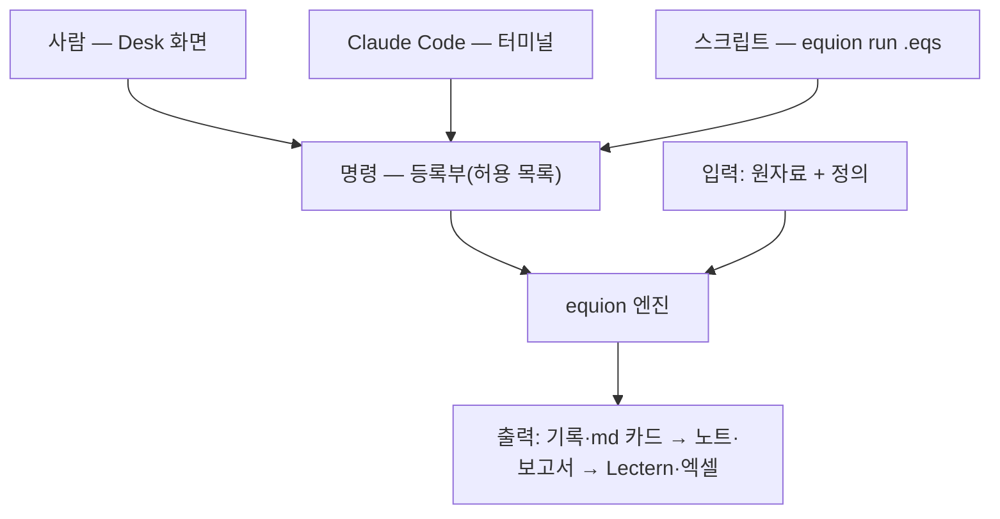

# Equion Desk — 종합 정리: 중요도·효율·충돌·확장성 (2026-11-09)

기획안 4판([`DESK.md`](DESK.md))과 그 뒤에 더한 안들 — 시나리오 평가([`DESK_SCENARIO.md`](DESK_SCENARIO.md)), 분석과 md 결과([`DESK_ANALYSIS.md`](DESK_ANALYSIS.md)),
작업 장면([`DESK_SCENES.md`](DESK_SCENES.md)·[`DESK_SOLO.md`](DESK_SOLO.md)), 자료·저장·갱신([`DESK_DATA.md`](DESK_DATA.md)), 재연성([`DESK_REPRO.md`](DESK_REPRO.md)),
스크립트([`DESK_SCRIPT.md`](DESK_SCRIPT.md)) — 을 한자리에서 정리한다.

**한 장 요약**

- 요청은 열네 가지였고 대부분 **하나의 설계**로 모인다 — **세 입구(사람·Claude·스크립트)가 같은 명령을 부르고, 같은 엔진으로 계산해, 같은 기록(md 카드)을 남긴다.**
- **중요도**: 연립 모형의 추정·HS·전망 고리, 레고, 두 길, 보이는 계산, 설치만 하면 작동, 자료 관리, 재연(스크립트)이 **핵심**이고 모두 1차판에 든다.
  분석 통합·보고서로 보내기는 **중요**(1차판 끝), Lectern 수정·폼 일부·기초 분석 추가는 **2차판**, 머신러닝은 **미래**다.
- **효율**: 품은 적고 가치는 큰 것 — 작업 명령·기록·스크립트·md 렌더러·상대 기간·등록부 — 을 패키지 단계(E)에서 먼저 만든다. 그러면 Desk가 나오기 전에도
  "자료를 넣고 `equion run monthly.eqs`"가 된다.
- **충돌** 열 가지는 모두 풀 길이 있다. 가장 큰 것은 "저절로 계산하지 않는다 ↔ 자료만 넣으면 새 결과"이고, 순서와 판단 규칙을 미리 적은 스크립트로 푼다.
- **확장**: 등록부·부품·md 렌더러·기록 형식의 판 — 네 자리를 E 단계에서 굳히면 새 분석·자료 출처·머신러닝이 그 위에 붙는다.

## 1. 한 장 구조

## 2. 요청 목록과 중요도

| # | 요청 | 중요도 | 담긴 곳 | 1차판에 드는 범위 |
|---|---|---|---|---|
| R1 | 연립방정식 추정·예측 시뮬레이션이 핵심 — 식의 적합 통계·차트, 연립 해, EViews 작업과 비슷하게 AI와 함께 | 핵심 | 기획안 §1·W1~W3 | 전부 |
| R2 | 레고 — 변수·식·모형이 혼자서도, 조립해서도 | 핵심 | K0·W0 | 전부 |
| R3 | 손으로도 Claude로도, 만든 것은 고치고 제안을 받는다 | 핵심 | §2.1~2.3·K5~K7 | 명령·기록·바뀜 기록, 제안 카드는 1차판 끝 |
| R4 | 모든 결과가 보이게 — 뒤에서 몰래 돌지 않게 | 핵심 | §2.4 | 원칙이라 전부 |
| R5 | 설치만 하면 작동 — Python 판과 무관 | 핵심 | §10 | 전부 |
| R6 | Lectern 연계(필수 아님), Lectern도 고칠 수 있다 | 나중 | §8 | 파일 연계(L1~L6)만, Lectern 수정(LC)은 2차판 |
| R7 | 자료 불러오기와 작업 중 생기는 자료를 명시적으로 | 핵심 | K8·자료 탭 | 불러오기 화면·회차·값의 종류, 받아 오기(fetch)는 뒤로 |
| R8 | 회귀 밖 분석(시계열·계절조정 등)을 md 결과로 | 중요 | 분석 탭 | 엔진에 있는 분석을 등록부·카드로, 새 기초 분석은 2차판 |
| R9 | 분석 결과를 보고서 md로 보내기 | 중요 | 분석 탭 §5 | 보내기·새 기록으로 바꾸기, '지난달에서'는 1차판 끝 |
| R10 | Claude 없이도 모든 일 | 핵심 | 혼자 장면 탭 | 핵심 고리는 1차판, 후보 묶음·시나리오 폼은 2차판 초 |
| R11 | 이어 하기·가져오기·자료 업데이트와 그 영향 | 핵심(업데이트)·중요(가져오기) | 자료 탭 | 폴더가 곧 작업, 원자료 바꾸기·회차·다시 추정 비교. 묶어 보내기·이정표는 뒤로 |
| R12 | EViews 프로그램처럼 재연 — 자료만 넣으면 새 결과 | 핵심 | 재연성 탭 | 스크립트 실행·실행 기록·상대 기간 |
| R13 | 명령줄에서도 도는 스크립트, AI와 소통 | 핵심(R12의 형식) | 스크립트 탭 | E 단계에서 먼저 |
| R14 | 나중 머신러닝(scikit-learn) 확장, Keras 제외 | 미래 | 메모 | 막지 않기만 |

## 3. 충돌과 푸는 길

| # | 충돌 | 요청 | 푸는 길 | 남는 비용 |
|---|---|---|---|---|
| C1 | "저절로 계산하지 않는다" ↔ "자료만 넣으면 새 결과" | R4 ↔ R12 | 스크립트에 순서와 판단 규칙을 미리 적고, 실행은 한 번 누를 때. 무엇이 도는지 파일과 실행 기록에 다 보인다 | 스크립트를 한 번은 만들어야 한다 — 작업 기록에서 저절로 만든다 |
| C2 | 계수는 몰래 바뀌면 안 된다 ↔ 새 자료면 다시 추정해야 | R4 ↔ R12 | 평소엔 채택 계수 고정(Q18), 스크립트는 적어 둔 정책(`--adopt if_pass`)으로 다시 추정 — 걸린 식만 사람이 본다 | 채택 기준(`[criteria]`)을 처음에 정해 둬야 한다 |
| C3 | 모든 일을 손으로도 Claude로도 ↔ 만드는 품 | R3·R10 ↔ 효율 | 명령을 먼저 만들고 화면은 같은 함수를 부른다. 등록부 하나가 명령줄 옵션·화면 폼·도움말·AI 안내를 함께 만든다 | 화면은 결국 만들어야 한다 — 단계로 나눈다 |
| C4 | 모든 것이 보인다 ↔ 화면이 시끄럽다 | R4 ↔ 사용성 | 기록은 늘 남기되 알림은 묶고 접는다, 설정으로 정도를 고른다 | 설정 하나 |
| C5 | 설치만 하면 작동(고정 런타임) ↔ 확장(머신러닝·사용자 패키지) | R5 ↔ R14 | 런타임 하나 + 나중에 선택 확장 팩, 고급 사용자는 프로젝트 자체 환경. Keras를 빼서 크기 걱정은 작다 | 확장 팩 배포 경로 |
| C6 | 앱은 Python을 돌리지 않는다(안전) ↔ 스크립트·노트의 Python | 안전 ↔ R12·R13 | Python 단계는 터미널에서만(붙여 넣고 사람이 Enter), `.eqs`는 등록부 명령만 | Python이 든 흐름은 Desk 단추 한 번으로는 돌지 않는다 |
| C7 | 결과는 고치지 않는다 ↔ 보고서는 사람이 고친다 | R4 ↔ R9 | 기록은 불변, 보고서는 사람의 글. 숫자 구역을 새 기록으로 바꿀 때 고친 곳을 차이로 묻는다 | 차이 보기 화면 |
| C8 | 재연에는 원자료가 있어야 ↔ 원자료는 비공개 | R12 ↔ D30·Q9 | 원자료는 프로젝트 폴더에 해시와 함께, git·묶음에는 사람이 고를 때만 | 원자료 보관은 사용자 몫 |
| C9 | Lectern 연계·수정 ↔ Lectern의 범용성 | R6 | 파일로만 잇고, Lectern 수정은 다른 프로젝트에도 쓰이는 일반 기능으로 | 두 저장소의 일정 |
| C10 | 요청이 늘수록 파일 형식이 는다 | 전부 ↔ 단순함 | 형식마다 맡는 일을 나눴다(§8). 흐름은 TOML 대신 스크립트로 줄였다(Q26) | 형식 아홉 가지를 문서로 지켜야 한다 |

## 4. 효율 — 들이는 품 대비 얻는 것

| 기능 | 가치 | 품 | 판단 |
|---|---|---|---|
| 작업 명령 + 기록 | 상 — Desk 전에도 Lectern·터미널에서 Claude와 바로 쓴다 | 중 | **먼저**(E) |
| Equion 스크립트(`.eqs`) | 상 — 재연·AI 소통 | 하 — 명령 위의 얇은 층 | **먼저**(E) |
| md 렌더러 하나 | 상 — 모든 결과가 카드·보고서로 | 하 | **먼저**(E) |
| 상대 기간(`last`·`next:n`) | 상 — 자료만 넣으면 | 하 | **먼저**(E) |
| 분석 등록부 | 상 — 분석 하나를 더하면 네 곳에 | 중 | **먼저**(E) |
| 부품·조립 층·채택표 | 상 — 레고의 바탕 | 중 | **먼저**(E) |
| 자료 정의·회차·불러오기 틀 | 상 | 중상 — 표 모양이 다양하다 | 먼저(E), 흔한 모양부터 |
| W1 식 작업대(1초) | 상 — 가장 많이 쓰는 화면 | 상 | 1차판 |
| 설치본·런타임 | 상 | 중상 — PC 여덟 가지 시험 | 1차판 |
| W0·W2·W3·흐름 화면 | 상 | 상 | 1차판 |
| 불러오기 화면 | 상 | 중 | 1차판 |
| 제안 카드·바뀜 기록 화면 | 중 — Claude에게 맡길 때 안전 | 중 | 1차판 끝 |
| 보고서로 보내기 | 중상 | 중 | 1차판 끝 |
| 노트 실행 블록 화면 | 중 | 중 | 2차판(명령으로는 E에서) |
| 후보 묶음·시나리오 폼 | 중 — Claude 없을 때 | 중 | 2차판 초 |
| 기초 분석 추가 | 중 | 중 | 2차판 |
| Lectern 수정(LC1~LC6) | 하~중 | 중 — 다른 저장소 | 2차판 |
| 묶어 보내기·이정표 | 하~중 | 하~중 | 2차판 |
| ECOS·KOSIS 받기 | 중 | 중 | ROADMAP 0.8 |
| 머신러닝 확장 | 미정 | 상 | 미래 |

## 5. 확장성 — 늘릴 자리

| 늘릴 자리 | 지금 설계 | 늘릴 것의 예 | 지킬 것 |
|---|---|---|---|
| 등록부 | 명령·분석 하나 = 등록 항목 하나 → 명령줄·폼·도움말·AI 안내·허용 목록 | 새 분석, HP 필터, 나중 scikit-learn 분석 | 등록 항목의 모양을 E 단계에서 굳힌다 |
| 부품·조립 | 이름으로 끼우는 부품, 블록 = 식 파일 | 새 블록 종류(예: 나중 머신러닝 식 — 수치 자코비안 블록) | 엔진은 블록 단위로 풀이를 맡는다 |
| 자료 출처 | 원자료 + 불러오기 틀, `data fetch` | ECOS·KOSIS, 다른 표 모양 | 받은 파일은 원자료로 남긴다 |
| 출력 | 출력 객체 → md 렌더러 하나 | 새 표·차트 모양, 다른 문서 형식(Lectern으로) | 결과는 기록, 문서는 렌더 |
| 기록 형식 | 형식 이름과 판(지금 `manifest.json`의 `format_version`처럼) | 필드 추가 | 옛 기록을 계속 읽는다 |
| 패키지와 앱 | `equion-desk → equion` 한쪽 의존(D28) | 다른 화면, 서버에서 스크립트 실행 | 계산은 패키지에만 |
| 스크립트 | 등록부 명령의 줄 | 새 명령이 그대로 스크립트에 | 반복·조건은 넣지 않는다(Q27) |
| 런타임 | 설치 폴더 안 하나, 격리 | 선택 확장 팩(scikit-learn) | 사용자 PC의 Python과 섞이지 않게 |

## 6. 단계 다시 짜기

| 단계 | 담는 것 | 이 단계가 끝나면 사용자는 |
|---|---|---|
| E — 패키지(이 저장소) | 부품·조립·채택표, 자료 정의·회차·불러오기 틀(흔한 모양), 작업 명령 + 기록 + md 카드, 분석 등록부, 스크립트·상대 기간, 보고서·노트 명령 | Lectern 터미널 + Claude로 "자료 넣고 `equion run monthly.eqs`" — Desk 없이 핵심 고리와 재연 |
| D 1차판 | 런타임·설치본, 뼈대(작업 줄·기록 띠·바뀜 알림), W1·W4(불러오기 화면), W0·W2·흐름 화면, W3·보고서로 보내기, 제안 카드·바뀜 기록 화면 | 설치만 하고 손으로도 Claude로도 전체 고리 |
| 2차판 | 노트 실행 블록 화면, 후보 묶음·시나리오 폼, 기초 분석, Lectern 수정, 묶어 보내기·이정표, 회차 비교 고급 | 혼자서도 넓게, 문서 작업까지 매끄럽게 |
| 0.8 | ECOS·KOSIS 받기 | 자료 받기까지 명령 한 줄 |
| 미래 | scikit-learn 확장 팩 | — |

기획안 §9와 달라진 점: 스크립트를 E 단계로 당겼고(효율이 가장 높다), 흐름 화면을 D 1차판에 넣었으며, Lectern 수정(LC)을 2차판으로 미뤘다.
제안 카드·바뀜 기록(D5)은 1차판에 그대로 둔다 — 두 길·보이는 계산의 바탕이라서다.

## 7. 범위 줄이기 — 1차판에서 빼거나 줄일 것

1. 노트의 ▶ 실행 화면 → 1차판은 명령(`equion note run`)과 md 보기만.
2. Lectern 수정 → 파일 연계만(L1~L6).
3. 후보 묶음·시나리오 폼 → 2차판 초. 그 전에는 스크립트·노트에 여러 줄, 시나리오는 파일을 복사해 고친다.
4. 회차 비교의 요인 나누기 → 명령으로만, 화면은 2차판.
5. 이정표·묶어 보내기 → 폴더 복사로 충분.
6. 불러오기 틀 → 시점이 행으로 내려가는 표부터, 시점이 열로 가는 표·여러 머리줄은 다음.
7. 기초 분석 추가(E7) → 2차판.

## 8. 파일 지도

| 파일 | 맡는 것 | 누가 바꾸나 |
|---|---|---|
| `DATA/raw/` | 원자료 — 받은 그대로 | 아무도 — 넣기만 |
| `DATA/series.toml`·`derived.txt` | 시리즈 정의·불러오기 틀 | 사람·Claude(바뀜 기록) |
| `EQUATIONS/*.txt` | 블록 — 식·항등식 | 사람·Claude |
| `EQUATIONS/adopted.toml` | 채택표 — 어느 추정 기록의 계수를 쓰나 | 채택 단추·`adopt`·스크립트의 정책 |
| `equion.toml` | 조립(블록·모형·묶음)·판단 기준·지금 자료 회차 | 사람·Claude |
| `ASSUMPTIONS/`·`ADDFACTORS/`·`SCENARIOS/`·`VIEWS/` | 가정·보정항·시나리오·보기 | 사람·Claude |
| `FLOWS/*.eqs` | 스크립트 — 순서와 판단 규칙 | 사람·Claude·작업 기록에서 |
| `work/` | 기록(불변)·자료 회차·제안·바뀜 기록·초안 | 앱과 명령만 — 덧붙이기 |
| `notes/`·`reports/` | 노트(탐색)·보고서(남이 읽는 글) | 사람·Claude, 숫자 구역은 명령 |

## 9. 정할 것 29개 — 언제 정하나

| 언제 | 질문 | 추천 요지 |
|---|---|---|
| **E 단계 전(지금)** | Q0 부품 위치 · Q2 작업 기록 · Q4 파일 형식 · Q5 순서 · Q11 분석 기록 · Q15 분석 명령 이름 · Q18 계수 · Q19 회차를 적는 곳 · Q22·Q26 흐름의 형식 · Q23 흐름의 다시 추정 · Q24 상대 기간 · Q27 반복·조건 | 블록 = 식 파일, 조립은 `equion.toml` · 계산마다 기록 · TOML + CSV · E 먼저 · 분석마다 기록 · `equion an` · 채택 계수 고정 · `equion.toml` · 스크립트(`.eqs`) · `if_pass` · 상대 표기 허용 · 넣지 않음 |
| D 단계 전 | Q1 앱 안 계산 · Q3 바뀜 기록 · Q6 런타임 · Q7 오프라인 · Q8 회차 만들기와 바꾸기 · Q9 git · Q12·Q13 노트 · Q16·Q17 보고서 · Q20 묶음의 원자료 · Q21 초안 · Q28 종료 코드 | 명령이 있을 때만 앱 안에서 · `work/history/`에 늘 · 설치 폴더 안 런타임 하나 · 기본 설치본 하나 · 나눈다 · 정의만 넣는다 · 펼친 md, Python은 터미널 · 보고서 옆 폴더로 복사, 누를 때만 갱신 · 묶을 때마다 묻는다 · 초안으로 · 지금 약속 안에서 |
| 나중 | Q10 Lectern 수정 · Q14 기초 분석 · Q25 판이 다를 때의 재연 | 2차판에서 |

**추천대로 확정해도 되는지 한마디면** 결정 기록(`DECISIONS.md`)과 `ROADMAP.md`에 옮긴다. 다른 길을 고를 것만 번호로 알려 주면 된다.
