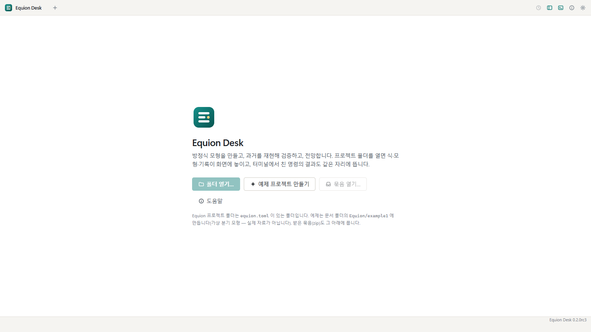
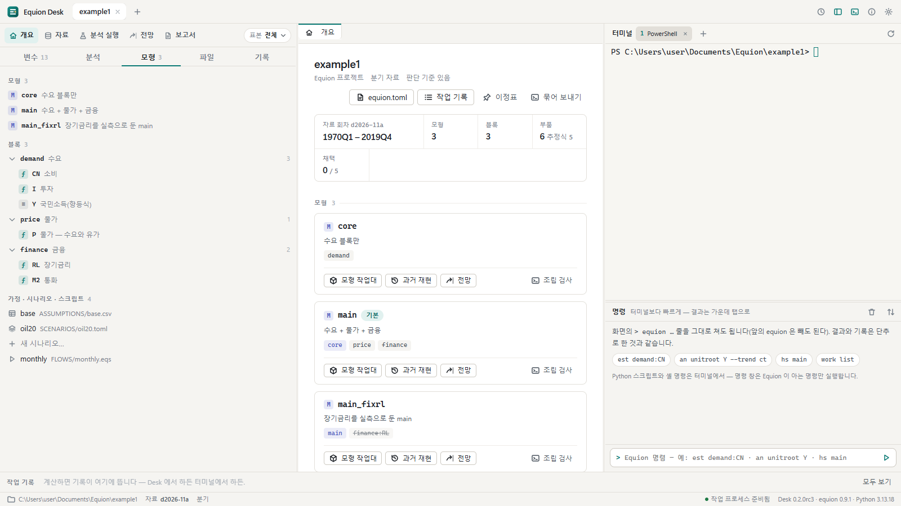
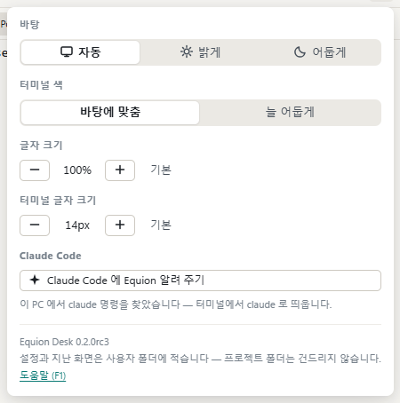
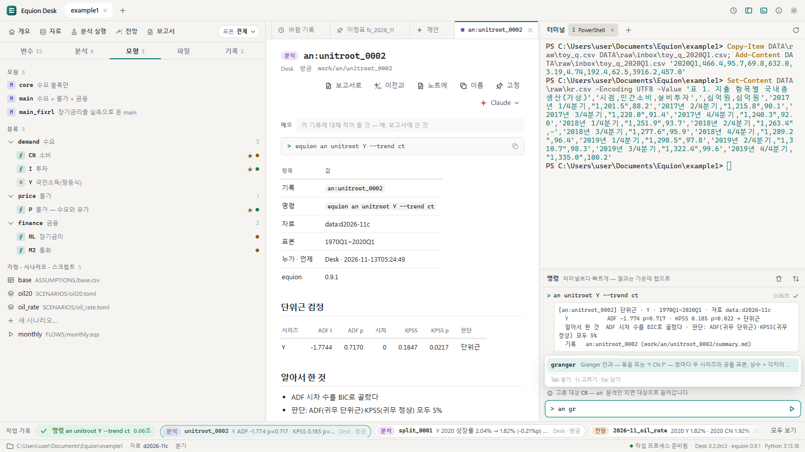

# 1. 설치와 첫 화면

이 장에서는 Equion Desk를 설치하고, 예제 프로젝트를 만들어 화면을 둘러봅니다. 설정(글자 크기 · 터미널 · 바탕)과 명령 창도 여기서 익힙니다.

## 1.1 설치

1. 저장소의 **Releases**에서 `EquionDesk-<판>-setup.exe`를 받습니다(태그 `desk-v…`). 대상은 **Windows 11 64비트**입니다
   (화면을 그리는 WebView2가 Windows 11에 들어 있습니다).
2. 받은 파일을 엽니다. 서명이 없는 앱이라 처음에는 'Windows의 PC 보호' 창이 뜹니다 — **추가 정보 → 실행**.
3. 설치 마법사에서 고를 것은 둘입니다.
   - **탐색기 폴더 우클릭에 'Equion Desk로 열기' 추가**(기본으로 켜짐) — 프로젝트 폴더를 우클릭해 바로 엽니다.
   - **바탕화면에 바로가기 만들기**(기본으로 꺼짐).
4. **사용자별 설치**라 관리자 권한이 필요 없습니다. 설치 폴더(기본 `%LOCALAPPDATA%\Programs\EquionDesk`) 안에 Python과 패키지
   `equion`이 함께 들어 있어서, PC에 Python이 없어도 되고 있어도 건드리지 않습니다. 인터넷 없이 돕니다.
5. 시작 메뉴의 **Equion Desk**로 띄웁니다. 지울 때는 Windows 설정의 '앱'에서 Equion Desk를 제거합니다 — 프로젝트 폴더와 설정은 남습니다.

> 회사 PC에서 프로그램 실행을 허용 목록으로 관리한다면, Desk는 설치 폴더의 `runtime\pythonw.exe`로 뜬다는 것을 알려 두세요.

## 1.2 첫 화면과 예제 프로젝트

프로젝트를 열지 않고 띄우면 첫 화면이 나옵니다.

| 단추 | 하는 일 |
|---|---|
| **폴더 열기…** | Equion 프로젝트 폴더(`equion.toml`이 있는 폴더)를 고릅니다 |
| **예제 프로젝트 만들기** | 문서 폴더의 `Equion\example1`에 예제를 만들고 엽니다(두 번째부터는 `example2`, …) |
| **묶음 열기…** | 다른 사람이 보낸 프로젝트 묶음(zip)을 문서 폴더의 `Equion` 아래에 풀어 엽니다([8장](08-records.md)) |
| **도움말** | 앱 안의 도움말(`F1`과 같습니다) |

**예제 프로젝트 만들기**를 누릅니다. 몇 초 뒤 프로젝트가 탭으로 열립니다.

예제는 가상 분기 모형입니다(실제 통계가 아닙니다). 왼쪽의 **모형** 탭을 누르면 위 그림처럼 구성이 보입니다.

| 구성 | 내용 |
|---|---|
| 블록 `demand`(수요) | `CN` 소비 · `I` 투자(추정식), `Y` 국민소득(항등식 `Y = CN + I + G`) |
| 블록 `price`(물가) | `P` 물가 — 수요와 유가 |
| 블록 `finance`(금융) | `RL` 장기금리 · `M2` 통화 |
| 모형 | `core`(수요 블록만) · `main`(세 블록 — 기본) · `main_fixrl`(장기금리를 실측으로 둔 main) |
| 가정 · 시나리오 · 스크립트 | `base`(전망 가정 `ASSUMPTIONS/base.csv`) · `oil20`(유가 20% 시나리오) · `monthly`(매달 하는 일 `FLOWS/monthly.eqs`) |

식 옆의 점은 가장 최근 추정이 판단 기준을 통과했는지(초록) 걸렸는지(주황)이고, ★는 채택한 식입니다. 아직 아무것도 추정하지 않았으므로
처음에는 점이 없습니다.

> 내 프로젝트를 처음 만들 때는 터미널에서 `equion new 폴더 --template desk`로 틀을 만들고 원자료와 식을 옮깁니다 —
> 패키지 문서의 [가이드 2. 내 모형을 프로젝트로](../guide/02-my-model.md).

## 1.3 화면의 세 열

| 열 | 무엇 | 어떻게 |
|---|---|---|
| 왼쪽 | 작업대 줄과 탭 다섯 — 무엇을 할지 고르는 곳 | 위의 **작업대 줄**(개요 · 자료 · 분석 실행 · 전망 · 보고서)은 작업대를 엽니다. 아래 **탭**은 대상(변수 · 분석 · 모형 · 파일 · 기록)의 목록입니다 |
| 가운데 | 작업대와 결과 — 일을 하는 곳 | 탭으로 여러 개를 열어 둡니다. `Ctrl+W`로 닫고, 다시 열면 보던 화면이 이어집니다. 저장하지 않은 고침(정의 파일 · 시나리오 폼 · 가정 표)이 있는 탭은 닫기 전에 묻습니다 |
| 오른쪽 | 터미널과 명령 창 | 위는 PowerShell 터미널, 아래는 Equion 명령 한 줄 창. 위아래 자리는 명령 창 머리의 ⇅로 바꿉니다 |

이름을 정하는 상자(새 모형 · 새 블록 · 묶음 · 이정표 · 보고서 · 보기)는 이름의 규칙(영문 · 숫자로 시작 …)을 옆에 보이고, 맞지 않으면 확인 단추를
꺼 둡니다. `Enter`는 확인입니다.

열의 경계를 끌면 폭이 바뀌고, 두 번 누르면 기본(창이 넓으면 1/3씩, 좁으면 가운데를 540px로 지킵니다)으로 돌아갑니다. 맨 위 오른쪽의
단추로 왼쪽 열과 오른쪽 열을 숨기면 가운데가 넓어집니다(`` Ctrl+` ``는 오른쪽 열). 이 설명서의 작업대 그림 가운데 몇 장은 오른쪽 열을
숨겨 가운데를 넓힌 모습입니다.

아래쪽의 **작업 기록 띠**에는 계산할 때마다 새 기록이 한 칸씩 생깁니다 — Desk에서 누른 것이든, 터미널에서 친 명령이든 같습니다.
칸을 누르면 그 결과 카드가 열립니다. 맨 아래 **상태줄**은 프로젝트 폴더 · 지금 자료 회차 · 작업 프로세스(계산하는 프로세스 — 초록이면 준비됨) · 판입니다.

## 1.4 설정

맨 위 오른쪽의 톱니를 누릅니다.

| 설정 | 고를 것 |
|---|---|
| 바탕 | 자동(Windows 설정을 따름) · 밝게 · 어둡게 |
| 터미널 색 | 바탕에 맞춤 · 늘 어둡게 |
| 글자 크기 | 화면 전체 — 80~140%, 5%씩 |
| 터미널 글자 크기 | 터미널만 — 10~24px, 1px씩(기본 14px). 열려 있는 터미널에도 바로 맞습니다 |
| Claude Code | **Claude Code에 Equion 알려 주기** — [9장](09-claude.md) |

설정과 지난 화면(열어 둔 탭)은 사용자 폴더(`%APPDATA%\EquionDesk`)에 적습니다. 프로젝트 폴더에는 설정을 쓰지 않으므로, 프로젝트를
다른 사람과 나눠도 내 화면 설정은 따라가지 않습니다.

## 1.5 명령 창과 터미널

오른쪽 열 아래의 **명령 창**에는 Equion 명령을 한 줄 칩니다. 앞의 `equion`은 빼도 됩니다.

1. 명령 창을 누르고 `an unitroot Y --trend ct`를 치고 `Enter` — 단위근 검정이 돌고, 결과가 가운데 탭으로 열립니다.
2. `an gr`까지 치면 다음 낱말의 후보가 뜹니다(`Tab`으로 채움). `↑` `↓`는 지난 명령입니다.
3. 실행한 명령은 창에 한 줄씩 남습니다 — 성공은 초록, 틀린 명령은 까닭과 함께 붉게.

명령 창은 터미널과 같은 일을 하고 같은 기록을 남기지만, 이미 떠 있는 계산 프로세스가 바로 하므로 빠릅니다(0.1초 안팎). Python
스크립트(`equion run x.py`), 셸 명령, 다른 프로젝트(`-p`)는 명령 창에서 하지 않고 터미널에서 합니다.

**터미널**은 프로젝트 폴더에서 뜨는 PowerShell입니다. 여기서 치는 `equion`과 `python`은 Desk에 든 것이라 따로 설치하지 않아도 됩니다.
머리의 `+`로 다섯 개까지 더하고, 탭의 `×`로 끝냅니다. 1번 터미널은 Claude Code를 띄우는 자리로 씁니다([9장](09-claude.md)).

> 이 설명서의 그림은 터미널의 프롬프트가 `PS C:\Users\user\Documents\Equion\example1>`로 보이게 찍었습니다. 여러분의 화면에는 실제 폴더가 보입니다.

## 1.6 도움말

`F1`(또는 맨 위의 ⓘ)은 앱 안의 도움말입니다 — 화면의 자리 · 핵심 고리 · 되돌리기 · Claude와 함께 · 같은 일을 하는 명령 · 손버릇을 한 장에 적었습니다.

## 같은 일을 하는 명령

| 화면에서 | 터미널에서 |
|---|---|
| 예제 프로젝트 만들기 | `equion new example1 --template desk` |
| 폴더 열기 | `equion-desk 폴더`(Desk가 떠 있으면 그 창의 새 탭으로) — 또는 탐색기에서 폴더 우클릭 → **Equion Desk로 열기** |
| 명령 창의 한 줄 | 같은 줄을 터미널에서 `equion …`으로 |

## 확인할 것

- [ ] 첫 화면에서 '예제 프로젝트 만들기'로 `example1`이 열린다
- [ ] 모형 탭에 모형 3개, 블록 3개(식 6개)가 보인다
- [ ] 설정에서 터미널 글자 크기를 키우면 열린 터미널의 글자가 바로 커진다
- [ ] 명령 창에서 `an unitroot Y`를 치면 결과 탭이 열리고 아래 작업 기록 띠에 `unitroot_…`가 생긴다

다음: [2. 자료](02-data.md)
