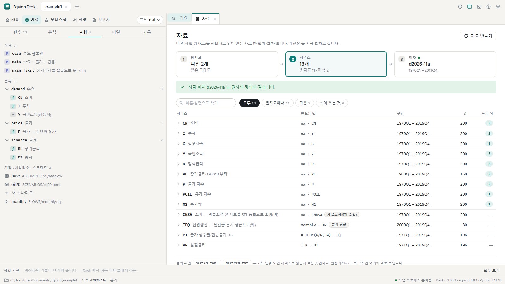
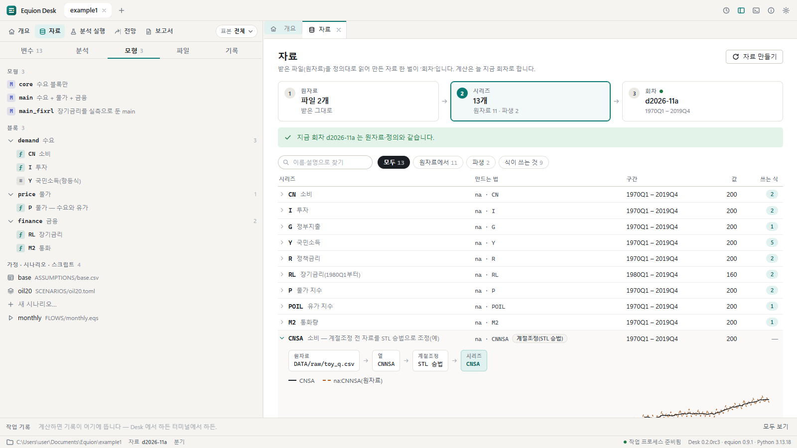
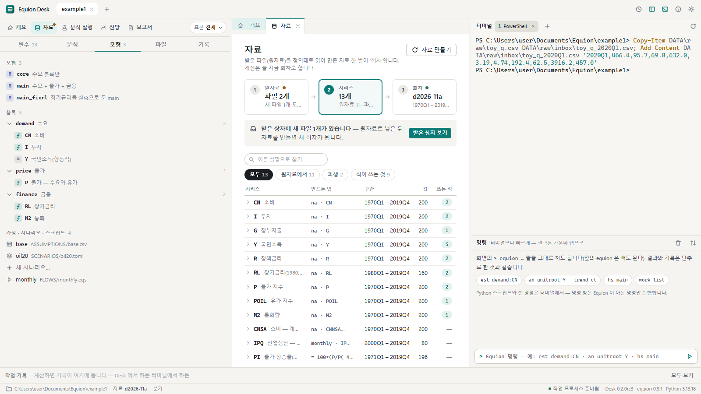
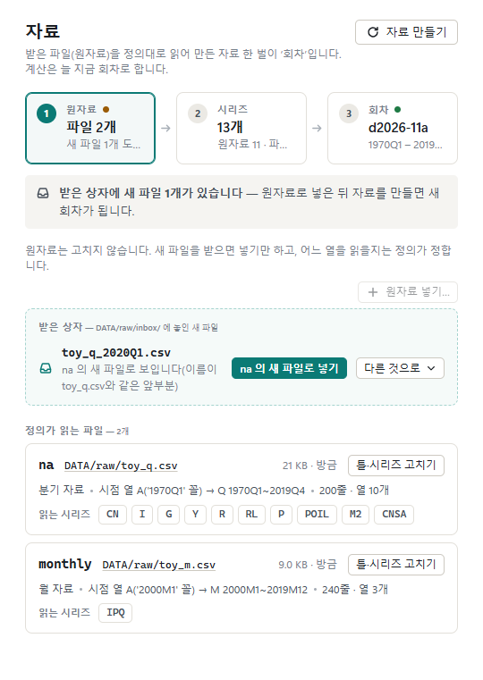
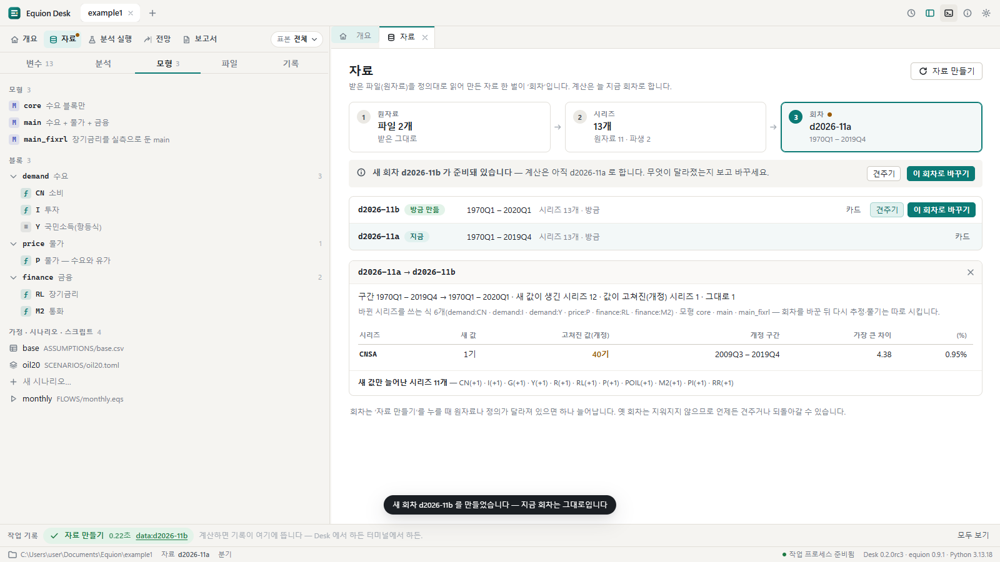
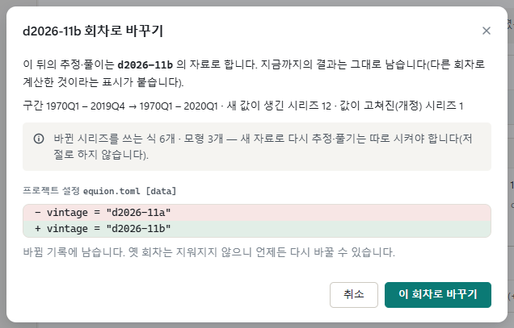
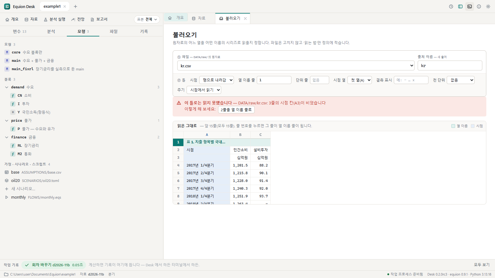
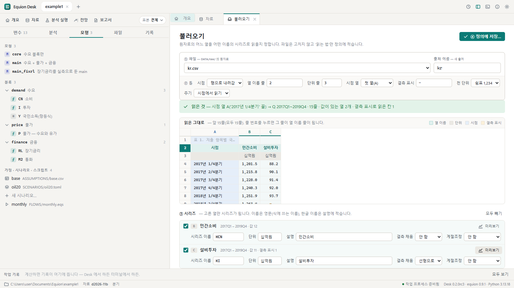
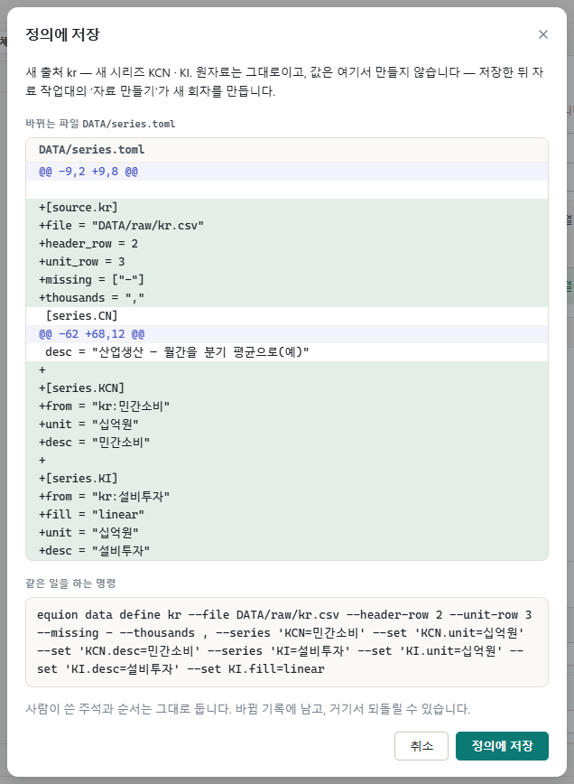

# 2. 자료

이 장에서는 자료가 어떻게 만들어지는지 보고, 새로 받은 원자료를 넣어 **새 회차**를 만들어 견준 뒤 바꿉니다. 마지막으로 처음 보는
통계표를 불러와 시리즈로 짝짓습니다.

## 2.1 원자료 → 시리즈 → 회차

Equion은 받은 파일을 고치지 않습니다. 받은 그대로 `DATA/raw/`에 두고(원자료), 어느 열을 어떤 이름의 시리즈로 읽을지를 자료 정의
(`DATA/series.toml`)에 적습니다. **자료 만들기**를 누르면 정의대로 읽어 자료 한 벌을 만들고 이름을 붙입니다 — 이것이 **회차**입니다
(`d2026-11a`처럼 만든 달과 글자). 추정·과거 재현·전망은 늘 **지금 회차**로 하고, 옛 회차는 지우지 않으므로 언제든 견주거나 되돌아갑니다.

## 2.2 자료 작업대

왼쪽 위 작업대 줄의 **자료**를 누릅니다.



- 위의 세 칸이 ① 원자료 → ② 시리즈 → ③ 회차입니다. 칸을 누르면 그 층의 목록이 아래에 나옵니다. 칸의 점은 할 일이 있다는 표시입니다.
- 시리즈 목록에는 시리즈마다 **만드는 법**(어느 원자료의 어느 열, 또는 파생식) · 구간 · 마지막 값 · **쓰는 식**의 수가 있습니다.
- 위의 찾기 칸은 이름과 설명을 함께 찾습니다(`금리`를 치면 `R`·`RL`). 묶음 단추(원자료에서 · 파생 · 식이 쓰는 것)로 가려 봅니다.

시리즈 줄을 누르면 펼쳐집니다. `CNSA`(계절조정 전 소비 — 원자료 열 `CNNSA`를 STL로 조정한 것)를 눌러 봅니다.



**내력**은 이 시리즈가 어디서 어떻게 왔는지를 한 줄로 보입니다. 차트는 원자료 값과 만든 시리즈를 겹쳐 그립니다. 아래의 단추로 이
시리즈를 계절조정하거나 변수 창으로 엽니다.

## 2.3 새 원자료 받기

새 분기 자료가 왔다고 해 봅시다. 받은 파일은 `DATA/raw/inbox/`(받은 상자)에 넣습니다. 따라 하기 위해, 오른쪽 터미널에 다음 한 줄을
붙여 넣고 `Enter` — 예제 원자료를 복사해 2020년 1분기 한 줄을 더한 파일을 받은 상자에 만듭니다.

```powershell
Copy-Item DATA\raw\toy_q.csv DATA\raw\inbox\toy_q_2020Q1.csv; Add-Content DATA\raw\inbox\toy_q_2020Q1.csv '2020Q1,466.4,95.7,69.8,632.0,3.19,4.74,192.4,62.5,3916.2,457.0'
```

실제로는 받은 엑셀·CSV 파일을 탐색기에서 `DATA\raw\inbox\`로 끌어다 놓으면 됩니다. 파일 이름이 지금 원자료의 이름으로 시작하면
(`toy_q.csv` → `toy_q_2020Q1.csv`, `toy_q_2026-12.csv`) 그 출처의 새 판으로 짝짓습니다.

Desk는 폴더를 지켜보다가 바로 알립니다.



**받은 상자 보기**를 누르면 파일마다 어느 출처의 새 판으로 보이는지와 그 까닭(이름의 같은 앞부분)이 나오고, 그 아래에 정의가 지금 읽는
파일들의 틀(주기 · 시점 열 · 구간 · 읽는 시리즈)이 있습니다.



**na 의 새 파일로 넣기**를 누릅니다(짝이 틀렸으면 '다른 것으로 ▾'). 넣기 전에 그 출처의 틀로 읽히는지(쓰는 열이 다 있는지, 주기가
같은지, 단위 줄 자리에 값이 오지 않았는지) 검사하고, 맞으면 파일을 `DATA/raw/`로 옮겨 출처가 새 파일을 읽게 합니다(정의 파일의 바뀜으로
기록됩니다). 아직 자료는 그대로입니다. 새 파일에 정의가 읽지 않는 새 열이 있으면 그 열을 시리즈로 정의하는 명령을 함께 권합니다.

## 2.4 자료 만들기와 견주기

넣고 나면 '자료 만들기'를 권합니다. **자료 만들기**를 누릅니다.



새 회차(`d2026-11b`)가 생기지만 **지금 회차는 그대로**입니다. 아래 상자가 두 회차의 차이입니다.

- 구간이 `2019Q4`에서 `2020Q1`로 늘었고, 새 값이 생긴 시리즈와 **값이 고쳐진(개정) 시리즈**를 나눠 보입니다.
- 이 예에서는 원자료의 과거 값을 고치지 않았는데도 `CNSA`가 개정됐습니다 — 계절조정 시리즈는 새 관측이 오면 과거의 조정값도 조금 바뀌기 때문입니다.
  어느 구간이 얼마나(가장 큰 차이와 %) 바뀌었는지가 보입니다.
- **바뀐 시리즈를 쓰는 식**과 모형이 함께 나옵니다 — 회차를 바꾼 뒤 무엇을 다시 추정하고 풀어야 하는지 미리 압니다.

원자료나 정의가 그대로면 자료 만들기를 눌러도 새 회차가 생기지 않습니다(내용이 같으면 같은 회차입니다).

> **자료가 짧아지면 묻습니다.** 받은 파일이 최근 몇 해만 담았거나 지난달 파일이 다시 와서, 새 자료의 어느 시리즈가 지금 회차보다 늦게 시작하거나
> 일찍 끝나면 자료 만들기는 아무것도 바꾸지 않고 멈춰, 어느 시리즈가 얼마나 짧아지는지 보입니다. 맞는 일이면(정말로 앞 기간을 버리는 경우)
> 그래도 만들기를 고릅니다(터미널은 `equion data build --allow-shorter`). 매달 흐름 안에서는 그 단계에 `!`를 남기고 지금 회차로 이어 갑니다.

## 2.5 이 회차로 바꾸기

**이 회차로 바꾸기**를 누릅니다.



`equion.toml`의 어느 줄이 바뀌는지와 같은 일을 하는 명령을 먼저 보입니다. 바꾸는 것은 설정 한 줄뿐이고 **다시 추정하거나 풀지는
않습니다** — 그 일은 따로 합니다. 확인을 누르면 상태줄의 회차가 바뀝니다.

바꾼 뒤 채택한 식이나 과거 재현 기록이 옛 회차로 계산된 것이면, 자료 작업대에 **할 일**이 뜹니다 — 옛 자료로 추정한 채택 계수, 옛 자료로
푼 과거 재현. '다시 추정해 견주기'는 채택할 때와 같은 방법(표본 · 표준오차 · 추정법)으로 다시 추정해 기록만 남기고 옛·새 계수를 나란히 보이며,
고른 식만 새 계수로 채택합니다. 더 옛 회차나 끝이 더 이른 회차로 바꾸면 그렇다고 알립니다(되돌아가는 것이 맞는지 보라는 뜻). 미리 골라 두는 것은 기준을 통과한 식뿐입니다 — '걸러짐' · '판단 못 함'(검정이 없는 추정법) · '식이 다름'(블록 파일의
식이 채택할 때와 달라짐)은 사람이 보고 고릅니다. 언제든 회차 목록의
옛 회차에서 **이 회차로 바꾸기**를 누르면 돌아갑니다.

## 2.6 새 통계표 불러오기

이번에는 처음 보는 통계표를 시리즈로 만듭니다. 통계 사이트에서 받은 표처럼 위에 제목 줄이 있고, 열 이름 아래에 단위 줄이 있고, 시점이
`2017년 1/4분기` 꼴이며, 숫자에 천 단위 쉼표가 있고, 빈 칸이 `-`인 표입니다. 터미널에 다음 한 줄을 붙여 넣고 `Enter`:

```powershell
Set-Content DATA\raw\kr.csv -Encoding UTF8 -Value '표 1. 지출 항목별 국내총생산(가상)','시점,민간소비,설비투자',',십억원,십억원','2017년 1/4분기,"1,201.5",88.2','2017년 2/4분기,"1,215.8",90.1','2017년 3/4분기,"1,228.0",91.4','2017년 4/4분기,"1,240.3",92.0','2018년 1/4분기,"1,251.9",93.7','2018년 2/4분기,"1,263.4",-','2018년 3/4분기,"1,277.6",95.9','2018년 4/4분기,"1,289.2",96.4','2019년 1/4분기,"1,298.5",97.8','2019년 2/4분기,"1,310.7",98.3','2019년 3/4분기,"1,322.4",99.6','2019년 4/4분기,"1,335.0",100.2'
```

1. 자료 작업대의 **① 원자료** 칸을 누르면, 정의가 아직 읽지 않는 파일로 `kr.csv`가 보입니다. 그 줄의 **불러오기**를 누릅니다.
2. 불러오기 화면은 **읽은 그대로의 표**와, 읽지 못한 까닭, 해 볼 틀을 권하는 단추를 보입니다.

   

3. 권하는 단추를 차례로 누릅니다 — 열 이름 줄(2) · 단위 줄(3) · 천 단위(쉼표) · 결측 표시(`-`). 누를 때마다 표에 그 줄과 칸이 색으로
   표시되고, 다 맞으면 초록 띠에 '읽은 것'(시점 꼴 · 주기 · 구간 · 값이 있는 열)이 나옵니다. 틀은 위의 칸(시점 · 열 이름 줄 · 단위 줄 ·
   시점 열 · 결측 표시 · 천 단위 · 주기)에서 직접 고쳐도 됩니다.
4. 아래 **③ 시리즈**에서 쓸 열을 고르고 시리즈 이름을 적습니다 — 식에 쓰는 이름이라 영문입니다(`KCN`, `KI`). 한글 열 이름은 설명으로,
   단위 줄은 단위로 자동으로 들어갑니다. `설비투자`는 가운데 빈 칸이 있으니 **결측 채움**을 '선형으로'로 고르고 **미리보기**를 누르면
   원자료와 만든 값을 겹쳐 보입니다.

   

5. 오른쪽 위 **정의에 저장…**을 누르면 `series.toml`에 적힐 줄(차이)과 같은 일을 하는 명령(`equion data define …`)을 먼저 보입니다.

   

6. 저장하면 자료 작업대의 시리즈 목록에 `KCN`·`KI`가 '회차에 없음'으로 나오고 '자료 만들기'를 권합니다. 자료 만들기 → 견주기 → 이 회차로
   바꾸기(2.4~2.5)를 하면 식에서 쓸 수 있습니다.

> **시점이 열로 가는 표**(줄마다 시리즈 하나, 시점이 오른쪽으로 늘어선 표)는 틀의 '시점'에서 **열로 감**을 고르고 시점 줄과 이름 열을
> 정합니다. 머리줄이 두 줄 이상이면 '열 이름 줄'에 `3,4`처럼 적거나 줄 번호를 `Shift`+누릅니다 — 위 줄의 병합 칸을 이어 붙인 이름이 됩니다.

> **보안 프로그램(DRM)이 걸린 파일**은 읽지 못합니다. 보안을 푼 사본이나, 엑셀에서 CSV로 다시 저장한 파일을 받은 상자에 넣으세요.

## 같은 일을 하는 명령

| 화면에서 | 터미널에서 |
|---|---|
| 회차 목록 · 지금 회차 | `equion data list` |
| 받은 상자 보기 · 넣기 | `equion data inbox` · `equion data build --inbox ask` |
| 자료 만들기 | `equion data build`(짧아지는 자료를 받아들일 때: `--allow-shorter`) |
| 견주기 · 바뀐 시리즈를 쓰는 식 | `equion data diff d2026-11a d2026-11b` · `equion data impact` |
| 이 회차로 바꾸기 | `equion data use d2026-11b`(만들면서 바로: `equion data build --use`) |
| 불러오기 — 읽어 보기 · 정의에 저장 | `equion data preview DATA/raw/kr.csv` · `equion data define kr --file DATA/raw/kr.csv --header-row 2 --unit-row 3 --thousands , --missing - --series KCN=민간소비 --series KI=설비투자 --set KI.fill=linear`(화면의 '정의에 저장…' 상자가 지금 틀 그대로의 명령을 보입니다) |

## 확인할 것

- [ ] 받은 상자에 파일을 넣으면 자료 작업대에 '받은 상자에 새 파일 1개'가 뜬다
- [ ] 자료 만들기 뒤 지금 회차는 그대로이고, 견주기에 구간 `2020Q1`과 바뀐 시리즈를 쓰는 식이 보인다
- [ ] 이 회차로 바꾸면 상태줄의 회차가 바뀐다
- [ ] 불러오기에서 권하는 단추를 누르면 초록 띠에 'Q 2017Q1~2019Q4'가 나온다
- [ ] 정의에 저장하면 `KCN`·`KI`가 시리즈 목록에 '회차에 없음'으로 보인다

이전: [1. 설치와 첫 화면](01-start.md) · 다음: [3. 변수와 분석](03-analysis.md)
