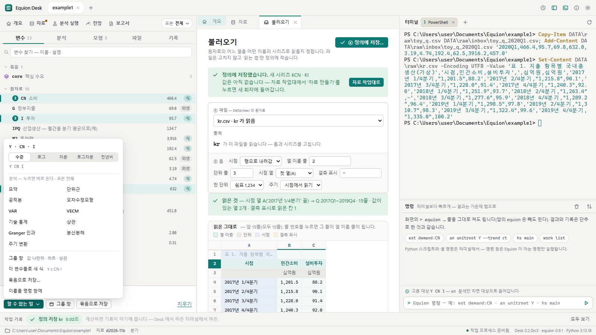
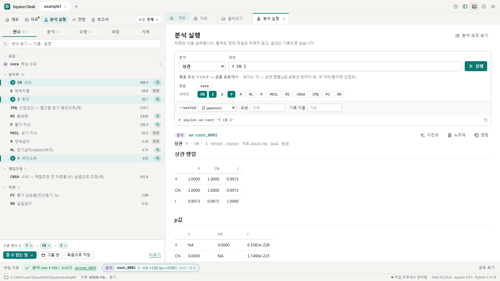
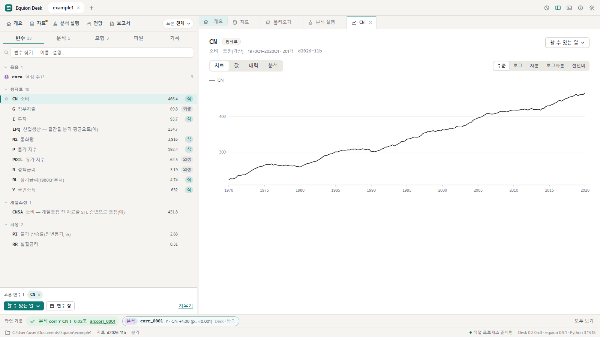
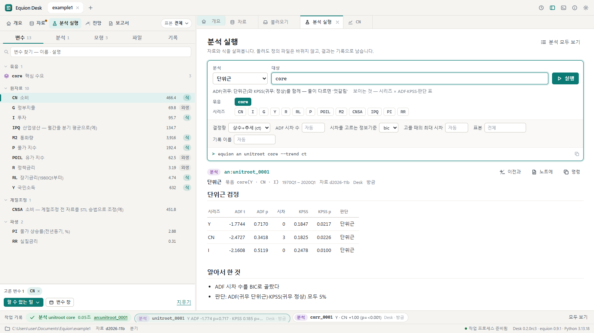

# 3. 변수와 분석

식을 세우기 전에 자료를 살펴봅니다. 이 장에서는 변수를 골라 분석을 바로 돌리고, 변수 창으로 한 변수를 자세히 보고, 분석 실행 화면에서
옵션을 정해 돌립니다. 분석은 **정의 파일을 바꾸지 않고** 결과를 기록(`an:`)으로만 남깁니다.

## 3.1 변수 탭에서 고르기

왼쪽의 **변수** 탭을 누릅니다. 묶음 · 원자료 · 계절조정 · 파생으로 나뉜 시리즈 목록이 나오고, 줄마다 설명 · 마지막 값 · 모형과의 관계
(`식` — 모형에 식이 있는 내생, `외생` — 모형이 쓰지만 식이 없는 것)가 있습니다. 위의 찾기 칸은 이름과 설명을 함께 찾습니다.

1. `Y`를 누릅니다(고름).
2. `Ctrl`을 누른 채 `CN`, `I`를 누릅니다 — 여럿 고르기. `Shift`+누르기는 사이를 모두 고릅니다.
3. 고른 차례가 번호로 보이고, 아래 **고른 변수** 줄에 칩으로 모입니다. 칩을 끌어 차례를 바꿉니다(오차수정모형은 첫 변수가 목표, VAR은 이 차례).

## 3.2 '할 수 있는 일'

**할 수 있는 일 ▾**(또는 고른 변수의 우클릭)을 누르면, 고른 수에 맞는 분석만 나옵니다.

- 맨 위의 변환(수준 · 로그 · 차분 · 로그차분 · 전년비)을 고르면 대상이 `log(Y)`처럼 바뀝니다.
- 하나를 골랐으면 기술 통계 · 자기상관 · 단위근 · 계절조정 …, 여럿이면 상관 · 공적분 · Granger 인과 · VAR · VECM … 이 나옵니다.
- 분석을 누르면 **지금 표본**(작업대 줄 오른쪽 끝, 처음은 '전체')으로 바로 돌고, 결과가 분석 실행 탭에 열립니다.
- 아래쪽: **그룹 창**(값 나란히 · 차트 · 상관) · **이 변수들로 새 식**(식 작업대에 `Y c CN I`) · **묶음으로 저장…**(이름 하나로 — `equion.toml`의 `[group]`.
  이미 있는 이름이면 알리고 단추가 '바꿔 저장'이 됩니다) · **이름을 명령 창에**.
- 여럿을 고른 채 그 가운데 하나를 우클릭해도 같은 메뉴(고른 것 모두)가 뜹니다. 계수표 · 전망 표 · 과거 재현 표의 변수 이름을 우클릭하면 그 변수 하나의 메뉴입니다.
- 마우스로 고른 뒤에도 `↑` `↓`로 옮기고 `Shift+↓`로 넓히고 `Space`로 고릅니다.

**상관**을 누릅니다.

결과 머리의 `an:corr_0001`이 이 분석의 기록입니다. 위의 폼에는 같은 분석의 대상 · 옵션과 **같은 일을 하는 명령**
(`equion an corr 'Y CN I'`)이 있어, 대상이나 옵션을 바꿔 다시 돌릴 수 있습니다. 결과 머리 오른쪽의 단추:

| 단추 | 하는 일 |
|---|---|
| **이전과** | 같은 분석 · 같은 대상의 앞 기록과 나란히 — 무엇이 달랐는지(표본 · 회차)와 판단이 바뀐 줄을 강조합니다 |
| **노트에** | 이 기록을 노트에 담습니다 — 다음 회차에 노트를 다시 실행하면 같은 분석을 새 자료로 돕니다([7장](07-reports.md)) |
| **명령** | 같은 일을 하는 명령을 복사합니다 |

## 3.3 변수 창

변수 이름을 **두 번 누르면** 변수 창이 열립니다. `CN`을 두 번 누릅니다.

| 탭 | 무엇 |
|---|---|
| 차트 | 시리즈의 그림. 오른쪽의 수준 · 로그 · 차분 · 로그차분 · 전년비는 **화면에서만** 바꿔 봅니다(자료는 그대로) |
| 값 | 기간마다의 값 |
| 내력 | 원자료 → 열 → 변환 → 시리즈 |
| 분석 | 이 변수로 자주 하는 분석을 그 자리에서 돌리고 결과를 봅니다(기록 `an:`으로 남습니다) |

여럿을 고르고 '그룹 창'을 누르면 같은 꼴의 창이 여러 변수로 열립니다(차트 · 값 나란히 · 상관 · 분석).

## 3.4 분석 실행 화면

작업대 줄의 **분석 실행**은 분석을 고르고 옵션을 정해 돌리는 화면입니다. 처음 열면(또는 오른쪽 위 **분석 모두 보기**) 등록된 분석이
갈래마다 한 줄씩 보입니다 — 무엇을 보이는 분석인지, 정의나 식 후보를 **만드는** 분석인지가 함께 적혀 있습니다.

**단위근**을 고르고, 대상에서 묶음 `core`를 누르고, 추세를 `ct`(상수와 추세)로 고른 뒤 `Ctrl+Enter`(또는 실행):

- 대상 칸 아래의 이름(묶음 · 시리즈)을 누르면 대상에 들어갑니다. 직접 적어도 됩니다(`Y CN`, `log(Y)`).
- 옵션 줄 아래의 명령 줄(`equion an unitroot core --trend ct`)은 실행 전에 보이고, 실행한 기록의 명령과 글자까지 같습니다.
- **표본**을 비우면 전체, `1990Q1:last`처럼 적으면 그 구간입니다. **기록 이름**을 적으면 자동 번호 대신 그 이름으로 남깁니다.
- 숫자 옵션(시차 · 차수 · 반복 수 …)은 받을 수 있는 범위를 벗어나면 붉게 표시하고 실행하지 않습니다.

## 3.5 만드는 분석 — 정의로 남기기

계절조정 · 파생 시리즈(genr) · 오차수정모형 · 시스템 추정처럼 무언가를 **만드는** 분석은 먼저 미리보기로 돌고 아무것도 바꾸지 않습니다.
마음에 들면 결과 머리의 **정의로 남기기**(새 시리즈 정의 → `series.toml`) 또는 **식 후보로 남기기**(그 부품의 후보 → 식 작업대)를 누릅니다.
무엇이 어느 파일에 적히는지 먼저 보이고 나서 씁니다. 예를 들어 자료 작업대에서 `CN`을 펼쳐 **계절조정**을 누르면 분석 실행 화면이 그
시리즈로 열려 미리보기를 돌리고, 정의로 남기기에서 이름(`CN_SA`)을 주면 다음 자료 만들기부터 그 시리즈가 생깁니다.

## 같은 일을 하는 명령

| 화면에서 | 터미널에서 |
|---|---|
| 분석 목록 | `equion an list` |
| 상관 · 단위근 | `equion an corr 'Y CN I'` · `equion an unitroot core --trend ct` |
| 표본을 정해 | `equion an unitroot Y --smpl 1990Q1:last` |
| 정의로 남기기 | `equion an keep an:seas_0001 --as CN_SA` |
| 묶음으로 저장 | `equion group define trio --series Y,CN,I` |
| 지난 분석 | `equion work list --kind an` · `equion work show an:corr_0001` |

## 확인할 것

- [ ] 변수 셋을 고르면 '할 수 있는 일'에 상관 · Granger · VAR이 있고 자기상관은 없다
- [ ] 메뉴에서 상관을 누르면 바로 돌고 작업 기록 띠에 `corr_0001`이 생긴다
- [ ] 분석 실행 화면의 명령 줄과 결과 기록의 명령이 같다

이전: [2. 자료](02-data.md) · 다음: [4. 식 고르기](04-equations.md)
