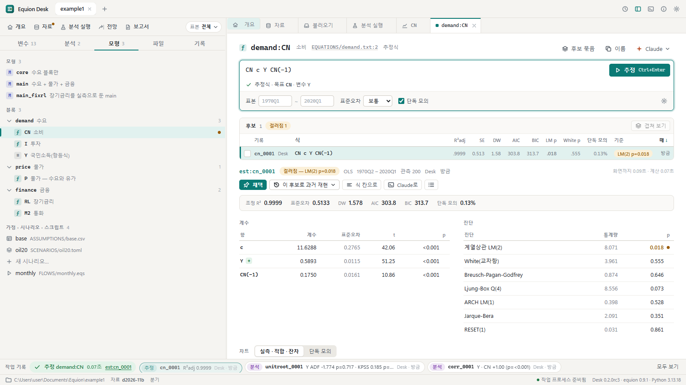
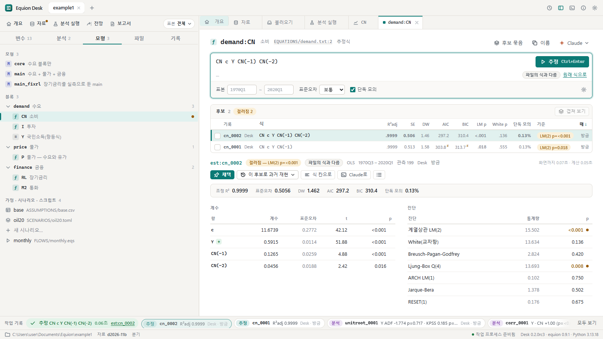
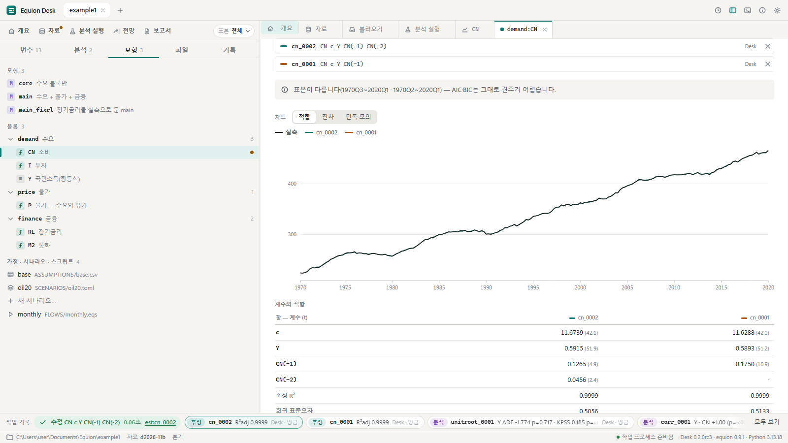
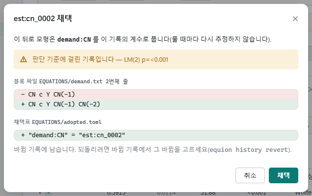
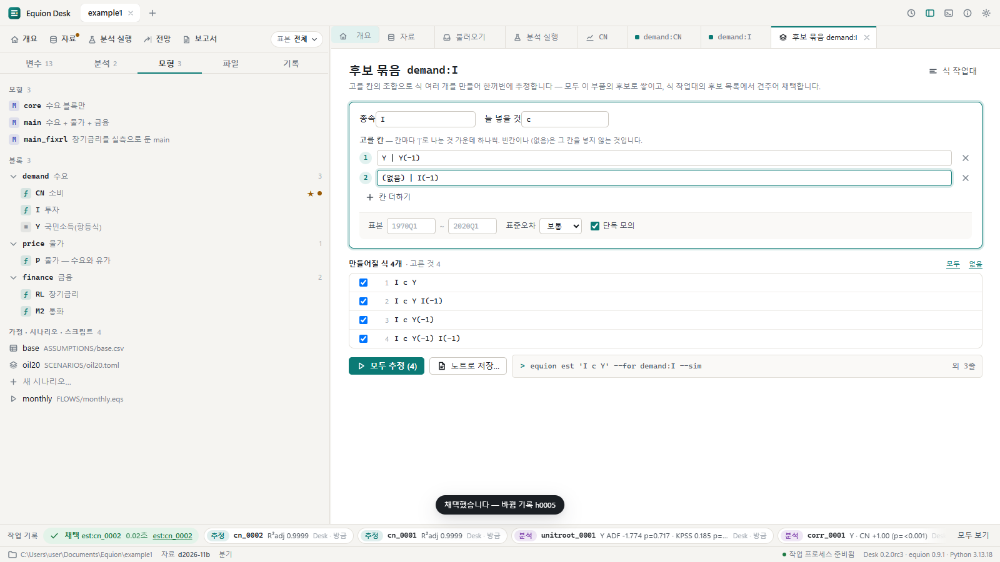
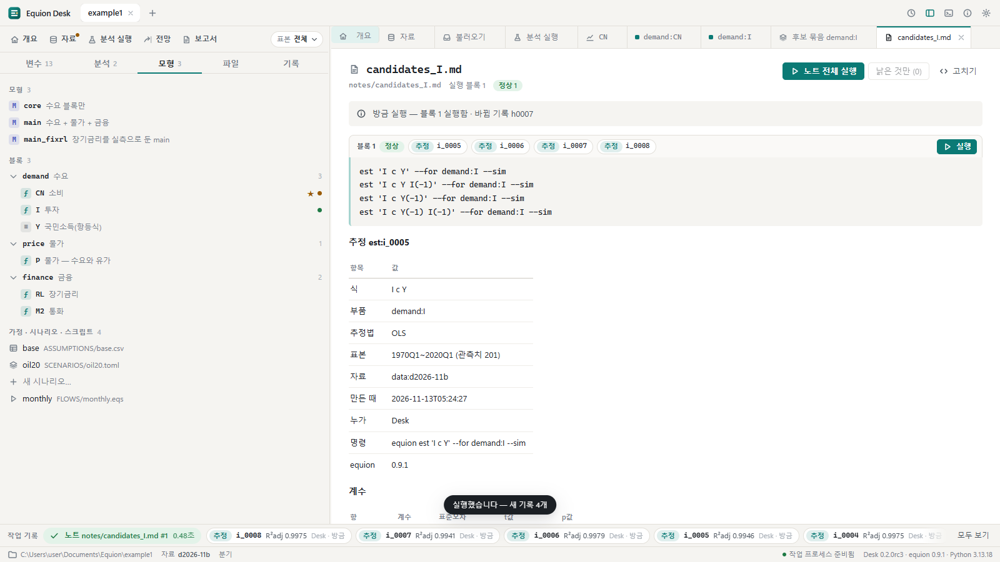

# 4. 식 고르기

이 장에서는 소비식 `CN`을 다듬습니다. 식을 고쳐 추정할 때마다 **후보**가 쌓이고, 후보를 견준 뒤 하나를 **채택**하면 그때 블록 파일의 식이
바뀝니다. 추정만으로는 파일이 바뀌지 않습니다.

## 4.1 식 작업대

왼쪽 **모형** 탭에서 `demand` 블록의 `CN 소비`를 누릅니다. 식 작업대가 열리고 블록 파일의 식(`CN c Y CN(-1)`)이 식 칸에 놓입니다.
여는 것만으로는 계산하지 않습니다. 식 칸을 누르고 `Ctrl+Enter`(또는 **추정**):

| 자리 | 무엇 |
|---|---|
| 식 칸 | 치는 동안 문법을 검사합니다 — 아래 줄에 '추정식 · 목표 CN · 변수 Y'처럼 읽은 것을, 틀리면 까닭(괄호 · 자료에 없는 변수 · 이 부품의 목표가 아닌 식)을 보이고 추정을 막습니다 |
| 옵션 줄 | 표본(비우면 전체) · 표준오차(보통 · HC · HAC) · **단독 모의**(이 식만 동태로 풀어 RMSPE를 함께 봄) |
| 결과 머리 | 기록 이름(`est:cn_0001`) · 판단 기준의 결과(통과 · 걸러짐과 까닭) · 추정법 · 표본 · 누가 · 언제 · 계산 시간 |
| 아래 | 요약 통계 · 계수표(부호 기준을 어기면 표시) · 진단(p값이 기준보다 작으면 점) · 실측 · 적합 · 잔차 차트 |

**판단 기준**은 `equion.toml`의 `[criteria]`에 적은 규칙입니다(예: 진단 LM · RESET의 p가 0.05보다 작으면 걸러짐, 계수 `Y`는 양수).
예제의 소비식은 잔차 자기상관(LM(2))에 걸려 '걸러짐'으로 나옵니다 — 걸러져도 기록은 남고 채택도 할 수 있지만, 무엇에 걸렸는지 알고
고르라는 표시입니다. 도구변수(`@inst`)를 쓴 2SLS나 `c(n)` 계수의 비선형 식처럼 기준의 검정(LM · RESET)을 계산하지 않는 추정법이면
**판단 못 함 — 검정 없음**으로 나옵니다. 통과가 아니므로, 매달 흐름의 '통과한 식만 채택'(`--adopt if_pass`)은 이런 식을 채택하지 않고 사람에게 남깁니다.

차트에 마우스를 올리면 그 기간의 값이 뜹니다. 차트에서 기간을 누르면 그 기간의 더미(`@d(2008Q4)`)를 식 칸에 넣는 단추가 나옵니다.

## 4.2 후보 쌓기

식 칸을 `CN c Y CN(-1) CN(-2)`로 고치고 `Ctrl+Enter`. 같은 부품의 후보로 기록되고 **후보 목록**에 줄이 늘어납니다.

- 후보 목록은 이 부품(`demand:CN`)의 추정 기록을 모두 보입니다 — 화면에서 한 것도, 터미널이나 Claude가 한 것도.
- 같은 식 · 같은 표본으로 다시 추정하면 한 줄로 모으고 `×2`로 표시합니다(기록은 둘 다 남습니다).
- 표본이 다른 후보끼리는 AIC · BIC를 견줄 수 없다는 표시가 붙습니다.
- 줄을 누르면 그 기록의 결과를 다시 계산하지 않고 보입니다. 결과 머리의 '파일의 식과 다름'은 블록 파일의 식과 다른 후보라는 뜻이고,
  **원래 식으로**는 식 칸을 파일의 식으로 되돌립니다.

## 4.3 겹쳐 보기

후보 둘(넷까지)의 네모를 고르고 목록 머리의 **겹쳐 보기**:

적합(또는 단독 모의)을 한 차트에 겹치고, 계수와 통계를 나란히 놓습니다. 단독 모의로 바꾸면 이 식만 풀었을 때의 경로와 RMSPE를 견줍니다.
**겹쳐 보기 닫기**로 돌아갑니다.

## 4.4 이 후보로 과거 재현

결과 아래의 **이 후보로 과거 재현 ▾**는 블록 파일을 바꾸지 않고 이 후보를 모형에 **끼워** 과거 재현을 풉니다. 변수마다 지금 식과
견준 전후(RMSPE)가 먼저 보이므로, 식 하나가 모형 전체에서 어떻게 움직이는지 채택 전에 압니다([5장](05-model.md)의 과거 재현과 같은 화면).

## 4.5 채택

`CN(-2)`가 든 후보를 고르고 **채택**:

채택은 두 곳을 바꿉니다 — 블록 파일(`EQUATIONS/demand.txt`)의 그 식 줄(줄 끝의 설명 주석은 그대로)과 채택표(`EQUATIONS/adopted.toml` —
모형은 채택한 기록의 계수로 풉니다). 바뀔 줄을 먼저 보이고, 확인을 누르면 씁니다. 채택한 식에는 왼쪽 목록과 후보 목록에 ★가 붙고,
이 바뀜은 바뀜 기록에 남아 되돌릴 수 있습니다([8장](08-records.md)).

## 4.6 후보 묶음 — 여러 식을 한꺼번에

설명변수의 조합을 여럿 시험할 때는 후보 묶음을 씁니다. `I 투자`의 식 작업대를 열고 오른쪽 위 **후보 묶음**:

1. **종속**(`I`)과 **늘 넣을 것**(`c`)을 적습니다.
2. **고를 칸**마다 `|`로 나눈 것 가운데 하나씩 고릅니다 — `Y | Y(-1)`, `(없음) | I(-1)`. 빈칸이나 `(없음)`은 그 칸을 넣지 않는 것입니다.
3. 아래에 만들어질 식이 글자 그대로 보입니다(2×2 = 4개). 빼고 싶은 식은 네모를 끕니다.
4. **모두 추정** — 고른 식이 모두 이 부품의 후보로 쌓입니다. 식 작업대의 후보 목록에서 견주고 채택합니다.
5. **노트로 저장…** — 이 묶음(`equion est …` 줄들)을 노트의 블록 하나로 남깁니다. 다음 자료가 오면 노트에서 ▶ 한 번으로 같은 시험을 다시 돌립니다.

노트는 [7장](07-reports.md)에서 더 다룹니다.

## 4.7 개별 식 — 모형 밖의 식

모형에 넣지 않고 따로 보고 싶은 식(예: 산업생산 `IPQ`의 단순한 식)은 왼쪽 **분석** 탭의 **새 개별 식**에서 씁니다. 식 작업대가 열리고,
'개별 식으로 남기기'를 누르면 모형이 쓰지 않는 블록 `single`(`EQUATIONS/single.txt`)에 한 줄로 남습니다. 나중에 마음이 바뀌면 **모형에 넣기**로
모형이 쓰는 블록으로 옮깁니다.

## 같은 일을 하는 명령

| 화면에서 | 터미널에서 |
|---|---|
| 추정(블록 파일의 식) | `equion est demand:CN --sim` |
| 고친 식을 후보로 | `equion est "CN c Y CN(-1) CN(-2)" --for demand:CN --sim` |
| 후보 견주기 | `equion compare --part demand:CN` |
| 이 후보로 과거 재현 | `equion hs main --swap demand:CN=est:cn_0001 --vs hs:hs_0001` |
| 채택 | `equion adopt est:cn_0002` |
| 후보 묶음의 한 줄 | `equion est 'I c Y' --for demand:I --sim` |
| 개별 식 · 모형에 넣기 | `equion block add single "IPQ c IPQ(-1)"` · `equion block add demand "IPQ c IPQ(-1)" --from single:IPQ` |

## 확인할 것

- [ ] 식 칸에 `CN c Y (`를 치면 괄호 오류가 보이고 추정 단추가 꺼진다
- [ ] 고친 식을 추정해도 `EQUATIONS/demand.txt`는 그대로다(파일 탭에서 확인)
- [ ] 채택하면 블록 파일의 그 줄이 바뀌고 ★가 붙는다
- [ ] 후보 묶음에서 4개를 모두 추정하면 `I`의 후보 목록이 4줄 늘어난다

이전: [3. 변수와 분석](03-analysis.md) · 다음: [5. 모형과 과거 재현](05-model.md)
