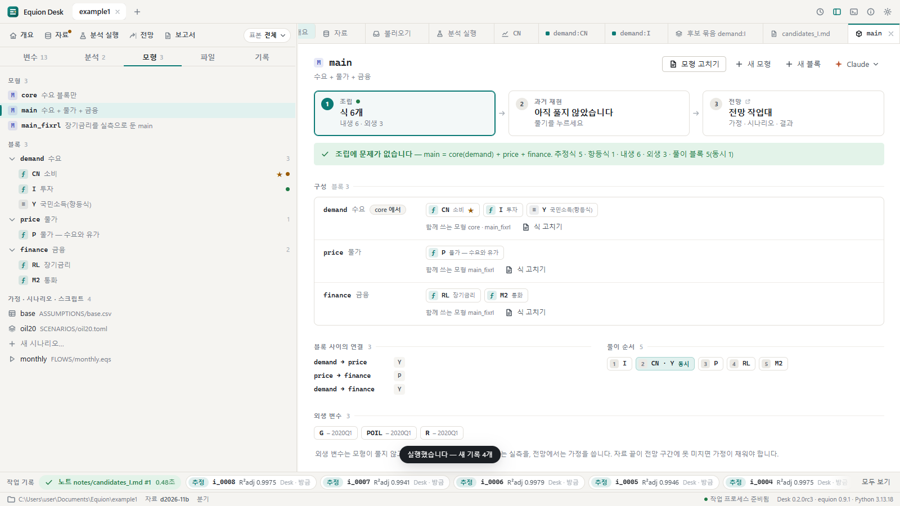
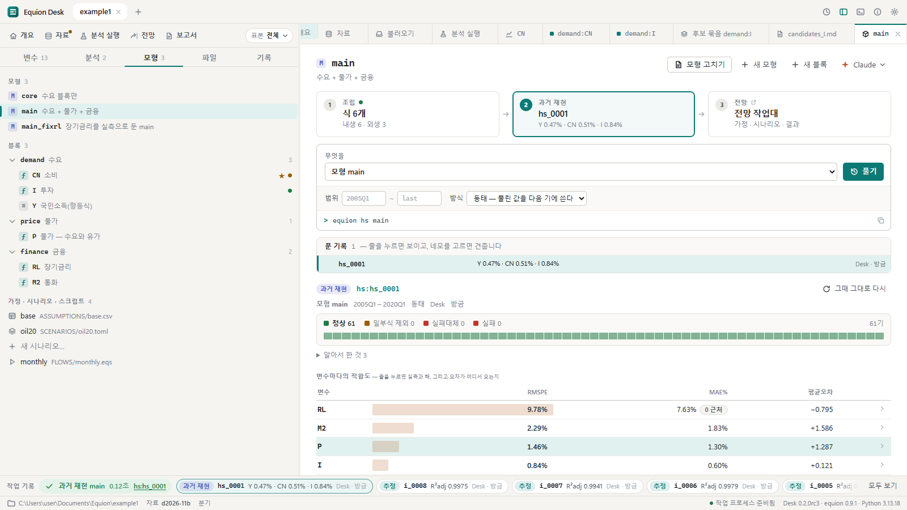
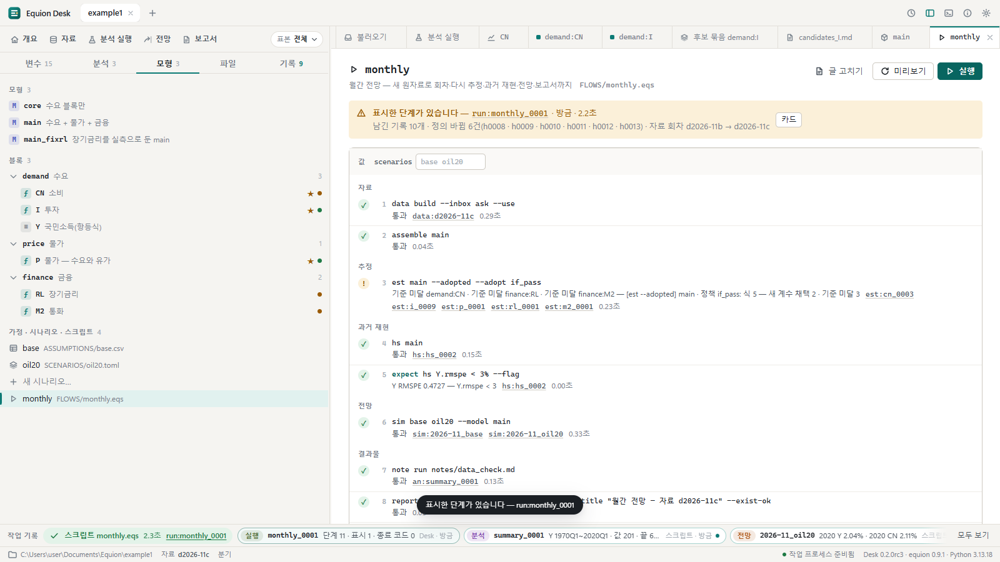

# 5. 모형과 과거 재현

식을 골랐으면 모형으로 묶어 함께 풉니다. 이 장에서는 모형 `main`의 조립을 검사하고, 과거 재현(Historical Simulation — 과거 구간을 모형으로
풀어 실측과 견주기)을 풀어 오차가 어디서 오는지 따라갑니다. 마지막으로 매달 하는 일을 적은 **흐름**(스크립트)을 실행합니다.

## 5.1 모형 작업대 — ① 조립

왼쪽 **모형** 탭에서 모형 `main`을 누릅니다(개요의 모형 카드에서 **모형 작업대**를 눌러도 같습니다).

위의 세 칸이 ① 조립 → ② 과거 재현 → ③ 전망입니다. ① 조립은 계산 없이 모형의 짜임을 검사합니다.

| 자리 | 무엇 |
|---|---|
| 띠 | 문제가 없으면 '조립에 문제가 없습니다'와 요약(추정식 · 항등식 · 내생 · 외생 · 풀이 블록). 문제가 있으면 무엇이 문제인지 — 두 블록이 같은 변수를 목표로 함, 자료에 없는 변수, 외생 자료가 짧음 |
| 구성 | 블록마다 식. 다른 모형에서 끼워 온 블록은 '…에서'(`core 에서`), 뺀 식은 줄 그어 보입니다. **식 고치기**는 그 블록 파일을 고치는 화면 |
| 블록 사이의 연결 | 어느 블록의 어느 변수가 다른 블록으로 가는지(`demand → price  Y`) |
| 풀이 순서 | 함께 풀어야 하는 묶음(동시 — `CN · Y`)과 차례 |
| 외생 변수 | 모형이 풀지 않고 받는 값과 자료의 끝 — 전망 구간에 못 미치면 가정으로 채워야 합니다 |

오른쪽 위의 **모형 고치기**는 이 모형의 정의(어느 블록을 쓰고 무엇을 뺄지)를, **새 모형** · **새 블록**은 새 정의를 만듭니다. 모두 `equion.toml`에
적힐 줄을 먼저 보이고 저장합니다.

## 5.2 과거 재현 — ② 풀기

② **과거 재현** 칸을 누르고 **풀기**(`Ctrl+Enter`). 범위(기본은 설정의 과거 재현 구간)와 방식(동태 — 풀린 값을 다음 기에 씀 · 정태 · 적합)을
바꿀 수 있습니다.

- **풀이 상태의 띠** — 기간마다 한 칸. 정상(초록) · 일부식 제외(입력 결측으로 그 식만 뺌) · 실패대체(풀리지 않아 실측을 넣음) · 실패.
- **변수마다의 적합도** — RMSPE · MAE% · 평균오차(치우침). 막대가 길수록 오차가 큽니다.
- **풀린 기록 목록** — 줄을 누르면 그 기록, 네모를 고르면 두 기록을 견줍니다(앞 · 뒤 · 달라짐).
- **그때 그대로 다시** — 이 기록을 만든 정의와 자료 회차로 다시 풀어 같은 숫자가 나오는지 봅니다(재연).

### 원인 따라가기

변수 줄(예: `P`)을 누르면 아래에 실측과 해의 차트, 그리고 그 변수의 식의 **입력마다** 이 풀이에서의 오차(내생이면) 또는 실측(외생이면)이
나옵니다. 내생 입력을 누르면 그 변수의 식으로 거슬러 올라가고, '지나온 길'로 돌아옵니다. 오차가 큰 변수가 자기 식 때문인지, 입력으로
받은 다른 변수의 오차 때문인지를 이렇게 가립니다.

**이 블록만 풀기**는 나머지 블록에 실측을 넣고 그 블록만 풀어 방금 보던 풀이와 견줍니다 — 오차가 블록 안에서 생기는지 밖에서 오는지
가리는 데 씁니다.

## 5.3 블록 파일 고치기

조립 화면의 **식 고치기**(또는 파일 탭에서 블록 파일 → **고치기**)는 블록 파일을 글로 고치는 화면입니다. 치는 동안 줄마다 문법을 검사해
읽을 수 없는 줄을 알리고, `Ctrl+S`로 저장하면 바뀜 기록에 남습니다. 식 하나를 다듬을 때는 식 작업대([4장](04-equations.md))가,
줄을 더하거나 빼거나 주석을 고칠 때는 이 화면이 편합니다.

## 5.4 흐름 — 매달 하는 일을 한 번에

매달 하는 일(자료 만들기 → 조립 검사 → 다시 추정 → 과거 재현 → 전망 → 노트 → 보고서)은 스크립트 `FLOWS/monthly.eqs`에 적혀 있습니다.
왼쪽 모형 탭 맨 아래의 `monthly`를 누르면 단계가 줄로 보입니다(묶음 제목 · 무엇을 바꾸는 단계인지). 여는 것만으로는 실행하지 않습니다.
**실행**을 누릅니다.

- 단계마다 ✓(통과) · `!`(표시 — 계속하되 볼 것) · ✗(실패)와 남긴 기록이 붙습니다. 기록 이름을 누르면 그 결과가 열립니다.
- 이 예에서는 3단계 `est main --adopted --adopt if_pass`가 `!`입니다 — 새 회차로 다시 추정했더니 기준에 못 미친 식이 있어, 그 식은 옛 계수를
  그대로 두고 통과한 식만 새 계수로 채택했다는 뜻입니다(위 띠에 '표시한 단계가 있습니다').
- `expect hs Y.rmspe < 3% --flag`처럼 **기대**를 적은 단계는 조건을 어기면 표시합니다.
- 사람이 정할 일도 `!`로 남기고 이어 갑니다 — 노트 · 보고서의 결과 구역을 누가 손으로 고쳐 덮지 않고 건너뛴 단계, 기준을 판단하지 못한 식(검정이 없는 추정법).
- 위의 **값** 칸(`scenarios`)은 스크립트의 매개변수입니다 — 이번 실행에만 다른 값을 줍니다. **미리보기**는 실행하지 않고 무엇을 할지 보입니다.
- 실행 중에는 아래 작업 줄에 몇 번째 단계인지('5/11')와 **취소**가 보입니다. 취소하면 끝난 단계의 표시와 기록은 그대로 남고, 멈춘 단계에 ✗와
  '몇 단계가 끝났고 어디서 멈췄는지'가 위 띠에 나옵니다. 띠의 **…단계부터 다시**로 이어 돌립니다(취소한 실행도 기록으로 남습니다).
- 실행 기록(`run:monthly_0001`)의 **카드**에는 단계마다의 결과와 정의의 바뀜이 모입니다. 터미널의 `equion run --replay run:monthly_0001`은 그때 그대로
  다시 돌려 숫자를 견줍니다.

## 같은 일을 하는 명령

| 화면에서 | 터미널에서 |
|---|---|
| 조립 검사 | `equion assemble main` |
| 과거 재현 · 범위와 방식 | `equion hs main` · `equion hs main --range 2005Q1:last --mode static` |
| 두 기록 견주기 | `equion compare hs:hs_0001 hs:hs_0002` |
| 이 블록만 풀기 | `equion hs price` |
| 그때 그대로 다시 | `equion hs --replay hs:hs_0001` |
| 새 모형 | `equion model define dp --blocks demand,price` |
| 흐름 실행 · 미리보기 · 다시 | `equion run FLOWS/monthly.eqs` · `--dry-run` · `equion run --replay run:monthly_0001` |

## 확인할 것

- [ ] 조립 화면에 '조립에 문제가 없습니다'와 내생 6 · 외생 3이 보인다
- [ ] 과거 재현을 풀면 기록이 목록에 생기고 변수마다의 RMSPE가 보인다
- [ ] `P`를 누르면 입력 `Y`(내생 — 오차)와 `POIL`(외생 — 실측)이 보이고, `Y`를 누르면 `demand:Y`로 거슬러 올라간다
- [ ] 흐름을 실행하면 11단계가 모두 돌아 단계마다 ✓ 또는 `!`가 붙고(이 예에서는 3단계가 `!`), `run:monthly_0001` 기록이 생긴다

이전: [4. 식 고르기](04-equations.md) · 다음: [6. 전망과 시나리오](06-forecast.md)
