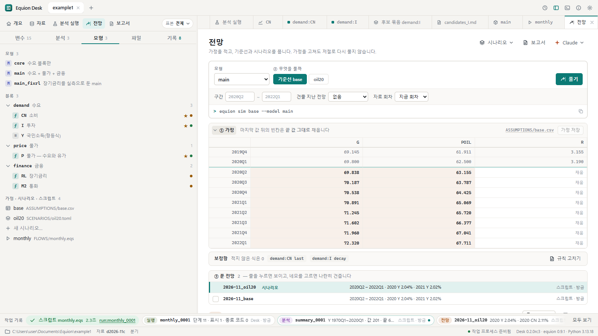
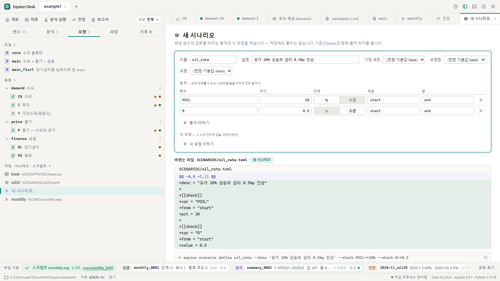
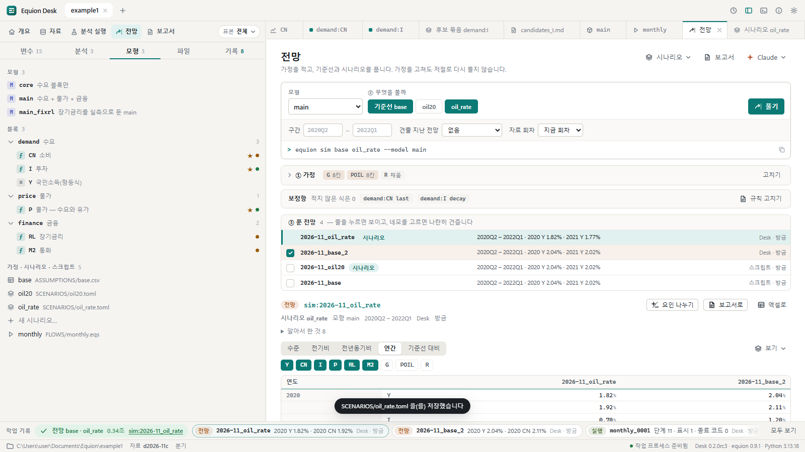
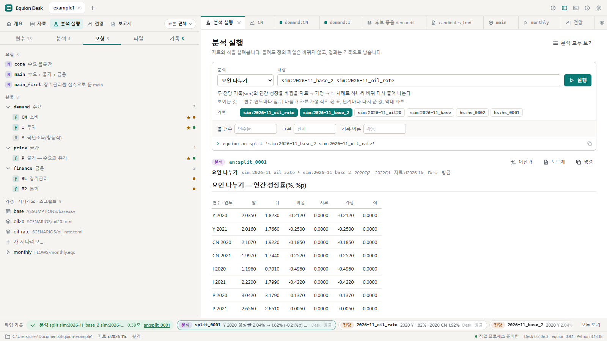

# 6. 전망과 시나리오

이 장에서는 전망 가정을 적고, 유가와 금리를 바꾼 시나리오를 만들어 기준선과 함께 풉니다. 결과를 견주고, 두 전망의 차이가 자료 · 가정 ·
식 가운데 무엇 때문인지 나눠 봅니다.

## 6.1 전망 작업대와 가정 표

작업대 줄의 **전망**을 누릅니다. 위의 줄은 무엇을 풀지(모형 · 기준선과 시나리오 · 구간 · 견줄 지난 전망 · 자료 회차)이고, 그 아래가
① 가정 · 보정항 · ③ 푼 전망입니다. 푼 전망이 있으면 가정 표는 한 줄 요약으로 접혀 있습니다 — **① 가정**의 머리를 누르면 펼쳐집니다.

- 가정 표는 외생 변수(`G` · `POIL` · `R`) × 전망 구간의 칸입니다. 위의 두 줄은 실측(자료 끝)이고, 그 아래가 적을 칸입니다.
- 칸의 색: 적은 값 · **채움**(마지막 값 뒤의 빈칸은 끝 값 그대로 채웁니다 — 칸에 '채움') · 값 사이의 빈칸은 붉게 알립니다(채우지 않습니다).
- 엑셀에서 여러 칸을 복사해 붙여 넣을 수 있습니다. 적은 뒤 **가정 저장**(풀기를 누르면 저장하지 않은 가정을 먼저 저장합니다).
  숫자가 아닌 칸은 바로 붉게 표시하고 까닭을 적으며, 고칠 때까지 저장하지 않습니다. 저장은 바뀐 칸의 줄만 다시 씁니다.
- 저장하지 않은 가정이 있는 채로 탭을 닫으면 버릴지 묻습니다.
- 가정은 `ASSUMPTIONS/base.csv`에 있습니다 — 엑셀로 직접 고쳐도 됩니다. Desk에서 고치는 중에 엑셀이 같은 파일을 저장하면, 치지 않은 칸은 새 값으로
  바뀌어 보이고 그렇다는 줄이 뜹니다. 저장하면 **화면에서 친 칸만** 지금 파일 위에 얹으므로 엑셀에서 고친 다른 칸은 그대로입니다. 같은 칸을 양쪽에서
  고쳤으면 칸마다 '읽었던 값 · 밖에서 바꾼 값 · 내가 친 값'을 보이고 어느 쪽을 쓸지 묻습니다. 아직 저장하지 않은 칸은 왼쪽에 가는 줄로 보입니다.

**보정항** 줄은 전망 구간에서 식마다 잔차를 어떻게 이어 갈지의 규칙입니다(`demand:CN last` — 마지막 잔차를 유지, `decay` — 줄여 감).
**규칙 고치기**로 `ADDFACTORS/base.toml`을 고칩니다.

> 가정을 고쳐도 저절로 다시 풀지 않습니다. 풀기를 눌러야 새 전망 기록이 생깁니다.

> 모형에 선행변수(`Y(+1)`처럼 다음 기의 값)가 있으면 전망은 모형 일관 기대(Fair-Taylor)로 풀고 '알아서 한 것'에 그렇다고 적습니다.
> 방식은 `equion.toml`의 `[forecast] mce`(`"fair-taylor"` · `"stacked"` · `false`)로 정합니다.

## 6.2 시나리오 만들기

왼쪽 모형 탭의 **새 시나리오…**(또는 전망 작업대의 **시나리오 ▾**)를 누릅니다.

1. **이름**(`oil_rate` — 영문)과 **설명**을 적습니다.
2. **충격**에 `POIL` · `20` · `%`를 적고, **충격 더하기**로 `R` · `0.5` · **수준**을 더합니다. 처음 · 끝을 비우면 전망 구간 전체입니다
   (`start` · `end`, `start+3`처럼 적으면 처음 넉 분기만).
3. 식의 잔차에 값을 더하고 싶으면(판단 보정) **식 보정 더하기**.
4. 아래에 **바뀌는 파일**(`SCENARIOS/oil_rate.toml`)의 내용과 같은 일을 하는 명령이 바로 보입니다. 아직 쓰지 않았습니다.
   줄마다 바로 검사합니다 — 크기가 숫자가 아니거나, 변수가 없거나, 기간을 읽을 수 없거나, 처음이 끝보다 늦거나, 항등식이 푸는 변수(`Y`)면
   그 칸이 붉어지고 줄 아래에 까닭이 나오며 저장 단추가 꺼집니다. 모형이 푸는 변수(예: `CN`)에 충격을 주면 막지는 않고 알립니다 — 그 식의
   잔차에 값을 그대로 더하는 것이 되므로(%는 쓰지 않음), 보통은 외생 변수에 충격을 주고 내생 변수는 **식 보정**으로 다룹니다.
5. **저장하고 풀기** — 시나리오 파일을 쓰고, 기준선과 함께 풀어 전망 작업대로 갑니다(**저장**만 하고 나중에 풀어도 됩니다).
   쓰다 만 폼은 탭을 닫았다 열거나 Desk를 다시 띄워도 그대로 남습니다.

## 6.3 결과 보기와 견주기

- **③ 푼 전망** — 이 모형의 전망 기록입니다. 줄을 누르면 그 전망이 보이고, 네모를 고르면 나란히 견줍니다. 함께 푼 기준선은 처음부터 골라져 있습니다.
- 결과 머리: 기록 이름(`sim:2026-11_oil_rate`) · 시나리오 · 모형 · 구간 · 누가 · 언제. 자료 회차가 지금과 다르면 '다른 회차' 표시가 붙습니다.
  **알아서 한 것**을 펼치면 풀면서 자동으로 한 일(가정 채움 · 보정항 규칙 등)이 나옵니다.
- 모양: **수준 · 전기비 · 전년동기비 · 연간 · 기준선 대비**. 연간은 고른 전망들을 나란히, 기준선 대비는 시나리오와 기준선의 차이입니다.
- 시리즈 단추로 보일 시리즈를 고릅니다. 표의 칸 색은 값의 종류(실측 · 가정 · 채움 · 해)입니다. 열 이름(변수)을 누르면 실측에 이어
  그린 전망 차트가 나옵니다(견주는 전망과 함께).
- **보기 ▾ → 이 보기 저장**은 지금 고른 시리즈와 모양을 이름으로 남깁니다(`VIEWS/*.toml`) — 다음 달에도 같은 표를 한 번에 엽니다.

## 6.4 요인 나누기

두 전망이 왜 다른지 — 자료가 바뀌어서인지, 가정이 바뀌어서인지, 식이 바뀌어서인지 — 를 나눠 봅니다. 견줄 전망 하나를 고른 상태(위처럼
기준선이 골라진 상태)에서 결과 머리의 **요인 나누기**를 누릅니다.

두 전망 사이를 자료 → 가정 → 식 차례로 하나씩 바꿔 다시 풀어, 연간 성장률의 바뀜을 몫으로 나눕니다. 이 예는 같은 자료 · 같은 식에
가정(시나리오의 충격)만 다르므로 바뀜이 모두 '가정' 칸에 있습니다. 지난달 전망과 이번 달 전망을 나누면 자료 개정과 식 재추정의 몫이 함께
보입니다. 결과는 분석 기록(`an:split_…`)으로 남습니다.

## 같은 일을 하는 명령

| 화면에서 | 터미널에서 |
|---|---|
| 기준선과 시나리오 풀기 | `equion sim base oil_rate --model main` |
| 지난 전망과 견주며 | `equion sim base --vs sim:2026-10_base` |
| 시나리오 만들기 | `equion scenario define oil_rate --desc '유가 20% 상승과 금리 0.5%p 인상' --shock POIL=+20% --shock R=+0.5` |
| 시나리오 목록 · 지우기 | `equion scenario list` · `equion scenario remove oil_rate` |
| 요인 나누기 | `equion an split 'sim:2026-11_base_2 sim:2026-11_oil_rate'` |
| 보기 저장 | `equion view define core --series Y,CN,I --show yoy` |

## 확인할 것

- [ ] 가정 표에서 값 사이에 빈칸을 두면 붉게 알린다
- [ ] 시나리오 폼에 충격을 적으면 바뀔 파일과 `equion scenario define …` 명령이 바로 보인다
- [ ] 크기에 `abc`를 적으면 그 칸이 붉어지고 저장 단추가 꺼진다
- [ ] 저장하고 풀면 기준선과 시나리오가 함께 풀리고, 연간으로 두 전망이 나란히 보인다
- [ ] 요인 나누기에서 시나리오의 바뀜이 '가정' 칸에 모인다

이전: [5. 모형과 과거 재현](05-model.md) · 다음: [7. 보고서와 엑셀](07-reports.md)
