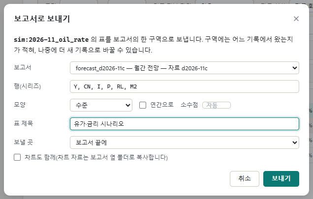
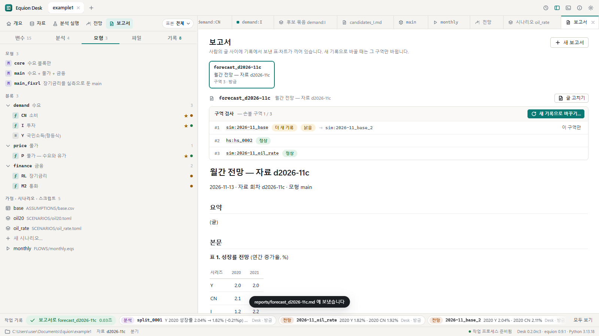
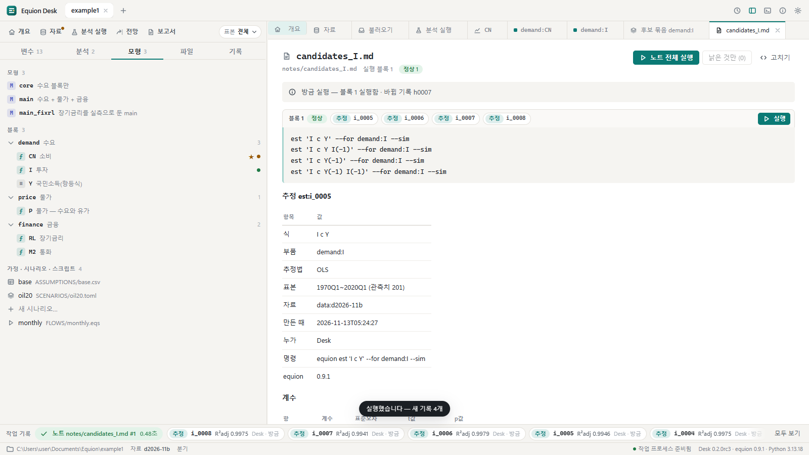

# 7. 보고서와 엑셀

결과를 사람에게 보낼 차례입니다. Equion의 보고서는 사람이 쓴 글(Markdown) 사이에 **기록에서 보낸 표와 차트**가 구역으로 끼어 있는 파일입니다.
다시 계산한 뒤에는 그 구역만 새 기록으로 바꿉니다. 이 장에서는 전망을 보고서로 보내고, 엑셀로 내고, 노트로 같은 분석을 다시 돌리는 법을 봅니다.

## 7.1 보고서로 보내기

[6장](06-forecast.md)의 전망 작업대에서 시나리오 전망을 보는 상태로, 결과 머리의 **보고서로**를 누릅니다.

| 칸 | 무엇 |
|---|---|
| 보고서 | 보낼 보고서(`reports/*.md`). 없으면 새로 만듭니다 — 이 예에서는 5장의 흐름이 만든 `forecast_d2026-11c`가 있습니다 |
| 행(시리즈) · 모양 · 연간으로 · 소수점 | 지금 화면에서 보던 시리즈와 모양이 그대로 들어와 있습니다. 바꿔도 됩니다 |
| 표 제목 | 보고서에 보일 제목 |
| 보낼 곳 | 보고서 끝 또는 어느 구역의 앞뒤 |
| 차트도 함께 | 차트 자료를 보고서 옆 폴더로 복사해 함께 넣습니다 |

**보내기**를 누르면 보고서 탭이 열립니다.

- 위의 **구역 검사**는 보고서의 구역마다 어느 기록에서 왔는지와 상태입니다 — 정상, 또는 **더 새 기록**(같은 계산을 새 자료로 다시 한 기록이
  있음 — 예를 들어 같은 모형 · 같은 시나리오를 다시 풀었음) · **낡음**(그 기록 뒤에 정의가 바뀜) · **손으로 고침**(누군가 구역 안의 글을 고침).
  바꿔 끼운 과거 재현, 그때 그대로 다시 푼 기록, 다른 회차에 묶어 푼 전망, 다른 식 후보는 '더 새 기록'으로 치지 않습니다 — 실험이 보고서의 표를 바꾸지 않게.
  또 **보고서가 다루는 회차 안에서만** 찾습니다(보고서 머리의 회차 — 흐름이 만든 `forecast_d2026-11c`라면 d2026-11c). 그래서 몇 달 뒤 11월 보고서를 고쳐도
  12월 전망이 섞이지 않습니다. 새 회차로 같은 보고서를 내려면 보고서 화면의 **새 보고서** 상자에서 '틀'로 이 보고서를 고른 뒤(터미널은
  `equion report new 새이름 --from 이것`) 새 기록으로 바꿉니다 — 구역 검사는 새 회차에 같은 계산이 있으면 그렇게 알립니다.
- **새 기록으로 바꾸기…**는 '더 새 기록'인 구역을 그 기록으로 바꿉니다. 구역마다 무엇이 달라지는지 먼저 보이고 나서 바꿉니다. 바꾸는 것은
  구역 안뿐이고, 사람이 쓴 글(요약 · 해석)은 그대로입니다. 손으로 고친 구역은 덮지 않고 알립니다.
- **글 고치기**는 보고서 파일을 글로 고칩니다(요약 · 해석을 쓰는 곳).
- 보고서 파일은 평범한 Markdown이라 다른 편집기나 Lectern에서 열어도 됩니다.

## 7.2 엑셀로

전망 결과 머리의 **엑셀로**는 보는 전망(과 견주는 전망)을 엑셀 한 권으로 냅니다 — 값과 함께 값의 종류(실측 · 가정 · 채움 · 해)와 출처
(기록 · 회차 · 모형)를 시트로 적습니다. 파일 이름을 정하면 `exports/`에 쓰고, 알림 줄에 같은 일을 하는 명령과 함께 알립니다.

## 7.3 결과 카드 — 고정과 메모

작업 기록 띠의 칸이나 결과 머리의 기록 이름을 누르면 그 기록의 **결과 카드**가 열립니다(표 · 차트 · 만든 명령 · 자료 회차 · 누가). 카드에서
**고정**하고 **메모**를 적어 두면, 기록 탭에서 '고정'으로 가려 볼 수 있습니다 — "보고서에 쓴 전망"처럼 나중에 다시 찾을 기록에 씁니다.
고정한 기록은 이정표와 묶어 보내기에도 함께 들어갑니다([8장](08-records.md)).

## 7.4 노트 — 같은 분석을 다음 회차에 다시

노트(`notes/*.md`)는 글 사이에 `equion` 명령의 블록을 넣은 Markdown입니다. 블록을 실행하면 바로 아래 **결과 구역**에 결과가 채워집니다.
매달 하는 점검(자료 요약 · 단위근 · 후보 묶음)을 노트로 두면, 새 회차가 왔을 때 ▶ 한 번으로 같은 분석을 다시 돌립니다.

- 노트를 만드는 길: [4장](04-equations.md)의 후보 묶음 → **노트로 저장**, 분석 결과 · 카드의 **노트에**(그 기록을 노트에 담음), 왼쪽 **분석** 탭의 노트 목록.
- 블록마다 상태 — **정상** · **낡음**(그 결과 뒤에 자료나 정의가 바뀜) · **실행 안 함**. 머리의 **노트 전체 실행** · **낡은 것만**.
- 블록에는 노트에 쓸 수 있는 명령(추정 · 분석 · 과거 재현 · 전망 · 보고서)만 들어갑니다. 채택처럼 정의를 바꾸는 명령은 노트에서 실행하지 않습니다.

## 같은 일을 하는 명령

| 화면에서 | 터미널에서 |
|---|---|
| 보고서로 보내기 | `equion report add reports/forecast_d2026-11c.md sim:2026-11_oil_rate --rows Y,CN,I --title '유가·금리 시나리오'` |
| 새 보고서 · 지난 보고서를 바탕으로 새 회차의 보고서 | `equion report new forecast --title '월간 전망'` · `equion report new forecast_d2026-12a --from forecast_d2026-11c` |
| 구역 검사 · 새 기록으로 바꾸기 | `equion report check reports/forecast_d2026-11c.md` · `equion report update reports/forecast_d2026-11c.md` |
| 엑셀로 | `equion export sim:2026-11_oil_rate sim:2026-11_base_2 --xlsx exports/oil_rate.xlsx` |
| 고정 · 메모 | `equion work pin sim:2026-11_oil_rate` · `equion work memo sim:2026-11_oil_rate '보고서에 쓴 전망'` |
| 노트 실행 · 담기 | `equion note run notes/candidates_I.md` · `equion note add notes/check.md --record an:corr_0001` |

## 확인할 것

- [ ] 보고서로 보내면 보고서 탭이 열리고 새 구역이 '정상'으로 보인다
- [ ] 기준선을 다시 풀면 기준선 구역이 '더 새 기록'이 되고, 새 기록으로 바꾸면 그 구역만 바뀐다
- [ ] 엑셀로 낸 파일이 `exports/`에 생긴다
- [ ] 노트의 ▶ 실행 뒤 블록 상태가 '정상'이 된다

이전: [6. 전망과 시나리오](06-forecast.md) · 다음: [8. 기록과 되돌리기](08-records.md)
