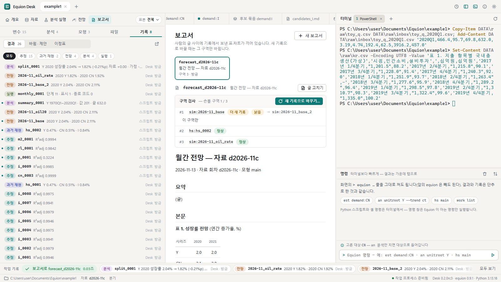
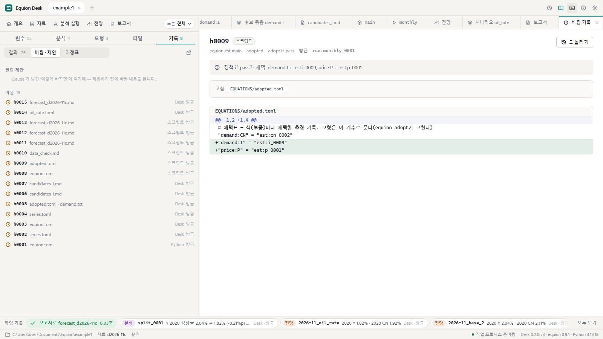
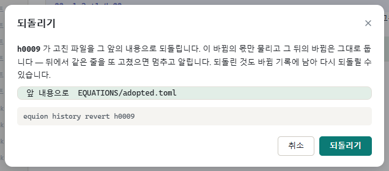
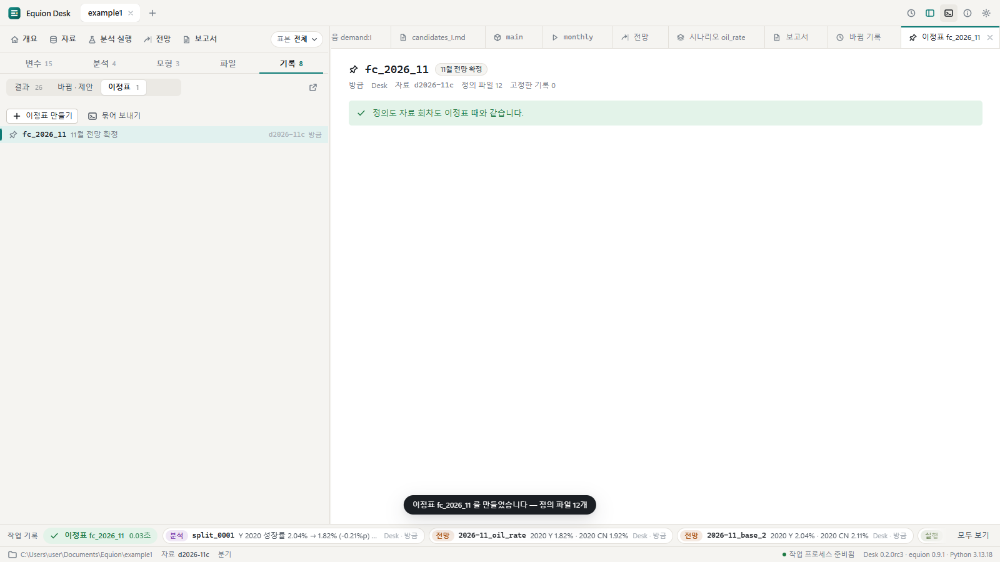

# 8. 기록과 되돌리기

Equion에서는 계산한 결과도, 정의 파일의 바뀜도 모두 기록으로 남습니다. 이 장에서는 기록 탭에서 지난 결과를 찾고, 마음에 들지 않는 바뀜을
되돌리고, 중요한 때를 **이정표**로 남기고, 프로젝트를 **묶어 보내는** 법을 봅니다.

## 8.1 기록 탭

왼쪽의 **기록** 탭을 누릅니다. 위에 **결과 · 바뀜·제안 · 이정표** 세 칸이 있습니다.

- **결과**는 계산 기록입니다 — 추정 · 과거 재현 · 전망 · 분석 · 실행 단추로 가려 봅니다. 줄마다 핵심 수치(R²adj · RMSPE · 성장률 …) · 누가
  (Desk · 터미널 · 스크립트 · Claude) · 언제. 줄을 누르면 결과 카드가 열립니다.
- 줄 앞의 점은 아직 보지 않은 새 기록입니다. 탭 이름 옆의 수(`기록 8`)도 그 수입니다.
- 오른쪽 위의 ↗는 기록 목록을 가운데에 넓게 엽니다 — 여러 기록을 골라 **스크립트 초안**으로 만들 수 있습니다(한 번 한 일을 매달 하는 일로).

## 8.2 바뀜 기록과 되돌리기

**바뀜·제안**을 누르면 정의 파일의 바뀜이 새것부터 나옵니다(`h0001`, `h0002`, …). 위의 **열린 제안**은 Claude가 남긴 제안입니다([9장](09-claude.md)).
바뀜 하나를 누르면 가운데에 차이가 넓게 보입니다.

머리에는 바뀜 번호, 누가(Desk · 터미널 · 스크립트 · Claude · 바깥), 어떤 명령으로(여기서는 흐름의 `est main --adopted --adopt if_pass`), 어느
실행의 단계였는지(`run:monthly_0001`)가 있고, 아래에 파일마다의 차이가 있습니다. 명령 없이 편집기나 Claude가 파일을 직접 고친 것은 누가
**바깥**으로 남습니다.

오른쪽 위의 **되돌리기**를 누르면:

**그 바뀜 하나만** 물립니다 — 그 바뀜이 고친 줄만 앞의 내용으로 돌리고, 그 뒤에 다른 일이 같은 파일의 다른 곳을 고쳤으면 그것은 그대로 둡니다.
여러 파일을 고친 바뀜은 파일 하나만 되돌릴 수도 있습니다. 되돌린 것도 새 바뀜으로 남으므로 되돌리기를 다시 되돌릴 수 있습니다. 맨 위 제목줄의
시계 단추는 이 바뀜 기록을 어느 화면에서나 엽니다.

뒤의 바뀜이 **같은 줄**을 또 고쳤으면(예: 채택한 뒤 같은 식을 다시 채택) 그 바뀜만 물릴 수 없습니다. 이때는 아무것도 쓰지 않고 '뒤의 바뀜과 겹칩니다'
상자에 겹친 파일과 뒤의 바뀜을 보입니다. 할 수 있는 것은 셋입니다 — 뒤의 바뀜부터(새것부터) 차례로 되돌리기, 그 파일을 직접 고치기, 또는
**통째로 되돌리기**(그 파일을 그 바뀜 앞 내용으로 — 뒤의 바뀜도 그 파일에서 함께 물러납니다. 터미널의 `--force`와 같습니다).

> 되돌리기는 정의 파일만 돌립니다. 계산 기록(`est:` · `sim:` …)은 지우지 않습니다 — 그 정의로 다시 계산하려면 다시 풉니다.

## 8.3 이정표

전망을 확정한 때처럼 중요한 때를 이름 붙여 남깁니다. 이정표는 그때의 **정의 파일 사본 · 자료 회차 · 고정한 기록**의 묶음입니다.
**이정표** 칸 → **이정표 만들기**를 누르고, 이름(`fc_2026_11` — 영문)과 설명(`11월 전망 확정`)을 적습니다.

- 이정표를 누르면 지금과 견줍니다 — 그 뒤에 바뀐 정의 파일이 차이로 보이고, 자료 회차가 다르면 알립니다(위 그림은 방금 만들어 같은 상태).
- **이때로 되돌리기**는 정의 파일을 그때로 다시 씁니다(바뀜 기록에 남습니다). 자료 회차는 건드리지 않습니다 — 필요하면 [2장](02-data.md)처럼 회차를 바꿉니다.
- 노트와 보고서는 이정표에 넣지 않습니다(사람의 글이라서). 결과 카드에서 고정한 기록은 이정표가 기억합니다.

## 8.4 묶어 보내기와 묶음 열기

프로젝트를 다른 PC나 동료에게 옮길 때는 개요(또는 이정표 칸)의 **묶어 보내기**를 씁니다. zip 하나에 정의 파일 · 노트 · 보고서와,
고른 만큼의 기록 · 자료 회차를 넣습니다(원자료는 고를 때만 — 크고, 받은 그대로라 다시 받을 수 있으므로). 받는 쪽은 Desk 첫 화면의
**묶음 열기…**로 zip을 고르면 문서 폴더의 `Equion` 아래에 풀어 엽니다. 묶음에 든 기록은 받는 쪽에서도 그때 그대로 다시 풀 수 있습니다.

## 같은 일을 하는 명령

| 화면에서 | 터미널에서 |
|---|---|
| 결과 기록 목록 · 하나 보기 | `equion work list` · `equion work show sim:2026-11_oil_rate` |
| 바뀜 기록 · 되돌리기 | `equion history list` · `equion history revert h0009`(파일 하나: `--file EQUATIONS/adopted.toml`, 겹쳐도 통째로: `--force`) |
| 이정표 만들기 · 견주기 · 되돌리기 | `equion milestone make fc_2026_11 --note '11월 전망 확정'` · `equion milestone show fc_2026_11` · `equion milestone restore fc_2026_11` |
| 묶어 보내기 · 묶음 열기 | `equion bundle make [--raw] [--records keep]` · `equion bundle open 받은.zip 풀_폴더` |
| 기록을 스크립트 초안으로 | `equion script new 초안 --from-records est:cn_0002 hs:hs_0001` |

## 확인할 것

- [ ] 4장에서 채택한 바뀜을 되돌리면 블록 파일의 `CN` 줄이 앞의 식으로 돌아가고, 되돌림도 바뀜 기록에 새 줄로 남는다
- [ ] 같은 줄을 뒤에서 또 고친 바뀜을 되돌리려 하면 '뒤의 바뀜과 겹칩니다'가 뜨고, 취소하면 파일이 그대로다
- [ ] 이정표를 만든 뒤 블록 파일에 주석 한 줄을 더하면 이정표 화면에 그 차이가 보인다
- [ ] 묶어 보내기로 만든 zip을 묶음 열기로 열면 같은 모형이 새 탭으로 열린다

이전: [7. 보고서와 엑셀](07-reports.md) · 다음: [9. Claude Code와 함께](09-claude.md)
