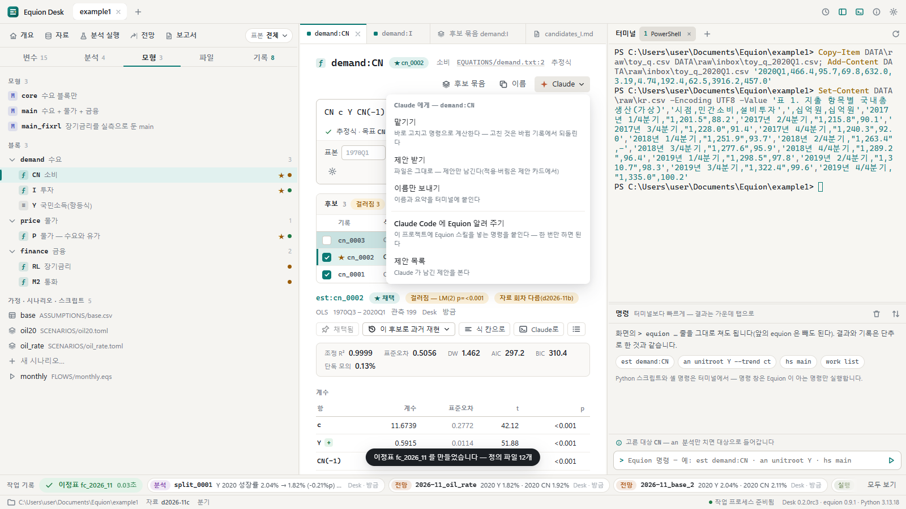
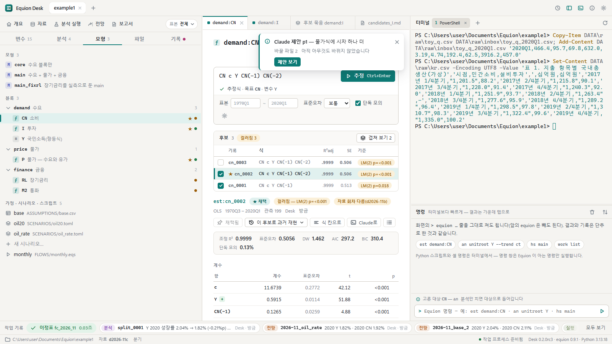
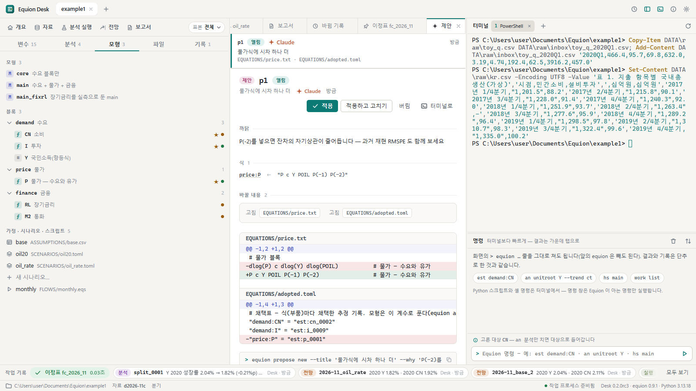

# 9. Claude Code와 함께

Claude Code(Anthropic의 코딩 도우미)는 Desk의 터미널에서 띄우면 같은 프로젝트 폴더에서 같은 `equion` 명령을 씁니다. 그래서 Claude가 추정하거나
푼 결과는 바로 화면의 작업 기록 띠와 후보 목록에 뜨고, Claude가 고친 정의 파일은 바뀜 기록에 '누가 Claude'로 남아 되돌릴 수 있습니다.
이 장에서는 Claude에게 일을 맡기는 두 방식 — **맡기기**와 **제안 받기** — 과 함께 일할 때 알아 둘 것을 봅니다.

Claude Code가 없어도 Desk의 모든 기능은 그대로입니다.

## 9.1 준비

1. **Claude Code 설치** — Claude Code는 Desk에 들어 있지 않습니다. PC에 설치하고 로그인해 두면, Desk 터미널에서 `claude`로 띄웁니다
   (설정 상자 아래에 'claude 명령을 찾았습니다'가 보이면 준비된 것입니다).
2. **Equion 알려 주기** — 프로젝트마다 한 번, 설정(톱니)이나 아무 작업대의 **Claude ▾**에서 **Claude Code에 Equion 알려 주기**를 누릅니다.
   터미널 1번에 `equion guide skill --install project`가 붙고, `Enter`를 누르면 이 프로젝트의 `.claude/skills/equion/`에 Equion 스킬이 들어갑니다.
   Claude는 이것으로 명령과 규칙(판단 기준에 걸린 식의 채택은 사람에게 묻기, 정의 파일은 명령으로 고치기 등)을 압니다. 예제 프로젝트에는
   `CLAUDE.md`도 들어 있어 Claude가 처음에 `equion guide`를 읽습니다.
3. **띄우기** — 터미널 1번에서 `claude`를 칩니다. 그 폴더에서 처음 띄우면 Claude Code가 '이 폴더를 믿는가'를 묻습니다 — 기본 선택이
   **No, exit**이니 `↓`로 **Yes, I trust this folder**를 고르고 `Enter`.

> 1번 터미널은 Claude의 자리로 씁니다 — 화면의 **Claude ▾**가 보내는 글은 늘 1번에 붙습니다. 사람의 다른 일은 2번부터 쓰면 섞이지 않습니다.

## 9.2 Claude ▾ — 부탁하는 글을 터미널에 붙이기

작업대와 결과 화면 오른쪽 위의 **Claude ▾**는 지금 보는 대상(부품 · 모형 · 기록)으로 부탁하는 글을 만들어 터미널 1번에 붙입니다.
`Enter`는 직접 누릅니다 — 앱이 대신 보내지 않으므로, 붙은 글을 읽고 고쳐서 보내도 됩니다.

| 항목 | 무엇 |
|---|---|
| **맡기기** | Claude가 바로 파일을 고치고 명령으로 계산합니다 — 고친 것은 바뀜 기록에서 되돌립니다 |
| **제안 받기** | 아무것도 바뀌지 않습니다 — Claude가 '이렇게 바꾸면'을 제안으로만 남기고, 적용 · 버림은 사람이 제안 화면에서 합니다 |
| **이름만 보내기** | 대상의 이름과 요약만 붙입니다 — 부탁은 직접 씁니다 |
| **Claude Code에 Equion 알려 주기** | 9.1의 2 |
| **제안 목록** | Claude가 남긴 제안을 봅니다(기록 탭의 바뀜·제안) |

## 9.3 맡기기

예: 소비식 작업대의 **Claude ▾ → 맡기기**를 누르고, 붙은 글 끝에 "잔차 자기상관을 줄이는 후보를 셋 만들어 견줘 주세요"를 더해 `Enter`.

- Claude가 `equion est … --for demand:CN`으로 추정할 때마다 후보 목록과 작업 기록 띠에 기록이 뜹니다(누가 **Claude**).
- 판단 기준에 걸린 후보(걸러짐 · 판단 못 함)를 채택해야 할 때 Claude는 사람이 이름을 대고 시켰어도 까닭을 보이고 먼저 묻도록 배웠습니다 — 터미널에서 답합니다.
  이정표로 되돌리기 · 바뀜 되돌리기 · 기록 정리(`work clean --yes`)처럼 한꺼번에 물리거나 되돌릴 수 없는 일도 무엇이 바뀌는지 보이고 묻습니다.
- Claude가 정의 파일을 바꾸면(채택 · 시나리오 · 블록 파일) 화면 위에 바뀜 알림('Claude — equion adopt …')이 뜹니다. 알림에서 차이를 보고,
  마음에 들지 않으면 바뀜 기록에서 **되돌리기**([8장](08-records.md)).
- Claude Code가 명령을 실행하기 전에 권한을 물으면 터미널에서 키로 답합니다. '다시 묻지 않기'를 고르면 이 프로젝트의
  `.claude/settings.local.json`에 남아 같은 꼴은 다시 묻지 않습니다.

## 9.4 제안 받기

**제안 받기**로 부탁하면 Claude는 파일을 바꾸지 않고 `equion propose new …`로 제안을 남깁니다. 제안이 생기면 알림 카드와 기록 탭의 점이 뜹니다.

**제안 보기**를 누르면:

- **까닭**(Claude가 왜 이렇게 바꾸자는지)과 바뀔 식, 바뀔 파일마다의 차이가 보입니다. 아직 아무것도 바뀌지 않았습니다.
- **적용** — 같은 일을 하는 명령(`equion propose apply p1`)을 보이고 나서 파일을 씁니다. 제안은 '적용함'이 되고, 그 바뀜으로 가는 단추가 생깁니다(되돌릴 수 있습니다).
- **적용하고 고치기** — 적용한 뒤 그 파일을 고치는 화면을 엽니다. **버림** — 제안을 닫습니다. **터미널로** — 제안의 이름을 터미널에 붙여 Claude와 더 이야기합니다.
- 제안을 만든 뒤 그 파일이 바뀌면(사람이나 다른 일이 고침) 제안에 **낡음**이 붙고, 덮겠다고 고르지 않으면 적용하지 않습니다.

## 9.5 Claude가 화면을 연다

Claude는 `equion desk show 이름`으로 Desk에 화면을 열어 달라고 알릴 수 있습니다(`est:cn_0003` · `model:main` · `prop:p1` · 파일 경로 …).
"방금 만든 후보를 화면에 띄워 줘"라고 부탁하면 그 탭이 앞으로 옵니다. 화면을 옮길 뿐이고 계산하거나 바꾸지 않습니다.

## 9.6 함께 일할 때

- **동시에 써도 됩니다.** Claude가 흐름을 돌리는 동안 사람은 명령 창과 다른 작업대를 그대로 씁니다. 기록마다 누가(Claude · Desk · 터미널 · 스크립트)가 남습니다.
- **고치던 파일을 Claude가 바꾸면** — 파일 탭에서 고치는 중에 같은 파일이 밖에서 바뀌면, 저장할 때 덮기 전에 묻습니다. 취소하면 밖의 고침이 그대로이고,
  덮어도 그 사이의 고침은 바뀜 기록에 남아 있습니다. Desk를 닫았다 열어 '고치던 글'이 되살아났을 때도 같습니다 — 닫혀 있던 동안 파일이 바뀌었으면
  알림과 '차이 보기'가 뜹니다.
- **명령이 겹치면 기다립니다** — Claude와 사람이(또는 흐름과 터미널이) 동시에 정의를 고치면, 한쪽이 끝날 때까지 다른 쪽이 기다립니다(프로젝트 잠금 — 30초가
  넘으면 '다른 명령이 이 프로젝트를 고치는 중입니다'로 아무것도 바꾸지 않고 멈춥니다). 엑셀 · 동기화 프로그램이 파일을 쥐고 있으면 그 파일 이름과 함께 알립니다.
- **터미널 위에 붉은 띠가 뜨면** — 셸에서 띄운 프로그램(`claude` 등)이 시작하다 멈춘 것입니다. 회사 보안 프로그램(DRM)이 프로그램 실행을 막을 때
  생깁니다. 띠의 **다시 시작**을 누르고, Claude Code는 `claude --continue`로 하던 대화를 이어 갑니다.
- **Desk가 꺼져 있는 동안** Claude(또는 다른 사람)가 한 일은, 다시 열면 '꺼져 있는 동안' 알림과 작업 기록 띠로 보입니다.

부탁하는 말의 예와 Claude가 한 일을 확인하는 법은 패키지 문서의 [가이드 7. Claude와 함께](../guide/07-with-claude.md)에 더 있습니다.

## 같은 일을 하는 명령

| 화면에서 | 터미널에서 |
|---|---|
| Equion 알려 주기 | `equion guide skill --install project` |
| Claude가 읽는 안내 | `equion guide` |
| 제안 목록 · 보기 · 적용 · 버림 | `equion propose list` · `equion propose show p1` · `equion propose apply p1` · `equion propose drop p1` |
| 화면 열기(Claude가 치는 것) | `equion desk show est:cn_0003` |
| Claude가 한 일 보기 | `equion work list` · `equion history list` |

## 확인할 것

- [ ] 'Claude Code에 Equion 알려 주기'를 누르면 터미널 1번에 명령이 붙고, `Enter` 뒤 `.claude/skills/equion/SKILL.md`가 생긴다
- [ ] 터미널 2번을 보고 있어도 Claude ▾의 글은 1번에 붙고 1번이 골라진다
- [ ] Claude가 남긴 제안을 적용하면 바뀜 기록에 남고, 되돌리기로 앞으로 돌아간다

이전: [8. 기록과 되돌리기](08-records.md) · 처음: [사용설명서](README.md)
