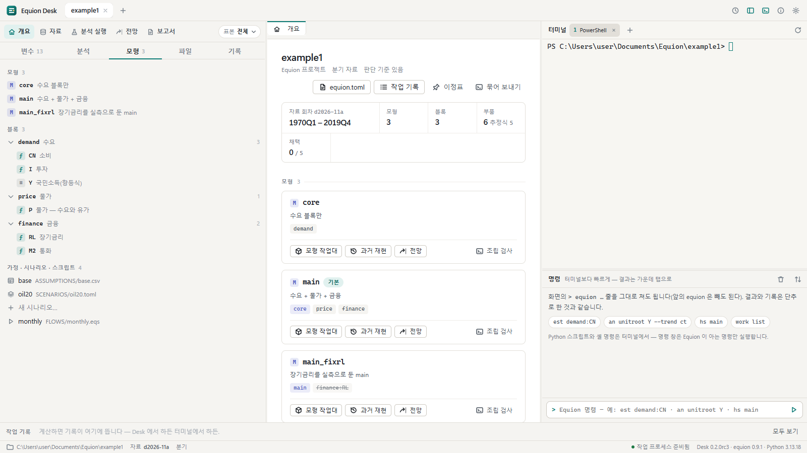

# Equion Desk 사용설명서

Equion Desk는 Equion 프로젝트를 화면에서 다루는 Windows 앱입니다. 원자료를 넣어 자료를 만들고, 식을 추정해 고르고, 모형을 조립해 과거를
재현하고, 가정을 적어 전망과 시나리오를 풀고, 결과를 보고서와 엑셀로 냅니다. 계산과 파일 형식은 모두 패키지 `equion`의 것이고, 화면의
단추는 터미널에서 치는 `equion` 명령과 같은 일을 합니다. 그래서 화면에서 한 일과 터미널(사람이나 Claude Code)에서 한 일이 같은 기록으로
남고, 서로의 결과가 같은 자리에 뜹니다.

이 설명서는 **따라하기**입니다. 앱에 든 예제 프로젝트(가상 분기 모형) 하나로 처음부터 끝까지 차례로 해 봅니다. 장마다 그림이 있고,
그림은 실제 화면을 그대로 찍은 것입니다. 장 끝의 **같은 일을 하는 명령**은 그 장에서 누른 단추를 터미널에서 할 때의 명령입니다.

## 차례

| 장 | 하는 일 | 걸리는 시간 |
|---|---|---|
| [1. 설치와 첫 화면](01-start.md) | 설치 · 예제 프로젝트 만들기 · 화면 둘러보기 · 설정 · 명령 창과 터미널 | 10분 |
| [2. 자료](02-data.md) | 자료 작업대 · 시리즈의 내력 · 받은 원자료 넣기 · 새 회차 만들기와 견주기 · 새 통계표 불러오기 | 15분 |
| [3. 변수와 분석](03-analysis.md) | 변수 고르기 · 우클릭 메뉴 · 변수 창 · 분석 실행(단위근 등) | 10분 |
| [4. 식 고르기](04-equations.md) | 식 작업대 · 후보 쌓기 · 겹쳐 보기 · 채택 · 후보 묶음 · 노트 | 15분 |
| [5. 모형과 과거 재현](05-model.md) | 조립 검사 · 과거 재현 · 오차의 원인 따라가기 · 흐름(스크립트) 실행 | 10분 |
| [6. 전망과 시나리오](06-forecast.md) | 가정 표 · 시나리오 폼 · 기준선과 견주기 · 요인 나누기 | 15분 |
| [7. 보고서와 엑셀](07-reports.md) | 보고서로 보내기 · 새 기록으로 바꾸기 · 엑셀로 · 노트 | 10분 |
| [8. 기록과 되돌리기](08-records.md) | 기록 탭 · 바뀜 기록과 되돌리기 · 고정과 메모 · 이정표 · 묶어 보내기 | 10분 |
| [9. Claude Code와 함께](09-claude.md) | Claude에게 알려 주기 · 맡기기와 제안 받기 · 제안 적용 · 함께 일할 때 | 15분 |

장은 차례로 이어집니다 — 앞 장에서 만든 회차·기록이 다음 장에 쓰입니다. 한 장만 볼 때도 예제 프로젝트를 새로 만들면 그 장을 따라 할 수 있습니다
(그림의 숫자와 기록 이름은 조금 다를 수 있습니다).

## 화면 한눈에

| 자리 | 무엇 |
|---|---|
| 맨 위 | 프로젝트 탭(여럿 열 수 있습니다) · 오른쪽에 바뀜 기록(시계) · 왼쪽 열과 오른쪽 열 보이기 · 도움말 · 설정(톱니) |
| 왼쪽 위 | **작업대 줄** — 개요 · 자료 · 분석 실행 · 전망 · 보고서, 그리고 **표본**(메뉴에서 바로 돌린 분석이 쓰는 구간) |
| 왼쪽 탭 | **변수**(시리즈와 묶음) · **분석**(개별 식과 돌린 분석) · **모형**(모형 · 블록과 식 · 가정 · 시나리오 · 스크립트) · **파일** · **기록**(결과 · 바뀜과 제안 · 이정표) |
| 가운데 | 작업대와 결과가 탭으로 열립니다. 닫았다 다시 열면 지난 화면이 이어집니다 |
| 오른쪽 | **터미널**(프로젝트 폴더에서 뜨는 PowerShell — 다섯 개까지) · **명령 창**(Equion 명령 한 줄) |
| 아래 | 작업 줄(도는 계산과 취소) · **작업 기록 띠**(새 기록이 생기는 순간 한 칸씩) · 상태줄(폴더 · 지금 자료 회차 · 작업 프로세스 · 판) |

## 먼저 알아 둘 것

- **계산은 누를 때만 합니다.** 화면을 여는 것만으로는 추정하거나 풀지 않습니다. 파일이 바뀌면 화면은 다시 읽지만 다시 계산하지는 않습니다.
- **계산할 때마다 기록이 남습니다** — `est:`(추정) · `hs:`(과거 재현) · `sim:`(전망) · `an:`(분석) · `run:`(스크립트 실행) · `data:`(자료 회차).
  기록은 고치지 않습니다. 다시 계산하면 새 기록입니다. 그래서 언제든 '그때 그 숫자'로 돌아갈 수 있습니다.
- **정의 파일을 바꾸는 일은 무엇이 바뀌는지 먼저 보입니다.** 블록 파일(식) · `equion.toml` · 자료 정의 · 가정 · 시나리오 · 스크립트 · 노트 · 보고서를
  바꾸는 단추는 바뀔 줄(차이)과 같은 일을 하는 명령을 먼저 보이고, 확인을 누르면 씁니다. 바뀐 것은 모두 **바뀜 기록**에 남고 되돌릴 수 있습니다.
- **화면마다 명령 줄이 있습니다**(`> equion …`). 누르면 복사됩니다. 같은 일을 터미널이나 스크립트에서 할 때 그대로 씁니다.

## 손버릇

| 키 | 하는 일 |
|---|---|
| `Ctrl+Enter` | 추정 · 분석 실행 · 풀기 |
| `Ctrl+S` | 고치던 정의 파일 저장 |
| `Ctrl+W` | 가운데 탭 닫기 |
| `` Ctrl+` `` | 오른쪽 열(터미널 · 명령 창) 보이기 · 숨기기 |
| `Ctrl`·`Shift` + 누르기 | 변수 여럿 고르기 |
| `F1` | 앱 안의 도움말 |

## 막혔을 때

| 이럴 때 | 이렇게 |
|---|---|
| 설치 파일을 열면 'Windows의 PC 보호' 창이 뜬다 | 서명이 없는 앱이라 그렇습니다 — **추가 정보 → 실행** |
| 원자료를 읽지 못한다(글자가 깨지거나 '읽을 수 없는 파일') | 회사 보안 프로그램(DRM)이 걸린 파일은 Python이 읽지 못합니다. 보안을 푼 사본이나 CSV로 저장한 파일을 쓰세요 |
| 터미널 위에 붉은 띠 — '시작하다 멈췄습니다' | 보안 프로그램이 터미널에서 띄운 프로그램을 막은 것입니다. 띠의 **다시 시작**을 누르고, Claude Code였다면 `claude --continue`로 이어 갑니다 |
| 상태줄의 '작업 프로세스'가 준비되지 않는다 | 창을 닫았다 다시 엽니다. 그래도 그러면 [도움말의 막혔을 때](../guide/08-troubleshooting.md)와 터미널의 `equion check`로 정의 파일을 검사합니다 |
| 실수로 파일을 바꿨다 | 맨 위의 시계(바뀜 기록)에서 그 바뀜을 골라 **되돌리기** — [8장](08-records.md) |

## 이 설명서의 그림

그림은 예제 프로젝트(가상 자료 — 실제 통계가 아닙니다)로 찍었고, 폴더 경로는 `C:\Users\user\Documents\Equion\example1`로 보입니다.
화면이 바뀌면 `uv run --package equion-desk --group ui python desk/tests/guide_shots.py`로 다시 찍습니다 — 이 스크립트는 설명서의 순서와
설명서에 적힌 PowerShell 줄을 그대로 실행하므로, 그림이 만들어지면 설명서대로 따라 할 수 있다는 뜻이기도 합니다.

터미널 명령으로 프로젝트를 다루는 법은 패키지 문서의 [가이드](../guide/README.md)에, 방정식 문법은 [방정식 문법](../explain/equations.md)에 있습니다.
